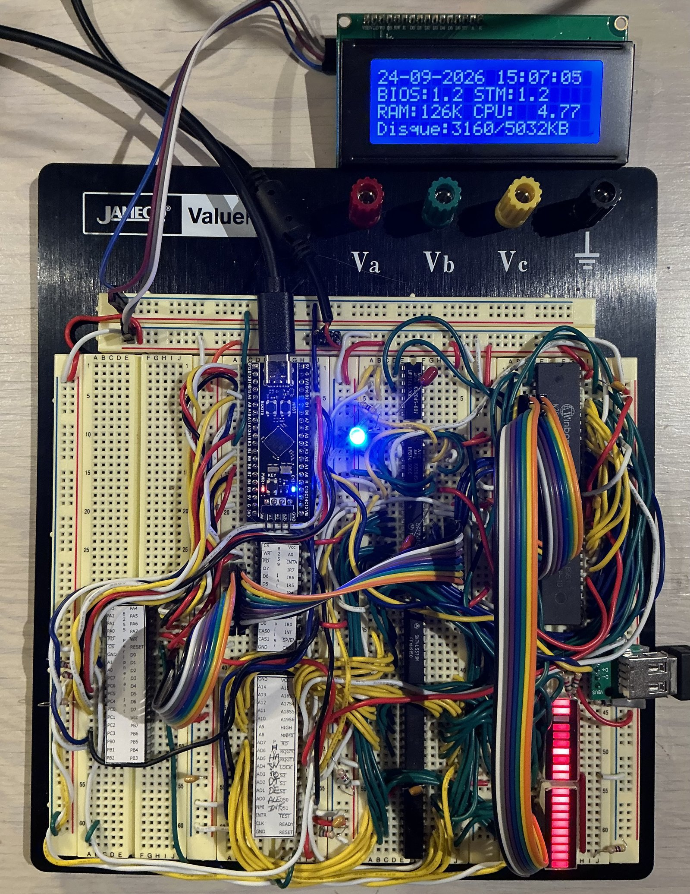
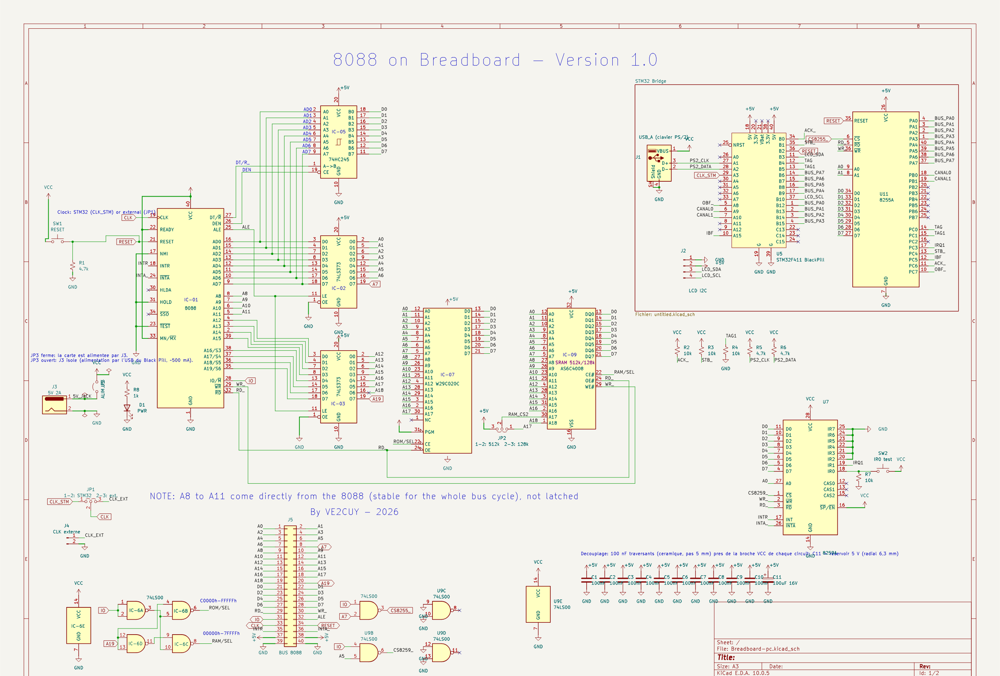
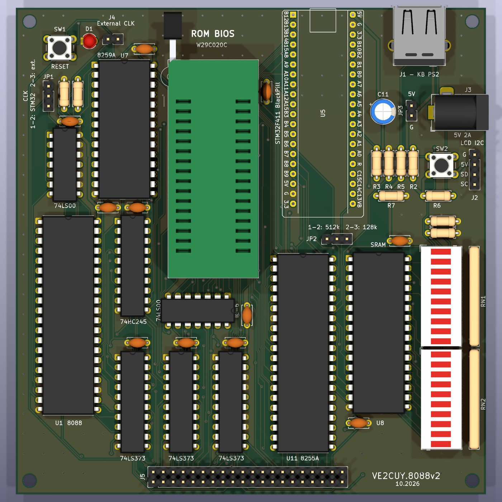
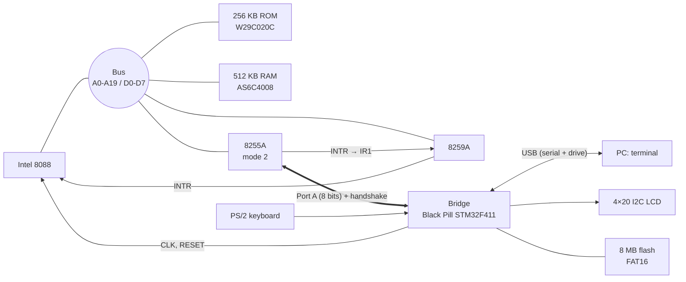
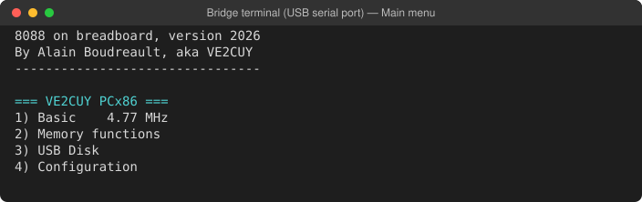
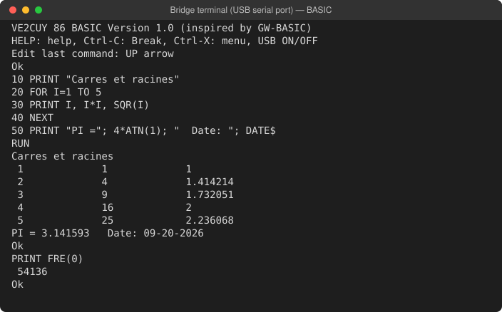
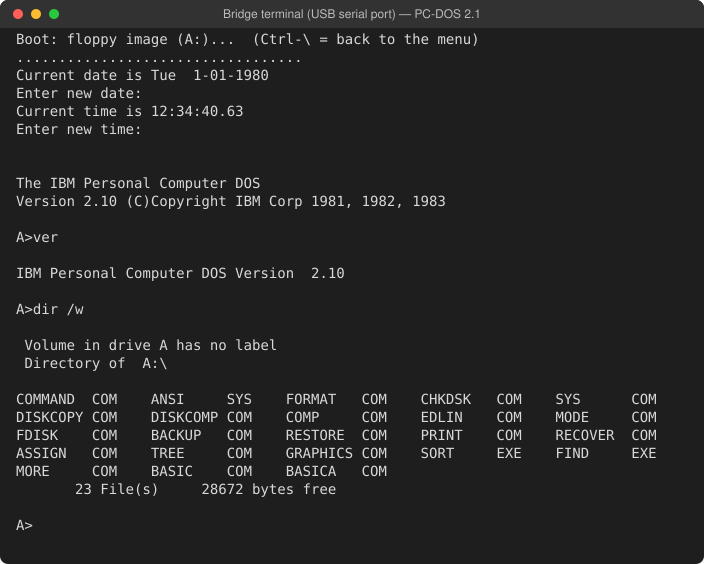
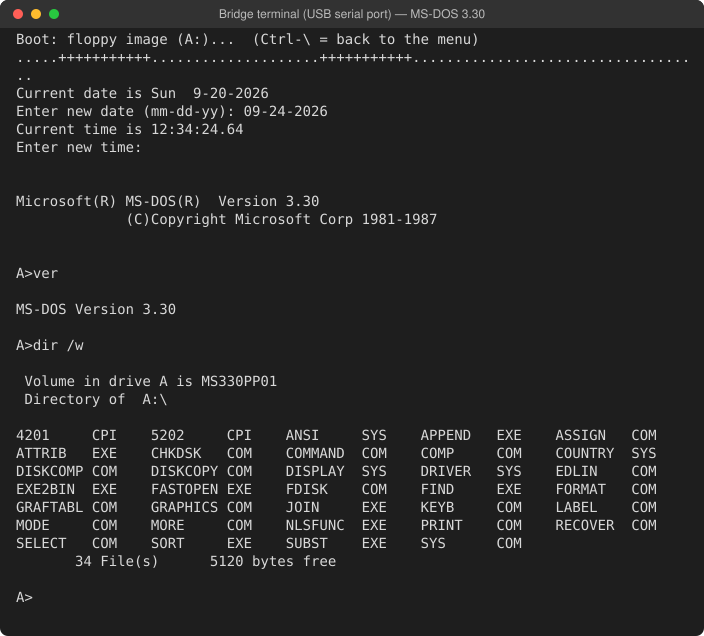

# breadboard-PC — an 8088 computer on a breadboard

A microcomputer with a PC/XT-inspired architecture, built on solderless breadboards around an
**Intel 8088**. Its ROM, whose source code is **written entirely in 8086 assembly language**, boots
into an interactive menu, runs two BASIC interpreters and **boots PC-DOS 2.1, MS-DOS 3.30, 5.0 and
6.22** from 160 KB to 1.44 MB floppy disk images.

A project by Alain Boudreault (VE2CUY), 2026. *[Version française](README_fr.md)*

<p align="center">
  <br>
  <em>The build: the Black Pill STM32F411 bridge (top centre), the 8088, the 8255, the 8259, the ROM and
  the RAM. The LCD shows the “Information” screen (date and time, versions, RAM, disk, speed).</em>
</p>

## At a glance

| | |
|---|---|
| **Processor** | Intel 8088, 4.77 MHz by default, adjustable from 1 to 10 MHz (tested up to 7.38 MHz) |
| **Memory** | 256 KB ROM (W29C020C, `C0000h`–`FFFFFh`); **512 KB** static RAM (AS6C4008, `00000h`–`7FFFFh`), 510 KB of it for DOS |
| **I/O** | 8255A in mode 2 (bus to the bridge), 8259A (interrupts), 4×20 I2C LCD, PS/2 keyboard |
| **Bridge** | WeAct **Black Pill STM32F411** board (firmware 1.6): keyboard, USB terminal, LCD, clock, disk, RESET |
| **Software** | ROM written entirely in assembly (NASM, strict 8086 instruction set): menu, BIOS for DOS, Tiny BASIC, GW-BASIC-style BASIC, RAM test with a memory map |
| **Operating systems** | PC-DOS 2.1, MS-DOS 3.30, 5.0 and 6.22, booted from a floppy disk image (160 KB to 1.44 MB) |

## The build

The core of the machine (processor, address latches, data buffer, ROM, RAM, decoding) is wired on
breadboards with 74LS/74HC logic and no programmable logic (no GAL, no CPLD):

- two **74LS373** latch `A0`–`A7` and `A16`–`A19` on `ALE`; a **74HC245** buffers `D0`–`D7`
  (`DEN`, `DT/R`);
- two **74LS00** do all the decoding, with `M` = memory cycle (`IO/M` = 0):
  - **ROM**: `CE# = NAND(A19, M)` — `C0000h`–`FFFFFh`;
  - **RAM**: `CE# = NAND(/A19, M)` — `00000h`–`7FFFFh`;
  - **8255** (ports `80h`–`83h`): `CS# = NAND(IO, A7)`;
  - **8259** (ports `20h`–`21h`): `CS# = NAND(IO, A5)`;
- the 8088's `RD#` and `WR#` go straight to the ROM, the RAM, the 8255 and the 8259.

<p align="center">
  <br>
  <em>Schematic of the build (KiCad, <a href="kicad/Breadboard-pc">kicad/Breadboard-pc</a>). The clock comes from the
  bridge (<code>CLK_STM</code>) or from an external input, selected by jumper JP1. On the PCB, a third 74LS373 (U12)
  also latches A8-A11, so the whole address bus (A0-A19) can drive two 10-LED bargraphs (readable when single-stepping or halted); J5 brings the bus
  out on a 2 x 20 header.</em>
</p>

<p align="center">
  <br>
  <em>PCB v2 (120 x 124.2 mm, 2 layers), KiCad 3D render: 8088, ZIF socket for the ROM, Black Pill bridge (U5),
  512 KB RAM, 8255, 8259, address bargraphs and J5 bus connector. Routed with Freerouting.</em>
</p>

### The signals in action

The animation follows the machine from RESET to DOS reading a sector: the reset vector fetched from
ROM, a RAM write, programming the 8259 and the interrupt vector table (IVT), a key press and the `IRQ1`
interrupt, a BIOS call (`INT 13h`) and the bridge's burst reply. For each step: the chips involved, the
level of the control signals and the memory area targeted.

<p align="center">
  
</p>

The animation is generated by [medias/animation/generer_signaux.py](medias/animation/generer_signaux.py).

## The circuit

The 8088 does not bit-bang any peripheral. All traffic goes through **a single 8255 in mode 2**: an
8-bit bidirectional bus with hardware handshaking, connected to the bridge. Every byte received from
the bridge raises an interrupt (`IR1` of the 8259); during a bridge command, `IR1` is masked and the
BIOS polls for the replies.



The bridge wiring in detail (pins, 3.3 V / 5 V levels, pull-up resistors) is described (in French) in
[arduino/8088_bridge_stm32/README.md](arduino/8088_bridge_stm32/README.md).

## The STM32 bridge

The bridge firmware (a PlatformIO project, [arduino/8088_bridge_stm32](arduino/8088_bridge_stm32))
gives the 8088 the peripherals of a PC:

| Function | Details |
|---|---|
| **PS/2 keyboard** | Frame decoding; raw scan codes passed to the 8088 |
| **Terminal** | Native USB serial port to the PC (ANSI, 80 columns, UTF-8) |
| **Display** | 4×20 HD44780 LCD over I2C (PCF8574) |
| **Real-time clock** | STM32 RTC (32.768 kHz crystal): `TIME$`, `DATE$`, `INT 1Ah` |
| **Disk** | 8 MB W25Q64 SPI flash formatted FAT16: files, sectors, floppy images mounted as A: (read-only ones too) |
| **Throughput** | Replies sent **in bursts**, as soon as the 8088 has read the previous byte (firmware 1.6) |
| **USB drive** | The flash is exposed to the PC as a USB drive (`USB ON` / `USB OFF`) to copy files onto it |
| **8088 clock** | `CLK` signal generated by hardware PWM, 1 to 10 MHz |
| **8088 RESET** | Held while the bridge starts up; **Ctrl-Alt-Del** (PS/2) or **Ctrl-\\** (terminal) |

The 8088 talks to the bridge through a command protocol on a dedicated channel
(see [Solution-01/lib/bridge.asm](Solution-01/lib/bridge.asm)). The firmware is flashed over USB, with
the board in DFU mode: `platformio run -e blackpill_f411ce_usbdrive -t upload`.

## The menu

At power-up, the ROM displays a menu on both the terminal and the LCD. It can be driven from either
the PS/2 keyboard or the terminal; **Esc** goes back to the previous menu.

<p align="center">
  
</p>

| Menu | Options |
|---|---|
| **1) Basic** | Tiny BASIC; GW-BASIC-style BASIC |
| **2) Memory functions** | Memory dump and editing, CPU registers, code entry and execution, interrupt vector table; **RAM test**: *Trace* (full progress), *MAP* (memory map and summary only) or *Loop* (MAP repeated until Esc) |
| **3) USB Disk** | USB drive toggle, file list, **booting a disk image** |
| **4) Configuration** | Clock speed (0.1 and 1 MHz steps; 2.35, 4.77, 8 and 7.2 MHz presets), CPU speed test, date and time, information screen |

The **RAM test** checks all 512 KB byte by byte (the test stack is moved to low RAM, the last 2 KB are
tested separately), then the address lines `A0`–`A18` (the chip's real capacity). It ends with a
**memory map** (one character per KB) and the good and faulty amounts.

## BASIC

An original reimplementation inspired by GW-BASIC: same keywords, same error messages, integers,
single-precision floating point (in software) and strings. About 54 KB are free for programs.

<p align="center">
  
</p>

| Category | Commands and functions |
|---|---|
| **Program** | `RUN` `LIST` `EDIT` `DELETE` `NEW` `CLEAR` `CONT` `TRON` `TROFF` `HELP` `SYSTEM` |
| **Control flow** | `IF…THEN…ELSE` `GOTO` `GOSUB`/`RETURN` `ON…GOTO/GOSUB` `FOR…NEXT` `WHILE…WEND` `END` `STOP` |
| **Data** | `LET` `DIM` `ERASE` `SWAP` `DATA`/`READ`/`RESTORE` `DEF FN` `DEFINT`/`DEFSNG`/`DEFSTR` |
| **Input/output** | `PRINT` `INPUT` `LINE INPUT` `INKEY$` `CLS` `LOCATE` `COLOR` `BEEP` |
| **Math** | `ABS` `SGN` `INT` `FIX` `SQR` `SIN` `COS` `TAN` `ATN` `LOG` `EXP` `RND` `RANDOMIZE` |
| **Strings** | `LEN` `LEFT$` `RIGHT$` `MID$` `INSTR` `CHR$` `ASC` `STR$` `VAL` `HEX$` `UCASE$` `STRING$` |
| **Files** | `SAVE` `LOAD` `MERGE` `FILES` `KILL` `FORMAT`; `OPEN` `PRINT #` `INPUT #` `EOF` `CLOSE` |
| **Clock** | `TIMER` `TIME$` `DATE$` (read and set the bridge RTC) |
| **Machine** | `PEEK` `POKE` `DEF SEG` `INP` `OUT` `WAIT` `CALL` `FRE` |
| **Disk and system** | `DSKREAD` `DSKWRITE` `USB ON`/`OFF` `BOOT "image.img"` |

## DOS 2.1 to 6.22

The ROM provides the BIOS layer a DOS expects: disk (`INT 13h`, CHS and LBA), keyboard (`INT 16h`),
clock (`INT 1Ah`), text output to the terminal (`INT 10h`) and bootstrap (`INT 19h`). A floppy image
copied to the flash (through the USB drive) is mounted as drive **A:** and booted from
**USB Disk → 3) Boot disk image**, or with `BOOT "PCDOS2_1.IMG"` from BASIC. DOS writes go to the
image file; a read-only image is mounted anyway, without write access.

<p align="center">
  <br>
  <em>PC-DOS 2.1: booting from the image (one dot per sector read), VER, DIR /W</em>
</p>

<p align="center">
  <br>
  <em>MS-DOS 3.30</em>
</p>

What makes DOS 5.0 and 6.22 possible:

- **512 KB of RAM** (these versions require at least 256 KB);
- the **model byte** `FEh` (PC/XT) at `F000:FFFE`: without it, DOS 5 takes the AT keyboard path
  (ports `60h`/`64h`), which hits the 8259 with this decoding;
- the BIOS tick counter `0040:006C`, kept in step with the bridge clock (there is no timer on this
  build): DOS 6 times its F5/F8 boot pause with it;
- **1.44 MB** floppies (geometry from the image size, `INT 13h AH=08h/18h`).

DOS accented letters and box-drawing characters (code page 437) are converted to **UTF-8** on the
terminal: the PC terminal must be set to UTF-8.

Limitations: no video hardware (programs that write to video memory display nothing); DOS keyboard
input from the terminal only; **KEYB** does not work (it reads the keyboard through port `60h`) —
setup disks that start it from `AUTOEXEC.BAT` must have it removed (see the `-nokeyb` copies in
[PC-DOS/](PC-DOS)).

## Building the ROM

```sh
cd Solution-01
make            # solution-01.bin (256 KB, 512 KB RAM); make rom-en for English; make rom-128: 128 KB RAM
make check      # checks size, reset vector, signature and model byte
make test       # test benches under emulation (Unicorn)
make test-rom   # full ROM simulation: DOS, BASIC, PS/2 keyboard
```

Tools: NASM, GNU Make, Python 3 (+ `unicorn` for the tests); PlatformIO for the bridge.

## Repository layout

| Folder | Contents |
|---|---|
| [Solution-01/](Solution-01) | 8088 ROM (NASM) and tests; full technical documentation (in French) in [Solution-01/README.md](Solution-01/README.md) |
| [arduino/8088_bridge_stm32/](arduino/8088_bridge_stm32) | Firmware of the Black Pill STM32F411 bridge (PlatformIO) |
| [kicad/](kicad) | Schematic and PCB of the build |
| [PC-DOS/](PC-DOS) | Test floppy disk images |
| [medias/](medias) | Datasheets, schematic, PCB render, signal animation and screenshots |

> The terminal screenshots on this page are produced by the actual (English) ROM, running in the
> project's simulator ([medias/captures/generer.py](medias/captures/generer.py)).
