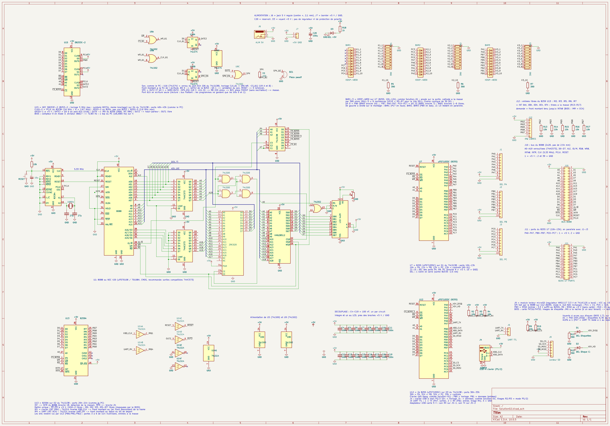
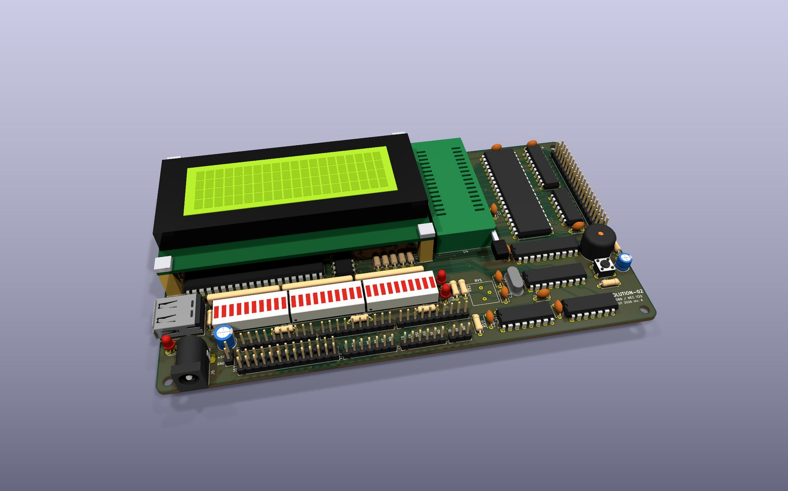
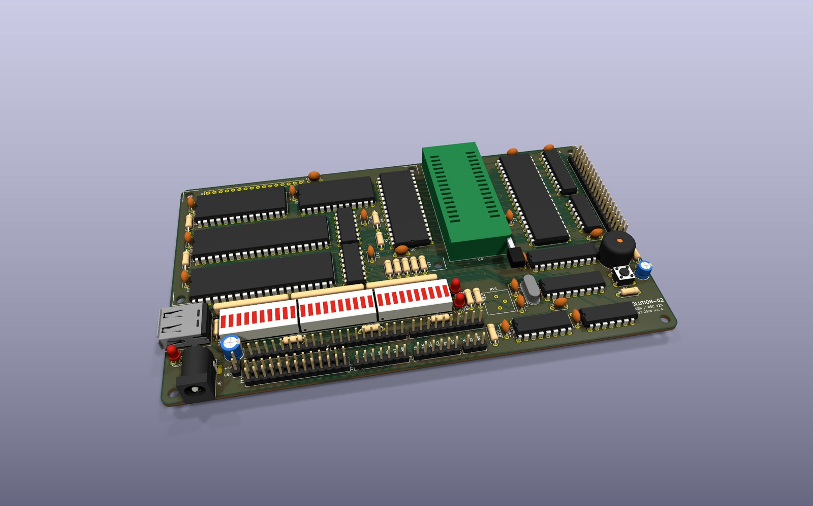
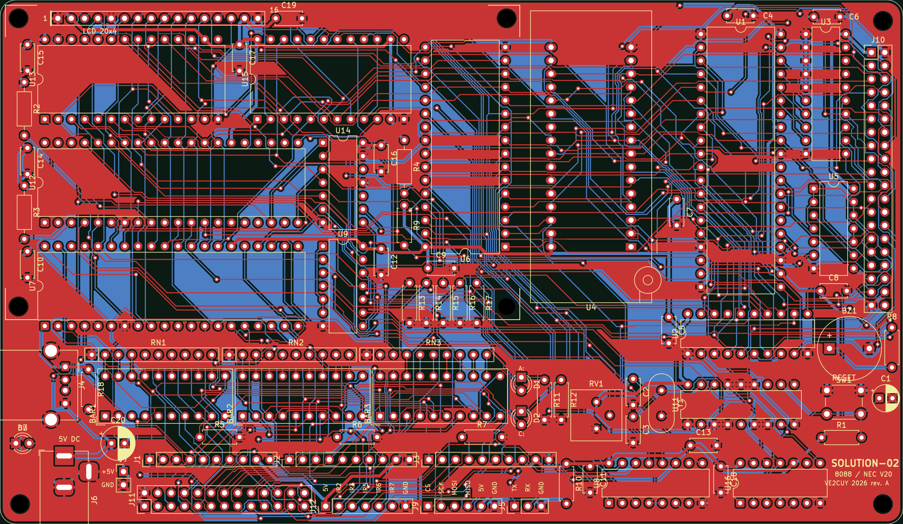

# Solution-02 — stand-alone 8088 / NEC V20 computer (VE2CUY)

*[Version française](README_fr.md)*

An 8088 (or NEC V20) computer built on a breadboard, **without the STM32 bridge**:
the processor drives its LCD and its memory directly.

- Clock: 82C84 + 16 MHz crystal → **5.33 MHz** (16 / 3)
- ROM: 29C020 (W29C020C), 256 KB
- RAM: HM628512, 512 KB
- Address latches: 2 × 74HC573 (U2: A0–A7, U3: A16–A19)
- Decoding: 74LS00 (U5), 74LS138 (U8), 74LS02 (U9)
- Display: 20×4 LCD (HD44780 / ST7066U), 8-bit bus, write only
- Parallel I/O: 8255 (U7, µPD71055C) at 10h–13h, 24 LEDs on J1–J3
- Keyboard and UART: second 8255 (U12) at 30h–33h — PS/2 keyboard (USB-A socket J4) and
  9600 8N1 software UART (J5), bit-banged as in Solution-01
- **PC-DOS 2.1 in ROM**: the 180 KB floppy is in the ROM (drive A:, read only); IBM PC-style
  BIOS (INT 10h, 13h, 16h…) through software interrupts, 24 × 80 DOS screen seen through a
  20 × 4 window on the LCD

Schematic: [Solution02.kicad_sch](Solution02.kicad_sch).
PCB: [Solution02.kicad_pcb](Solution02.kicad_pcb) (172 × 100 mm, 2 layers; see [PCB](#pcb)).
Log of the steps: [Directives.md](Directives.md) (French).

<p align="center">
  <a href="medias/schema.png"></a><br>
  <em>Solution-02 schematic (click to enlarge).</em>
</p>

## Memory map

| Addresses | Contents | Selection |
|---|---|---|
| 00000h–7FFFFh | 512 KB RAM | CE# = NAND(/A19, M) — U5 pin 8 |
| 80000h–FFFFFh | 256 KB ROM | CE# = NAND(A19, M) — U5 pin 6 |

A18 is not connected to the ROM: the 256 KB image appears twice
(80000h–BFFFFh and C0000h–FFFFFh). The BIOS occupies the last 64 KB of the
image (offset 30000h), seen at **F000:0000**. At reset, the 8088 starts
at FFFF:0000 = FFFF0h = F000:FFF0 (offset 3FFF0h of the image), where there is
a `JMP F000:0000`.

ROM and RAM contents with BIOS 2.3:

| Addresses | Contents |
|---|---|
| 00000h–003FFh | interrupt vector table (filled by "Load DOS") |
| 00400h–004FFh | BIOS data area (BDA): equipment, memory, video mode |
| 00500h–5EBFFh | DOS and programs (**379 KB** reported by INT 12h; **507 KB** when B: is the card's DOS 2.1 image) |
| 5EC00h–5EFFFh | private INT 10h stack (1 KB, BIOS 2.5; at 7EC00h–7EFFFh when DOS gets 507 KB) |
| 10000h–1FFFFh | (outside DOS) **BASIC** segment (menu 6): program, variables, stack |
| 5F000h–7EFFFh | **drive B:**: 128 KB virtual disk (kept after Ctrl + Alt + Del) |
| 7F000h–7FFFFh | BIOS data (DSEG = 7F00h): 24 × 80 screen, variables, queues, LCD copy, animation stack (900h–AFFh), menu stack |
| C0000h–ECFFFh | **reduced PC-DOS 2.1 floppy** (180 KB: 40 cylinders, 1 head, 9 sectors) = offset 0 of the image |
| ED000h–EFFFFh | free (FFh) |
| F0000h–F7FFFh | BIOS |
| F8000h–FFFEFh | **BASIC** (basic_s02.asm: the Solution-01 BASIC, ~25 KB) |
| FFFF0h | RESET |

The ROM's PGM (WE#) pin is tied to +5 V: a write by DOS or a program into the
ROM area (for instance at B8000h, a PC's video memory) has no effect.

## I/O ports (74LS138, U8)

U8 decodes **A7 = 0**, **IO/M = 1** (E1# = E2# = A7, E3 = IO/M) and
**A6–A4** (inputs A, B, C). Each active-low output covers a block of 16 ports:

| Output | U8 pin | Ports | Use |
|---|---|---|---|
| O0 | 15 | 00h–0Fh | **LCD (in use)**: 00h = command, 01h = data (RS = A0) |
| O1 | 14 | 10h–1Fh | **8255 (U7, in use)**: 10h = PA, 11h = PB, 12h = PC, 13h = control (A0–A1) |
| O2 | 13 | 20h–2Fh | **8259A (U13)**: 20h = ICW1/OCW2/OCW3 (A0 = 0), 21h = ICW2-4/OCW1 (mask) — as on the PC |
| O3 | 12 | 30h–3Fh | **second 8255 (U12, in use)**: 30h = PA, 31h = PB, 32h = PC, 33h = control (keyboard, software UART, SD reader) |
| O4 | 11 | 40h–4Fh | **8253-2 (U15)**: 40h–42h = counters 0–2, 43h = mode (A0–A1) |
| O5 | 10 | 50h–5Fh | free |
| O6 | 9 | 60h–6Fh | **port 61h latch (U16)**: bit 0 = GATE2, bit 1 = speaker (write only) |
| O7 | 7 | 70h–7Fh | free |

Good to know:

- **A0–A3 do not go through the 138.** They go directly to the peripheral to
  select its registers. A peripheral that only uses a few of them, such as an
  8255 (A0–A1), appears several times in its block: 60h–63h, then 64h–67h, etc.
- **A8–A15 are not decoded.** With `IN/OUT port, AL` (8-bit port), they are 0.
  With `IN/OUT DX`, each block repeats every 256 ports.
- **Ports 80h–FFh (A7 = 1) are not decoded.** A second 138 enabled by A7 = 1
  and IO/M = 1 would provide 8 more blocks.
- **No RD#/WR# in the 138.** Its outputs depend only on the address. They suit
  as is the CS# of chips that receive RD# and WR# separately (8255, 8253, 8259,
  16550…). For a simple latch (74LS374/573) or a buffer (74LS244), the output
  must be combined with WR# or RD#, as for the LCD: E = NOR(WR#, O0) (U9), and
  the port 61h latch: clock = OR(WR#, O6) (U9). All 4 NOR gates of U9 are used.
- The decoding falls on the same blocks as a PC/XT: an 8259 on O2, an 8253 on
  O4 and an 8255 on O6 would be at the standard addresses (20h, 40h, 60h),
  which will make a compatible BIOS easier.

## 20×4 LCD

- Data bus DB0–DB7 connected directly to AD0–AD7 of the 8088.
- RS = A0 (latched by U2), E = NOR(WR#, O0) (U9 pin 13).
- R/W tied to ground: the busy flag cannot be read, each write is followed by
  a software delay.
- Contrast set by RV1 (VO pin).
- The E pulse lasts about 2 cycles (≈ 375 ns at 5.33 MHz): enough for an
  HD44780U (230 ns minimum), to watch with a slower controller.

## 8255 (U7) and LEDs

CMOS 8255 (µPD71055C) selected by **O1** of the 74LS138: ports **10h–13h**
(repeated up to 1Fh, since only A0–A1 go to the 8255).

| 8255 pin | Signal | Comes from |
|---|---|---|
| 34, 33, 32, 31, 30, 29, 28, 27 | D0–D7 | AD0–AD7 of the 8088 |
| 9, 8 | A0, A1 | U2 (74HC573) Q0, Q1 |
| 6 | CS# | U8 (74LS138) pin 14 (O1) |
| 5 | RD# | RD# (8088 pin 32) |
| 36 | WR# | WR# (8088 pin 29) |
| 35 | RESET | 82C84 RESET (U11 pin 10, 8088 pin 21) |
| 26 / 7 | VCC / GND | +5 V / GND (+ 100 nF) |
| 4, 3, 2, 1, 40, 39, 38, 37 | PA0–PA7 | J1 pins 1–8 |
| 18–25 | PB0–PB7 | J2 pins 1–8 |
| 14, 15, 16, 17, 13, 12, 11, 10 | PC0–PC7 | J3 pins 1–8 |

J1, J2 and J3 (1×10): pins 1–8 = PA/PB/PC 0–7, pin 9 = +5 V, pin 10 = GND.

LEDs: an output at 1 lights the LED if it is wired **output → 1 kΩ → anode,
cathode → GND** (pin 10). The 82C55 only supplies ~2.5 mA per output: for
brighter LEDs, go through a ULN2803 or a 74HC245.

**Bar graphs** (as in Solution-01): three HDSP-4830 (BAR1–BAR3) in parallel
with J1–J3, wired as a **contiguous chain of 30 LEDs**, like the address lines
of Solution-01: anode on the 8255 output, cathode to ground through **390 Ω** —
segments 1 to 9 through a network of 9 bussed resistors (RN1–RN3, SIP10),
segment 10 through a single resistor (R5–R7).

| Bar graph | Anode pins 1 → 10 | Cathodes |
|---|---|---|
| BAR1 | 1–6 free (bits 24–29), 7–10 = PC7 → PC4 | RN1 + R5 |
| BAR2 | PC3 → PC0, PA7 → PA2 | RN2 + R6 |
| BAR3 | PA1, PA0, PB7 → PB0 | RN3 + R7 |

Bit 0 (PB0) = pin 10 of BAR3, bit 23 (PC7) = pin 7 of BAR1: laid out from left
to right (BAR1, BAR2, BAR3, pin 1 on the left), the bar graphs show the BIOS
row (PC7 … PB0) with the 6 most significant LEDs off on the left. The current
is limited by the 82C55 output (~2.5 mA) rather than by the 390 Ω.

At RESET, the 8255 sets its 3 ports as inputs (floating outputs). The BIOS
sends control word **80h** (mode 0, PA, PB and PC as outputs) and turns the
LEDs off right at startup, just after initializing the LCD.

## 8253 (U15): timer

**NEC D8253C-2** (clock up to **5 MHz**) selected by **O4** of the 74LS138:
ports **40h–43h**, as on the PC (repeated up to 4Fh). The clock is PCLK of the
82C84 (16 MHz / 6 = **2.67 MHz**): an 8253-2 (5 MHz) or an 8254 (8 MHz) is
required; an ordinary 8253 or 8253-5 is limited to 2.6 MHz. In the schematic,
the symbol is the 82C54's (same pinout). The BIOS only uses what all these
chips have: mode 3 and counter latch (word 00h).

| 8253 pin | Signal | Comes from / goes to |
|---|---|---|
| 8 → 1 | D0 → D7 | AD0–AD7 of the 8088 |
| 19, 20 | A0, A1 | U2 (74HC573) Q0, Q1 |
| 21 | CS# | U8 (74LS138) pin 11 (O4) |
| 22 / 23 | RD# / WR# | 8088 pins 32 / 29 |
| 9, 15, 18 | CLK0, CLK1, CLK2 | PCLK: U11 (82C84) pin 2 |
| 11, 14 | GATE0, GATE1 | +5 V |
| 16 | GATE2 | bit 0 of port 61h (U16 pin 5) |
| 10 | OUT0 | IR0 of the 8259 (U13 pin 18): **IRQ0, INT 08h** |
| 17 | OUT2 | speaker (through U14 and U9, see "Sound") |
| 13 | OUT1 | free |
| 24 / 12 | VCC / GND | +5 V / GND (+ 100 nF) |

The BIOS programs counter 0 in mode 3 (square wave) with divisor **36617**:
IRQ0 at 2,666,667 / 36617 = **72.83 Hz**, exactly 4 times the PC rate
(18.2065 Hz, error 0.002 %). One PC tick (BDA counter, INT 1Ch) every 4.

### Sound (counter 2 and port 61h), as on the PC — not wired yet

| Part | Role |
|---|---|
| U16 (74LS74) | **port 61h latch**: flip-flop A = bit 0 (D0) → GATE2; flip-flop B = bit 1 (D1) → speaker enable (~Q = ~SPK_EN); ~PRE at +5 V, ~CLR = ~RESET (silence at power-up) |
| U9 A, B (74LS02) | latch clock CLK_61 = OR(WR#, O6): rising edge at the **end** of the write (stable data, 8088 hold ≥ 88 ns) |
| U14 C (74LS14) | ~RESET = inverted RESET (the 82C84 RESET is active high) |
| U14 D, U9 C | SPK = NOR(~OUT2, ~SPK_EN) = **OUT2 AND bit 1** |
| R8 220 Ω, BZ1 | **passive piezo buzzer** (no built-in oscillator) between SPK (through R8) and ground |

Frequency = 2,666,667 / N (counter 2 in mode 3): from **40.7 Hz** (N = 65536)
to beyond the audible range; A 440 Hz = N 6061 (439.97 Hz). Port 61h is
**write only** (a read leaves the bus floating): PC programs do
`IN AL,61h / OR AL,3 / OUT 61h,AL` then `AND AL,0FCh`; only bits 0 and 1
matter, so it works. **Pitch of PC programs' sounds**: they compute N for a
1.193 MHz clock; here it is 2.667 MHz, so their notes come out **2.235 times
higher** (~1 octave + 4 semitones; BASICA's `BEEP`, `SOUND`, `PLAY`). The
BIOS's sounds are in tune.

## Second 8255 (U12): PS/2 keyboard and UART

CMOS 8255 (µPD71055C) selected by **O3** of the 74LS138: ports **30h–33h**
(20h = 8259, U13; 40h and 60h stay free for a future 8253 or 8255 at the
addresses of a PC/XT). Control word **82h**: PA and PC as outputs, PB as input.
Same bits as Solution-01 for the keyboard.

| 8255 pin | Signal | Comes from / goes to |
|---|---|---|
| 34, 33, 32, 31, 30, 29, 28, 27 | D0–D7 | AD0–AD7 of the 8088 (**in order**) |
| 9, 8 | A0, A1 | U2 (74HC573) Q0, Q1 |
| 6 | CS# | U8 (74LS138) pin **12** (O3) |
| 5 / 36 | RD# / WR# | 8088 pins 32 / 29 |
| 35 | RESET | 82C84 RESET (U11 pin 10) |
| 26 / 7 | VCC / GND | +5 V / GND (+ 100 nF) |
| 18 | PB0 = KBD_CLK | J4 D+ (PS/2 clock), R2 10 kΩ pull-up to +5 V |
| 14 | PC0 = AVR_SS | ATmega SS (U17 pin 16), R21 10 kΩ to +5 V — schematic of 2026-11-21 (before: keyboard inhibit, diode not fitted) |
| 19 | PB1 = KBD_DATA | J4 D− (PS/2 data), R3 10 kΩ pull-up to +5 V |
| 20 | PB2 | free since the schematic of 2026-11-21 (was UART_RX) |
| 22 | PB4 = AVR_MISO | ATmega MISO (U17 pin 18), R20 10 kΩ to +5 V — schematic of 2026-11-21 |
| 37 | PA7 | free since the schematic of 2026-11-21 (was UART_TX) |

- **J4, female USB-A socket**: for a USB keyboard **with PS/2 fallback** (most
  ordinary USB keyboards). VBUS = +5 V, **D+ = clock, D− = data** (as in
  Solution-01), GND and shield to ground. The R2/R3 pull-ups are essential: it
  is by seeing D+ and D− pulled to +5 V that the keyboard picks PS/2 mode. A
  native PS/2 keyboard connects to the same signals (clock, data, +5 V, GND).
- **J5, 5 V TTL UART**: 1 = TX (output), 2 = RX (input), 3 = GND. With a 5 V
  USB-serial adapter: **adapter RX on J5-1, adapter TX on J5-2**, GND on J5-3.
  Terminal: 9600 baud, 8N1, no flow control. Since the schematic of
  2026-11-21, J5 goes to the UART of the ATmega U17 (TX = PD1, RX = PD0) and J8
  carries RTS/CTS (see
  [ATmega328P (U17)](#atmega328p-u17-hardware-uart-on-the-spi-bus--schematic-of-2026-11-21-to-be-validated)).

### Keyboard inhibit (diode on PC0) — abandoned

Under DOS, the BIOS only listens to the keyboard during INT 16h calls; at the
prompt, PC-DOS 2.1 loops on INT 16h AH=01h then INT 28h. A frame starting
between two calls would be lost (a missing key, or a lost release code that
makes the key repeat). Like the PC/AT keyboard controller, the BIOS (since
version 0.6) **inhibits the keyboard clock** when it is not listening: PC0 = 0
pulls KBD_CLK to ground through the diode; the keyboard then keeps its keys in
memory and sends them as soon as the clock is released (a frame interrupted
before its 10th bit is resent). PC0 is driven by the 8255's bit set/reset
words (BSR): PA7 (UART TX) is not touched.

Without the diode, nothing changes (PC0 is not connected to anything): the BIOS
compensates by listening longer (~8 ms) when DOS waits without displaying
anything, but a key can still be lost now and then. **Decision (2026-11-14):
the diode will not be fitted**; the 8259 (U13, below) signals the start of each
keyboard frame and each UART byte with an interrupt.

## SD card reader (J9)

In the spirit of period floppy emulators (Gotek, HxC): a microSD reader module
on **U12**, the SPI protocol generated **bit by bit by the 8088**, and the BIOS
reads the card (FAT16 or FAT32) to boot from a `.IMG` floppy image. No
microcontroller.

| Module signal (J9) | U12 (8255, mode 0, word 82h unchanged) | Direction |
|---|---|---|
| 1 CS | **PC4** (pin 13); R10 10 kΩ to +5 V (card deselected during RESET, 8255 as input) | output |
| 2 SCK | **PC5** (pin 12) | output |
| 3 MOSI | **PC6** (pin 11) | output |
| 4 MISO | **PB3** (pin 21); R9 10 kΩ to +5 V (defined level with no card) | input |
| 5 VCC | **+5 V** (the module's AMS1117 regulator makes the card's 3.3 V) | |
| 6 GND | ground | |

The module's 74LVC125 lowers CS, SCK and MOSI to 3.3 V; MISO comes out at
3.3 V, enough for an 8255 input (2.2 V threshold). The keyboard (PB0, PB1) does
not change. Expected software SPI throughput: ~60 µs per byte, ~15 KB/s (an XT
floppy: 25 to 40 KB/s). Since the schematic of 2026-11-21, the ATmega U17
shares SCK and MOSI (below).

### ATmega328P (U17): hardware UART on the SPI bus — schematic of 2026-11-21, to be validated

The software UART loses characters as soon as a system keeps interrupts masked
for more than about 50 µs (ELKS: 2–3 % of keystrokes, see
[elks/](elks/README.md)), and it keeps the 8088 busy for about 1 ms per character
sent, with interrupts masked. An ATmega328P takes over the UART: it receives and
sends by itself, keeps received bytes in its RAM, and the 8088 talks to it over
SPI, at its own pace, on the SD card bus. It had been removed on 2026-11-16 to
stay in the vintage spirit; it comes back for this reason, on the SPI bus
instead of U12 in mode 2 (PC4–PC6 now carry the SD card).

| ATmega328P (U17, DIP-28 in a socket) | Net | Comes from / goes to |
|---|---|---|
| 19 PB5 SCK | SD_SCK | U12 PC5 (shared with the SD card) |
| 17 PB3 MOSI | SD_MOSI | U12 PC6 (shared with the SD card) |
| 18 PB4 MISO | AVR_MISO | U12 **PB4**; R20 10 kΩ to +5 V. Separate line: many microSD modules never release their MISO |
| 16 PB2 SS | AVR_SS | U12 **PC0**; R21 10 kΩ to +5 V (ATmega not selected during RESET, 8255 as input) |
| 14 PB0 (ICP1) / 15 PB1 (OC1A) | UART_RX / UART_TX | J5 pins 2 / 1 (R4 keeps RX idle). **Terminal on a software UART of the ATmega** (schematic of 2026-11-22): input capture of timer 1 for reception, output compare for sending, 2400 to 115200 baud, 57600 at power-up |
| 2 PD0 RXD / 3 PD1 TXD | WIFI_TX / WIFI_RX | Hardware USART → **Grove - UART WiFi V2 module** (J13, schematic of 2026-11-23): RXD ← J13-1 (module TX, 3.3 V); TXD → J13-2 (module RX, level-shifted on board) |
| 4 PD2 | IRQ4 | U13 IR4: rising edge = a received byte is waiting |
| 12 PD6 / 13 PD7 | UART_RTS / UART_CTS | J8 pins 1 / 2 (3 = GND); R22 10 kΩ pulls CTS to ground (asserted with no terminal) |
| 9 / 10 XTAL1 / XTAL2 | AVR_XTAL1 / AVR_XTAL2 | Y2 16 MHz, C21 / C22 22 pF to ground |
| 1 RESET | AVR_RESET | R19 10 kΩ to +5 V only: no link with the 8088 RESET |
| 7 VCC, 20 AVCC / 8, 22 GND | | +5 V / ground; C23 100 nF |
| | | PC0–PC5, PD3–PD5 and AREF free |

- The ATmega is programmed **off the board**, in the TL866 socket: no ISP
  header.
- As an SPI slave, its SPI pins are inputs while SS = 1 (MISO included): no
  conflict with the SD card, which in turn ignores the clock while its CS = 1.
  The firmware must never switch to SPI master.
- U12 keeps control word 82h (PC0 output, PB4 input). PA7 and PB2 are free;
  gate U14B (former inverted UART_RX to IR4) is unused, input grounded.
- **Firmware**: [arduino/atmega_uart/](../arduino/atmega_uart/README.md), SPI protocol
  version 3 (2026-11-23): IDENT, ETAT, LIRE, ECRIRE, VITESSE, VIDER for the terminal
  (00h–05h, as in version 2), and the same for the Wi-Fi module (11h–15h).
- Wired and validated with BIOS 2.7 (2026-11-21); the BIOS keeps the software UART when
  the ATmega is absent. The PCB (172 × 100 mm) has to be redone.

### Wi-Fi module (J13): Grove - UART WiFi V2 (schematic of 2026-11-23)

The ATmega's hardware USART goes to Seeed's **Grove - UART WiFi V2** module (ESP8285, AT
firmware, 115200 baud); the terminal stays on the ATmega's software UART (PB0/PB1). The
ESP32 schematic of 2026-11-22 (Q1/Q2, R23–R30, 1 × 7 J13) is removed.

| J13 (1 × 4, Grove cable order) | Net | Module |
|---|---|---|
| 1 (yellow) | WIFI_TX | module TX (U0TXD, 3.3 V, direct) → ATmega PD0 RXD |
| 2 (white) | WIFI_RX | module RX ← ATmega PD1 TXD (5 V accepted: 2N7002 and 1 kΩ pull-up to VCC on board) |
| 3 (red) | +5V | module VCC (on-board ETA3410 buck, 3 V to 5 V); C25 100 µF for Wi-Fi peaks |
| 4 (black) | GND | GND |

- Direct wiring: the module level-shifts its own input; its 3.3 V output is above the
  ATmega's threshold (VIH = 3.0 V at 5 V). No RTS/CTS: PD3 and PD4 are free, and the
  ATmega's channel 2 has a 1 KB receive buffer.
- Footprint: 1 × 4 header at 2.54 mm pitch (Grove-to-Dupont cable).
- The BIOS talks to the module through menu **9) Wi-Fi** and **INT 14h, DX = 1** (COM2).
- **The module was reflashed as a SLIP router** (martin-ger's esp_slip_router, 2026-11-23):
  SLIP at 115200 baud, module at 192.168.240.1, client at 192.168.240.2, NAT to Wi-Fi; TCP
  configuration console at 192.168.240.1:7777 (`set ssid`, `set password`, `save`,
  `portmap add TCP 23 192.168.240.2 23`…). It was flashed **through the board** (menu 9,
  Ctrl+B: ATmega bridge) with esptool (`--baud 115200 --before no-reset`, module buttons for
  boot mode); the original AT firmware is saved in `wifi/sauvegarde/` (not in git).
  `wifi/slip_outil.py` speaks SLIP from a PC through the bridge (ping, module console), with no
  driver nor administrator rights.
- **ELKS networking**: see [elks/README.md](elks/README.md) (`net start slip`).
- **DOS networking**: `S02PKT` packet driver and mTCP, see [dos/README.md](dos/README.md).

## 8259A (U13): keyboard and UART interrupts

8259A selected by **O2** of the 74LS138: ports **20h–21h**, as in a PC (bus A0
= 8259 A0). Single controller (master): SP/EN at +5 V, CAS0–CAS2 free. The
8088 had no hardware interrupt: **INTR (pin 18) is detached from ground** and
receives INT from the 8259; INTA (pin 24, minimum mode) goes to the 8259. NMI,
TEST and HOLD stay grounded.

| 8259 pin | Signal | Comes from / goes to |
|---|---|---|
| 11, 10, 9, 8, 7, 6, 5, 4 | D0–D7 | AD0–AD7 of the 8088 (**in order**) |
| 27 | A0 | U2 (74HC573) Q0 |
| 1 | CS# | U8 (74LS138) pin **13** (O2) |
| 3 / 2 | RD# / WR# | 8088 pins 32 / 29 |
| 17 | INT | 8088 pin **18** (INTR) |
| 26 | INTA# | 8088 pin **24** (INTA#) |
| 16 | SP#/EN# | +5 V (single master) |
| 12, 13, 15 | CAS0–CAS2 | free |
| 18 | IR0 = IRQ0 | OUT0 of the 8253 (U15 pin 10): timer |
| 19 | IR1 = IRQ1 | U14 (74LS14) pin 2 = inverted KBD_CLK |
| 22 | IR4 = IRQ4 | PD2 of the ATmega U17 (byte received) since the schematic of 2026-11-21; before: U14 pin 4 = inverted UART_RX |
| 20, 21, 23–25 | IR2, IR3, IR5–IR7 | free: J12 pins 2–6, pulled to ground by R13–R17 (10 kΩ); masked by the BIOS |
| 28 / 14 | VCC / GND | +5 V / GND (+ 100 nF) |

The 8259 responds to the **rising edge** (edge-triggered mode, as on the PC);
but a PS/2 frame starts with a **falling** clock edge and a serial byte with a
falling edge of RX (start bit). **U14 (74LS14, Schmitt trigger) therefore
inverts KBD_CLK** (pin 1 → 2, to IR1) **and UART_RX** (pin 3 → 4, to IR4); gate
3: RESET → ~RESET (pin 5 → 6, port 61h latch); gate 4: OUT2 → ~OUT2 (pin 9 → 8,
sound); gates 5 and 6 unused, inputs grounded (VCC pin 14, GND pin 7). The bits
themselves are still read by U12 (PB0, PB1, PB2): the interrupt routine reads
the whole frame or byte by polling, as in BIOS 0.7, but it starts at the first
edge, even when DOS asks for nothing (BIOS 0.8). Numbers as on the PC: IRQ1 =
INT 09h (keyboard), IRQ4 = INT 0Ch (COM1). Since the schematic of 2026-11-21,
IR4 comes from the ATmega U17 (PD2): gate 2 of U14 is unused, input grounded.

To remember for software: the 8259 must service the interrupt while the input
is still high (keyboard clock low, ~40 µs; start bit, 104 µs); otherwise it
produces a spurious "IRQ7" interrupt. The BIOS must therefore avoid long
sections without interrupts (CLI).

### UART calibration

The UART is in software: the bit time depends on the processor and its clock.
`UART_N` (in `bios.asm`, default 29 for an 8088 at 5.33 MHz) is an
**estimate** to check:

1. Connect the oscilloscope to J5-1 (TX) and restart: the banner is sent just
   after the RAM test.
2. Measure the width of a bit (the shortest step): it must be **104.2 µs**
   (9600 baud).
3. Too long → decrease `UART_N`; too short → increase it. One unit ≈ 3.2 µs
   (3 % of a bit) on an 8088 at 5.33 MHz. The receiver uses the same constant.
4. Rebuild with the new value, without editing the source:
   `make clean && make UART_N=28` (then burn). A V20 (faster instructions)
   needs a larger value.

## Expansion headers (J10, J11, J12)

Three 2.54 mm pin headers give access to the board's signals (probes, logic analyzer,
expansions). They are in the schematic and in the simulator; not wired yet on the build.

**J10 (2 × 20): 8088 bus.** Latched addresses (74HC573 outputs), AD0–AD7 data and control
signals.

| Pins | Signals |
|---|---|
| 1 / 2 | +5 V / GND |
| 3–22 | A0–A19 (A0–A7 from U2, A8–A15 from the 8088, A16–A19 from U3) |
| 23–30 | D0–D7 |
| 31, 32 | ALE, IO/M# |
| 33, 34 | RD#, WR# |
| 35, 36 | INTA#, INTR |
| 37, 38 | CLK (5.33 MHz, 82C84 pin 8), RESET |
| 39 / 40 | GND / PCLK (2.67 MHz) |

**J11 (2 × 13): ports of 8255 U7 (10h–13h)**, in parallel with J1–J3 (LEDs): 1 = +5 V,
2 = GND, 3–10 = PA0–PA7, 11–18 = PB0–PB7, 19–26 = PC0–PC7.

**J12 (1 × 7): free interrupts of the 8259 (U13)**: 1 = +5 V, 2 = IR2, 3 = IR3, 4 = IR5,
5 = IR6, 6 = IR7, 7 = GND. Each input is pulled to ground by R13–R17 (10 kΩ). Numbers as on
the PC: IR2 = INT 0Ah, IR3 = INT 0Bh, IR5 = INT 0Dh, IR6 = INT 0Eh, IR7 = INT 0Fh.

To use them: the 8259 is edge-triggered; a request is a **rising edge held until INTA**. The
BIOS masks these inputs (IMR = ECh) and points their vectors to a bare IRET, with no EOI: a
program that uses them must install its handler, unmask the input (port 21h) and send the EOI
(`mov al, 20h` / `out 20h, al`). Without EOI, the input stays in service and blocks the
lower-priority inputs (including IR4, the UART, after IR2 or IR3). IR7 is also used for spurious
interrupts (the BIOS's `irq_parasite` handler). The simulator can enable and trigger them (IRQ
tab).

## BIOS 2.4

BIOS 2.4 comes in **French** (`make`: `build/solution-02-bios.bin`) and **English**
(`make en`: `build/solution-02-bios-en.bin`, texts under `%ifdef LANG_EN`). Burning:
`make flash FLASH_LANG=fr|en PUCE=ok`. New since 2.3:

- **Menu 7): LED animations ON/OFF**. Line 3 of the menu:
  `3) Anim. DEL 7) ON` (French) or `3) LED Show  7) ON`, with `ON` or `OFF`. On OFF, the
  animation task no longer gets control from IRQ0 (`V_LED_OFF`, DSEG 7B8h): the LEDs stay
  off in the menu and under DOS. The menu 3) screen still animates them (`V_LED_ECRAN`,
  7B9h). The setting goes back to ON at startup.
- **French menu** in the French BIOS: `1) DOS`, `2) Test memoire`. The English BIOS keeps
  `1) Load DOS` and `2) Test memory`. All LCD and UART texts are translated, including the
  ANSI welcome (`accueil_en.inc`, generated by `tests/gen_accueil.py`) and the RAM test
  report.
- **More robust keyboard**: an unreadable PS/2 frame (for instance one arriving while sending
  to the UART, interrupts masked) clears the pending F0/E0 prefixes. Before, if the 2nd byte
  of a release (`F0 xx`) was lost, the next key was taken for a release and disappeared.

Sources: [bios/bios.asm](bios/bios.asm) (startup, menu, RAM test, LEDs, keyboard, UART) and
[bios/services.inc](bios/services.inc) (IBM PC-style services). Sequence:

1. **Splash screen** (~2 s): `SOLUTION-02 BIOS 2.3`, `CPU 8088/V20 5.33MHz`,
   `RAM 512 Ko  LCD 20x4`, `VE2CUY - 2026`.
2. **Quick check** of the BIOS's 4 KB of data (7F000h–7FFFFh); on failure, the full RAM
   test starts right away. Banner on the UART. Programming of the **8253** (counter 0,
   mode 3, divisor 36617) and detection: two latched reads of the counter, ~20 µs apart,
   must differ and not exceed 36617 (without an 8253, the floating bus always returns the
   same value).
3. **Menu**, on the PS/2 keyboard (keys 1 to 5). When entering the menu, the BIOS installs
   the vectors, reinitializes the 8259 and **detects** it by reading back its mask register
   (A5h then 5Ah):
   - **8259 present**: the keyboard (IRQ1, INT 09h) and UART reception (IRQ4, INT 0Ch) go
     through **interrupts**. The routine reads the frame or byte by polling U12 from the
     first edge, decodes it and puts it in a queue (16 keys, 32 bytes). Nothing is lost
     while the program does something else (display, `DIR`…). IRQ7 (INT 0Fh) counts
     spurious interrupts (request dropped before INTA);
   - **8259 absent** (not wired yet): polling during waits, as in BIOS 0.7.

   With the 8259 **and** the 8253, IR0 is also unmasked: **IRQ0 (INT 08h) at 72.83 Hz**.
   IRQ0 sends the EOI and re-enables interrupts right away (a keyboard request drops in
   ~40 µs: it must not wait), then:
   - **time**: one call out of 4 = one PC tick (18.2065 Hz): BDA counter (0040:006C),
     midnight rollover (1800B0h ticks, 0040:0070), INT 1Ch. The DOS time advances (`TIME`,
     file dates);
   - **LED animations in the background**, everywhere (menu, Info, DOS…): the animations
     are a **task** on its own stack; while waiting for its next step, it gives control back
     to IRQ0 (`tache_cede`), which resumes it the required number of ticks later (3 =
     ~41 ms, 5 = ~69 ms, 12 = ~165 ms). A step lasts a few tens of µs, interrupts enabled.
   - **sound**: on the first menu display after startup, a short melody (C5, E5, G5, C6);
     under DOS, the **BEL** character (07h, written by INT 10h) gives an 880 Hz beep,
     ~0.25 s. Durations counted in IRQ0: without the 8259 or the 8253, no sound.

```
1) Load DOS 6) BASIC
2) Test memory
3) LED Show
4) Info  5) UART:ON
```

The **UART console** is **ON at startup** (and after Ctrl + Alt + Del or the RAM test); key
**5** toggles it (`UART:ON` ↔ `UART:OFF`). It applies **in every mode**:

- on the first menu after startup (and each time it is switched ON), a **color welcome
  screen** (ANSI sequences: cleared screen, title in white, repository addresses in red,
  "88 // PC" logo in green, slogans), inspired by the z/OS welcome screen
  ([medias/Z88.png](../medias/Z88.png)), without the LOGON section; it is generated by
  `tests/gen_accueil.py` (`accueil.inc`; `--apercu` shows it in the console);
- the BIOS screens (menu, Info, LED Show) are copied to the terminal: the BIOS keeps a copy
  of the 4 LCD lines (kept up to date by `lcd_cmd` and `lcd_car`) and sends it, without
  trailing spaces, when the screen is drawn. Before sending, it waits for the PS/2 keyboard
  to be quiet (~130 ms without a frame, at most ~1 s): sending masks interrupts and would
  lose the release of the key just typed;
- received bytes become **keys**, like those of the PS/2 keyboard: the menu can be driven
  from the terminal (`1` to `5`), Esc leaves the LED Show…;
- under DOS: see "UART console" below.

### 1) Load DOS

**SD card** (J9): the BIOS initializes the card (`Carte SD...`), reads the FAT (FAT16, or
FAT32: first cluster of the root) and lists the **`.IMG` images in the root** (16 at most).
If it finds some, it offers the choice:

```
Demarrer : Entree
>ROM PC-DOS 2.1
 PCDOS21.IMG  180K
 DOS33.IMG    720K
```

**↑ / ↓** move the selection (the list scrolls), **Enter** boots, **Esc** returns to the
menu; copied to the terminal when the UART console is ON (ANSI arrows). Without a card, or
without an image, A: is the ROM floppy, as before. The chosen image becomes **A:** for
INT 13h, **read and write** (DOS writes go directly into the file on the card, like a
Gotek):

| File size | Format | Sectors/track, sides, cylinders | DOS |
|---|---|---|---|
| 160 / 180 KB | 5¼ single-sided | 8 or 9, 1, 40 | 1.0+ / 2.0+ |
| 320 / 360 KB | 5¼ double-sided | 8 or 9, 2, 40 | 1.1+ / 2.0+ |
| 720 KB | 3½ DD | 9, 2, 80 | 3.2+ |
| 1.2 MB | 5¼ HD | 15, 2, 80 | 3.0+ |
| 1.44 MB | 3½ HD | 18, 2, 80 | 3.3+ |

Refusals (1 s message, back to the list): `Taille inconnue !` (unknown size), `Image
fragmentee !` (the file must be **contiguous**: copy it to a freshly formatted card),
`Erreur de lecture !` (read error). INT 13h AH=08h returns the image's geometry and drive
type (BL); AH=05h (format), 16h, 17h, 18h answer "done". Software SPI throughput: ~40 ms
per sector (unrolled reception, ~12 KB/s).

**Progress and indicator**: while booting from a card image (until DOS first waits for a
key), LCD line 4 shows `Lecture A: nnn Ko` and the **bar graph fills up** (one more LED
every 8 KB, it starts over after 24); the animations then resume.

**Access indicators** (BIOS 1.7, separate from the LED Show): two LEDs on **U12** —
**D1 on PA0** during each access to a card **floppy** (A: or B:), **D2 on PA1** during each
access to the **hard disk C:** (390 Ω to ground, active high, like the bar graphs). PA is
written as a whole with PA7 (UART TX) idle at 1; `uart_tx`, the only other writer of PA,
never runs during an access. (BIOS 1.6: PC7/PC6 of the bar graph with the LED Show
suspended, abandoned: the combination with the animations was confusing.)

**Hard disk C:** (BIOS 1.6; several images in 1.7): each `.IMG` file in the root **larger
than 1.44 MB** is a hard disk image; they are added at the bottom of the list (16 lines at
most in total, floppies first). The image that will be **C:** (INT 13h DL = 80h) carries a
`*`: the first one found initially, **Space** on another `C:` line selects it.

```
Demarrer : Entree
 ROM PC-DOS 2.1
 DOS33.IMG    360K
*C:DOS622_C.IMG 31M
>C:FREEDOS_C.IMG 31M
```

C: is mounted **after the choice**, whatever it is (line 1: `Verification C:...`; checking
the FAT, contiguous image, takes a few seconds with the software SPI; refusal: `Image C:
refusee !` and back to the list). **Enter** on a `C:` line selects that image and boots
from the hard disk (MBR → boot sector of the active partition, DL = 80h; A: stays the ROM
floppy). Geometry: heads and sectors per track read at the end of the MBR's first
partition (otherwise 16 × 63), cylinders = size / (heads × sectors), 1024 at most
(~504 MB). The file must be contiguous. BDA 0040:0075 = 1 fixed disk, INT 41h → parameter
table (DSEG:0C80h). INT 13h for C:: AH = 02h, 03h, 04h, 08h, 15h (type 3 and sector
count), 01h; 00h, 0Ch, 0Dh, 10h, 11h, 14h answer "done"; anything else, error 01h. DOS 3.x
and later sees C: from startup, even when booted from a floppy.

Ready-made images (in `PC-DOS/`, **outside git**, to copy to the root of a freshly
formatted card), produced from the installation floppies:

| Image | Contents | Generator |
|---|---|---|
| `DOS622_C.IMG` (32 MB, FAT16) | French MS-DOS 6.22 installed: `IO.SYS`, `MSDOS.SYS`, `COMMAND.COM`, `CONFIG.SYS`, `AUTOEXEC.BAT` in the root, all of `C:\DOS` (`*.??_` files decompressed: MS-DOS 6 KWAJ format, original names from `PACKING.LST`) | `python tests/gen_dos622.py` (`.7z` archive of the 4 floppies) |
| `FREEDOS_C.IMG` (32 MB, FAT16) | FreeDOS 1.4 8086 version: `KERNEL.SYS` from the floppy edition (x86), `COMMAND.COM`, `FDCONFIG.SYS`, `FDAUTO.BAT`; the 50 BASE packages of the LiteUSB edition in `C:\FREEDOS` (without sources or 286/386 packages) | `python tests/gen_freedos.py` (`FD14-FloppyEdition.zip`, `FD14-LiteUSB.zip`) |

UART console (BIOS 2.0): INT 10h AH=02h (cursor position) is copied to the terminal as a
relative move (`ESC [ n A/B/C/D`) and AH=09h/0Ah (character at position) as characters
followed by a cursor return; the cursor position is also kept in the BDA (0040:0050), which
FreeCOM reads directly (without it, backspace erased at the wrong place: a space on the
terminal).

`FDCONFIG.SYS` has **`STACKS=0,0`**: without it, the FreeDOS kernel hooks IRQ0, IRQ1 and
IRQ4 (INT 08h, 09h, 0Ch) through a relay that switches stacks; that delay makes the
software UART miss the start bit (bytes shifted by one bit) and the first edges of the PS/2
keyboard, read bit by bit from the interrupt.

Both have an 8086 MBR (`tests/mbr8086.asm`: active partition, CHS, 3 retries) and an
active FAT16 partition of 16 heads × 63 sectors (`tests/fatlib.py` library). No KEYB or
HIMEM (8088).

**Changing the A: floppy** (BIOS 1.7) while DOS runs: **Ctrl+Alt+Ins** on the PS/2
keyboard; on the terminal (BIOS 2.2) **Ctrl+\\** (1Ch, as in Solution-01), **F12**
(`ESC [ 2 4 ~`), Ctrl+] (1Dh) or Ctrl+Alt+Ins when the terminal sends it
(`ESC [ 2 ; 7 ~`). The key only raises a request; the list (`Disquette A: Entree`, the ROM
and the floppy images, without the C: lines) opens when DOS really waits for a key, never in
the middle of a disk access: INT 16h AH=00h, or (BIOS 1.9) about ten INT 16h AH=01h in a row
with no key and no INT 13h between them (idle DOS polls AH=01h in a loop and only calls
AH=00h once the key is there). The card is read again (it can be swapped; C: and B: keep
the position of their image). Enter mounts the image (or the ROM) as A:, Esc changes
nothing; the LCD then shows the DOS screen again. INT 13h AH=15h now reports a **change
line** for A: and AH=16h returns "disk changed" (06h) once after each change: DOS 3.x and
later reads the FAT again. (DOS 2.1 ignores it and only reads 5¼ floppies from 160 to
360 KB.) The card buffer (00500h, owned by DOS) is saved then restored; clean stack in
DSEG.

**B: = the card's DOS 2.1 image**: if `ROM PC-DOS 2.1` is chosen and the card holds a
PC-DOS 2.x image (boot sector OEM `IBM  2.`, the first one found), it becomes **B:**
(read-write) instead of the RAM virtual disk, and DOS gets **507 KB** instead of 379. Next
to the reduced ROM floppy, you thus have the complete floppy (BASICA, utilities, and DEBUG
if you add it).

**ROM floppy** (`PC-DOS/pcdos2_1_rom.img`, built by `tests/gen_dos_rom.py` from
`pcdos2_1.img`): IBMBIO.COM, IBMDOS.COM, COMMAND.COM, EDLIN.COM, CHKDSK.COM, FORMAT.COM from
PC-DOS 2.1, **MASM.EXE** (Microsoft MACRO Assembler 1.00, 1981) and **LINK.EXE** (Object
Linker 1.08) from `PC-DOS/MASM/` (MASM1.EXE, LINK1.EXE: the versions for DOS 1.1/2.x);
11 KB free. No DEBUG: there is no DEBUG for DOS 2.x in the repository, and it would not fit
(2 clusters short); put it on the card's image (B:).

The BIOS fills the vector table (256 vectors to an `IRET`, then its own), the data area
(BDA: 2 floppy drives, 80-column video, 379 KB), prepares drive B:, clears the screen and
boots A: (INT 19h: sector 0 at 0000:7C00). The BIOS services re-enable interrupts (STI):
IRQ1 and IRQ4 are serviced even during display. PC-DOS 2.1 asks for the date and time
(there is no battery-backed clock: the counter restarts from 0:00:00; the time typed is
then kept by IRQ0), then shows `A>`.

**Drive B:**: a **128 KB RAM** virtual disk (5F000h–7EFFFh), read-write (`COPY`, `DEL`,
`MD`…). DOS 2.1 only knows fixed floppy formats: B: is therefore a **160 KB** disk
(descriptor FEh: 40 tracks, 1 side, 8 sectors) of which only the first 256 sectors exist;
the clusters beyond 128 KB (251 to 314) are **marked bad** in the FAT, DOS never uses them
(`CHKDSK B:`: 32768 bytes in bad sectors; 127,488 bytes free). At each Load DOS, the BIOS
keeps the contents if they carry its signature (OEM `SOL02 B:`, 55AAh, FEh in the FAT),
otherwise it formats it (boot sector, 2 FATs, empty directory). The contents survive
Ctrl + Alt + Del, not power-off or the RAM test.

| INT | Service |
|---|---|
| 10h | screen: AH = 00h, 02h, 03h, 06h, 07h, 08h, 09h, 0Ah, **0Eh (teletype, copied to the UART if the console is ON)**, 0Fh |
| 08h / 1Ch | IRQ0 (8253): time and animations; INT 1Ch on each tick (18.2 Hz) |
| 11h / 12h | equipment (0061h: 2 drives) / memory (379 KB) |
| 13h | A: **in ROM**, read only: AH = 00h, 01h, 02h, 04h, 08h, 15h, 16h; write/format → error 03h (protected). B: **in RAM**: read, **write** (AH = 03h), format has no effect; sector beyond 128 KB → error 04h. Other drive → error |
| 09h / 0Ch / 0Fh | IRQ1 keyboard / IRQ4 UART / IRQ7 spurious (8259) |
| 14h | AH = 01h: send on the software UART; AH = 02h: byte received through IRQ4 (waits ~0.5 s, otherwise AH = 80h); AH = 03h: status (AH bit 0 = byte waiting) — reception only with the 8259 |
| 16h | keyboard: AH = 00h, 01h, 02h, 05h (and 10h–12h); AH = XT code, AL = ASCII, as on a PC; queue filled by IRQ1 (and by IRQ4 if the console is ON) |
| 15h, 17h | not applicable (no AT services, no printer) |
| 18h | back to the menu |
| 19h | boot A: |
| 1Ah | BDA tick counter, advanced by IRQ0 (AH = 00h, 01h); without the 8253, the time does not change |

**Screen**: DOS writes into a **24 lines × 80 columns** buffer (at 7F000h), in teletype
mode (wrap at column 80, scrolling at the bottom). The LCD shows a **20 × 4 window** of that
buffer. Vertically, it follows the cursor: these are the last lines written by the program.
Horizontally, it does not move during display: only the characters of its 20 columns are
sent to the LCD (the others only go to the buffer). When DOS waits for a key (INT 16h
AH=00h read, or 10 AH=01h calls in a row without display), the window moves, in steps of 10
columns, to show the cursor if it is out of view (for instance when typing a command longer
than 20 characters). The LCD cursor (underline) marks the cursor position when it is inside
the window.

**Navigation** (under DOS, while the keyboard is being read, for instance at the `A>`
prompt):

| Keys | Effect |
|---|---|
| Shift (left or right) + ↑ / ↓ | window one line up / down |
| Shift (left or right) + ← / → | window 10 columns left / right |
| Ctrl + Alt + Del | BIOS restart (splash screen, menu) |

The next display brings the window back to the cursor line; the chosen column stays until
the next keyboard wait following a display. **Accented characters** (DOS code page 437,
80h–FFh): on the **terminal**, converted to **UTF-8** (as in Solution-01; the terminal must
be in UTF-8, not CP437/CP850); on the **LCD**, whose ROM (A00) lacks these letters, the 8
programmable characters (CGRAM, loaded by `ecran_init`) draw **é è ê à ç ù ô** and the
**backslash** (BIOS 1.8: the A00 ROM has the yen sign at 5Ch, hence a Japanese character
instead of `\`; â becomes a to make room for it); the other letters lose their accent
(ë → e, ü → u…), a few symbols come from the LCD ROM (α β µ π Σ ° ÷ √ █) and box drawings
become `+ - | =`. The tilde (7Eh) stays an arrow → (ROM A00).

**Shift inverts Num Lock**, as on a PC: Shift + a keypad movement key (8 2 4 6, 7 1 9 3,
0 .) gives the cursor function (arrow, Home, End, Page…, Ins, Del) rather than the digit.
Navigation therefore also works with the keypad arrows, and when the E0 prefix of an arrow
is lost (BIOS 1.4 and earlier then wrote "8", "2"… at the prompt). Shift is also recognized
through the "fake release" (E0 F0 12h or E0 F0 59h) the keyboard sends just before the
arrow: navigation works even if the Shift press was lost (build without the diode).

**UART console** under DOS (menu 5 at `UART:ON`, 9600 8N1 terminal without local echo):

- **output**: each character written by INT 10h as teletype (AH = 0Eh, which DOS uses) is
  also sent on TX, as is (CR, LF, BS, BEL; the `ESC [ …` sequences of `CLS` are thus
  understood by the terminal);
- **input** (with the 8259): bytes received through IRQ4 become INT 16h keys, mixed with
  those of the PS/2 keyboard. CR → Enter, BS or DEL → backspace, TAB, ESC; LF and NUL
  ignored. Terminal ANSI sequences (sent in one go, read in IRQ4 by polling): `ESC [` or
  `ESC O` followed by A/B/C/D (arrows), H/F (Home/End), P/Q/R/S (F1–F4), or 1 to 6 then
  `~` (Home, Ins, Del, End, Page Up/Down). ESC alone (nothing within ~2.7 ms): Esc.

At `UART:OFF`, nothing from DOS goes through the UART (INT 14h remains available). Console
limitations: the UART is in software, each character sent takes ~1 ms **with interrupts
masked**: display is slower (`DIR`: ~1.5 s more for ~1,400 characters) and a PS/2 keyboard
frame or a received byte starting during a send can be lost (a lost key release can double
the key); text pasted into the terminal while DOS echoes it loses characters. Without the
8259: output only. Ctrl + Alt + Del sets the console back to OFF. A UART chip (8250/16550)
is planned for later.

Limitations: no battery-backed clock (the time restarts from 0 at each boot), PC programs'
sounds too high-pitched (see "Sound"), no video memory (a program that writes directly at
B800h displays nothing), A: read only (`COPY`, `DEL`… to A: → "Write protect error"; use
B:), US keyboard layout.

### CP/M-86 (BIOS 2.5)

CP/M-86 for the IBM PC goes through the BIOS (INT 10h, 13h, 16h), so it runs on the board.

- **Hard disk**: copy `PC-DOS/CPM86_C.IMG` (30 MB, outside git) to the SD card, then
  1) Load DOS → line `C:CPM86_C.IMG` → Enter: *Loading CPM.SYS...*, `C>` prompt.
  CP/M-86 1.1 for the PC/XT (Digital Research, 1983), installed in the simulator as on an
  XT: HDMAINT (type DBh CP/M partition, cylinders 0–15, 8064 KB, 896 directory entries,
  surface-tested), PIP of every file of the floppy (CPM.SYS, ASM86, DDT86, ED, PIP, STAT,
  SUBMIT, HDMAINT, SETUP…) plus HELP.CMD/HELP.HLP from the second DRI disk, partition made
  bootable. CP/M-86 reads at most 8 MB per volume: cylinders 16–60 (≈ 22 MB) are left free
  (Concurrent CP/M-86 or a DOS partition).
- **Floppies**: `PC-DOS/CPM86_11.IMG` (1.1, 320 KB, bootable) and `PC-DOS/CPM86.IMG`
  (1.0, 160 KB); Ctrl+\ changes the A: floppy (then Ctrl+C under CP/M).
- **Terminal**: the CP/M status line (25th row: time, date) is not shown; HDMAINT and SETUP
  use F1–F10 (PuTTY: `ESC [ 11 ~`…`21 ~` or `ESC O P`…`S`).
- HDMAINT's surface test (read/write of each cylinder through the SD card) takes ~7 min
  per cylinder on the board.

### ELKS (Linux subset, simulator)

[ELKS 0.9.2](https://github.com/ghaerr/elks) rebuilt for the board (BIOS console,
early 8259 EOI for the software UART): sources, patch and build script in
[elks/](elks/README.md). In the simulator it boots to `login:` (`root`, no password).
With the software UART, about 2–3 % of typed characters are still lost (turn the LED
animations off with key 7 first); with the ATmega U17 and BIOS 2.7, none (typed or
pasted lines). QNX 2.15C and PC/IX do not run: they drive the PC video card, floppy
controller and keyboard directly.

### Terminal through the ATmega U17 (BIOS 2.7)

BIOS 2.7 (`avr.inc`) detects the ATmega328P at power-up (IDENT: `A5h 'S' '2'`). Without
it, the software UART of BIOS 2.6 stays (PA7, PB2): **one ROM for both boards**. With the
ATmega:

- **Sending**: `uart_tx` becomes an ECRIRE transaction (~0.3 ms, interrupts enabled)
  instead of 1 ms with interrupts masked; if the ATmega is full (terminal holding RTS),
  it retries for ~1.3 s.
- **Receiving**: IRQ4 only notes that a byte is waiting (`irq_uart_avr`). The bytes are
  read in the foreground when the queues are looked at (`file_regarde`, `file_retire`,
  `ufile_retire` → `avr_service`), only as many as the BIOS queue can take: the rest
  waits in the ATmega (1 KB), which holds the terminal back with RTS. ANSI and UTF-8
  sequences: the following bytes are asked from the ATmega (`avr_suivant`, ~5 ms).
- **Shared SPI bus**: no SPI transaction in an interrupt. A transaction starts only if
  no other is in progress and the SD card is deselected (U12 PC4 = 1: every SD access ends
  with `sd_libere`). Otherwise (INT 10h called from an interrupt in the middle of an SPI
  access), the byte to send is dropped and counted.
- `kbd_libere` / `kbd_bloque` no longer touch PC0 (now the ATmega SS); at power-up, PC
  is set to 51h right after the mode word (SD card and ATmega deselected).
- INT 14h AH=00h does not change the speed: PC-DOS sets AUX to 2400 baud this way at
  boot, which would cut the terminal console.
- **Menu 8) UART speed**: a sub-menu (LCD and terminal) shows the speed in service and
  1) 9600, 2) 19200, 3) 38400, 4) 57600, 5) 115200; Esc returns without change. The menu
  shows it on line 2 (`2)RAM 8)19200 9)WiFi`; 115200 is written `115k2` there). The new speed is announced on the terminal at the old one
  ("UART: 19200 baud (set the terminal)"), then the ATmega switches once everything waiting
  has been sent. Kept across RESET and Ctrl+Alt+Del (the ATmega is not reset; the firmware
  gives its speed back through IDENT); power-up = **57600** (firmware version 3, BIOS 2.9;
  9600 before). Above 9600, turn RTS/CTS flow control on in the terminal to paste text: the
  BIOS reads about 3 KB/s from the ATmega.
- **Menu 9) Wi-Fi, Ctrl+B = bridge** (BIOS 3.0, firmware version 4): the terminal switches to
  115200 baud and talks straight to the module (esptool flashing, configuration); Esc on the
  PS/2 keyboard ends the bridge and restores the previous speed. During the bridge the BIOS
  sends nothing to the terminal.
- **Menu 9) Wi-Fi** (BIOS 2.9, firmware version 3): the terminal and the PS/2 keyboard talk
  to the Grove - UART WiFi V2 module (AT commands at 115200 baud). Keys go to the module
  (Enter = CR LF, backspace passed on); what it returns goes unchanged to the terminal (it
  echoes by itself: ATE1) and, line by line, to LCD lines 2 and 3; the command being typed
  shows on line 4 after `>`. Esc returns to the menu. Examples: `AT`, `AT+GMR`,
  `AT+CWMODE_CUR=1`, `AT+CWJAP_CUR="network","password"`, `AT+CIFSR`.
- **INT 14h, DX = 1** (COM2) = Wi-Fi module: AH = 01h sends AL, AH = 02h returns the oldest
  byte (waits ~0.5 s, then AH = 80h), AH = 00h/03h returns the status (AH bit 0 = byte
  waiting). Without a version 3 ATmega: AH = 80h. DX = 0 (COM1) stays the terminal.
  Block mode (BIOS 3.1): AH = 08h reads up to CX bytes (1 to 255) into ES:BX without waiting,
  AH = 09h sends CX bytes from ES:BX (waits for room, ~1 s at most); CX = bytes done, one SPI
  transaction for up to 255 bytes. Used by the ELKS `ttyS1` driver.
- Info (menu 4): line 3 = ATmega diagnostic `AVR02 L0200 P00 FC0` (version, free space in
  the ATmega, bytes dropped by the BIOS, ETAT flags: C0h = CTS and RTS asserted, 02h = framing
  errors).
- Without the 8259 (fault), the ATmega is polled at each look at the queues; the LED Show
  wait loop does not read it.

### 2) Test memory

BIOS 2.3 (`ramtest.inc`): the **exhaustive test of Solution-01** (`test_ram`,
`test_ram_map`, `test_ram_loop`), full report on the **UART** (always) and progress on the
**LCD**. Submenu: **1) Trace** (one line per 1 KB block: range, physical address in binary,
OK/DEFAUT, KB tested; each faulty byte detailed: address, expected, read), **2) MAP** (same
tests, map and summary at the end, LCD every 64 KB), **3) Loop** (MAP in a loop; Esc,
pressed during a pass, stops it at the end of the pass; summary of the passes). Esc: menu.
LCD: `Bloc:NNN/512 Def:NNN`, the range and the block state (Trace), the address lines, then
`RAM OK` or `RAM DEFECTUEUSE` (faulty).

Non-destructive (each byte is saved then restored), in this order:

1. **Address lines A0–A18** first (writes through DS with IF = 1, reads through ES with
   IF = 0, as in Solution-01: base 35555h and its 19 neighbors; the faulty line is named,
   even when the base is overwritten). On failure, two addresses overlap: the byte-by-byte
   test would also write into the vector table and into DSEG (BIOS stack); it is
   **skipped** (message), instead of crashing.
2. **00000h–7EFFFh byte by byte**, 4 patterns (AAh, 55h, 00h, FFh); interrupts masked
   during segment 0 (vectors, BDA, card at 0000:8000h), enabled elsewhere (the handlers
   only use DSEG).
3. **DSEG** (7F000h–7FFFFh, 4 KB: BIOS data, screen and stack): stack moved to a low block
   found good, no calls during the test, faults recorded (64 at most) then reported.
4. **Memory map** (8 lines of 64 blocks: `.` good, `X` faulty, `R` not tested) and summary
   (KB tested, good, faulty, faulty bytes).

The **startup test** does not change: quick check of DSEG, and full test without a stack
(LCD) if DSEG is faulty.

### 3) LED Show

9 animations in a loop on the 24 outputs of 8255 U7 (bar graphs BAR1–BAR3), seen as a
single row laid out this way on the build, from left to right:
**PC7 … PC0, PA7 … PA0, PB7 … PB0**. A full cycle lasts ~35 s.

With the 8253, the animations run **permanently, in the background** (IRQ0), from startup:
in the menu, under DOS, everywhere. Menu 3 is only their **screen**: name of the current
animation and number of complete cycles since startup, and the terminal below. **Esc**
returns to the menu (the LEDs keep going). Without the 8253: the animations only run in
menu 3, in the foreground, as before.

| Animation | Effect |
|---|---|
| Chenillard (chaser) | one LED runs along the row from left to right (2 rounds) |
| Balayage (sweep) | 3 LEDs go back and forth, left to right then back (3 times) |
| Remplissage (fill) | the row fills from left to right, then empties (2 times) |
| Explosion | 2 LEDs leave the center toward the ends, then come back (2 times) |
| Alternance (alternate) | checkerboard that inverts (10 slow steps) |
| Compteur/Gray | PB (right) = binary counter, PA (center) = its Gray code, PC (left) = counter / 8 |
| Ports C A B | PC, PA then PB lit in turn (from left to right), then everything blinks |
| Etincelles (sparks) | LEDs lit at random (~1 in 4) |
| Vu-metre (VU meter) | a bar starting from the left (0 to 24 LEDs) rises and falls to random levels |

During the animations, keyboard / UART terminal:

- **key** → LCD line 3 and sent on the UART (Enter = CR LF and clears the line, backspace =
  erases the last character, arrows = ANSI sequences `ESC [ A/B/C/D`);
- **byte received on the UART** → LCD line 4 and **echo** on the UART.

Screen: `LED SHOW  Echap=menu`, the animation name and the number of complete cycles, then
`Clavier PS/2 >` and `UART 9600 8N1 >`, replaced by the text at the first character.

With the 8259, keys and received bytes arrive through IRQ1/IRQ4 and are handled by the LED
Show screen. UART console ON: received bytes are keys (line 3 and echo), not line 4.
Limitations: sending a character on the UART masks interrupts (~1 ms): a keyboard frame or a
byte starting at that moment can be lost (or give a spurious IRQ7), as can a byte received
while reading a keyboard frame (and vice versa). Without the 8259: polling, a key typed while
a character is sent or while the animation changes can be lost.

### 6) BASIC

The **"GW-BASIC-like" BASIC of Solution-01** (`Solution-01/lib/basic*.asm`, unchanged),
assembled separately by `basic_s02.asm` (`build/basic_s02.bin`, F000:8000) with an
adaptation layer: display through **INT 10h** (24 × 80 screen, LCD window with Shift +
arrows, and the terminal if the console is ON), keyboard through **INT 16h** (PS/2 keyboard
and terminal), **TIME$** and **TIMER** time taken from the BDA tick counter (IRQ0), date in
RAM. Its segment is 10000h (free outside DOS). Banner `VE2CUY 86 BASIC Version 1.0 (inspired
by GW-BASIC)`, then `Ok`; **SYSTEM** returns to the menu.

**Terminal** (BIOS 2.2): UTF-8 characters sent by the terminal (2 or 3 bytes, PuTTY) become
those of DOS code page 437 (à → 85h…), the reverse of the display; each byte of a sequence
(UTF-8, `ESC [ …`) is read immediately, the next one arriving 3/4 of a bit later.
**Ctrl+Alt+Del** on the terminal: `ESC [ 3 ; 7 ~`. The loading messages (`Carte SD...`,
`Verification C:...`, `Lecture : nnn Ko` every 64 KB, refusals) also go to the terminal.

**Files** (BIOS 2.0, `fs_s02.inc`): instead of the STM32 bridge of Solution-01 (same `fs_*`
API, see `Solution-01/lib/bridge.asm`), a small **FAT12** system (root only, one open file
at a time) on **floppy A:** through INT 13h: `SAVE`, `LOAD`, `MERGE`, `RUN "f"`, `FILES`
(with free space), `KILL`, `OPEN`/`PRINT#`/`WRITE#`/`INPUT#`/`LINE INPUT#`/`CLOSE`,
`FORMAT "YES"` (clears the FAT and root, keeps the BPB), `DSKREAD`/`DSKWRITE` (LBA sector).
Data at 20000h (whole FAT and root, one-sector buffer); the floppy is read again at the first
operation and after a change (INT 13h AH=16h). A: is the chosen card image (Load DOS,
**Ctrl+Alt+Ins** or Ctrl+] on the terminal, or `BOOT "NAME.IMG"`); otherwise the ROM
floppy, read only (writing gives *Disk I/O error*). `USB ON/OFF`: *Device unavailable*.

**Loading a floppy**: Ctrl+Alt+Ins (list of the card's images); `BOOT "NAME.IMG"` mounts
the image (INT 13h **AH=F0h**, specific to the project as in Solution-01; ".IMG" added when
there is no dot; AH=F1h: the ROM) then boots from it (INT 19h first prepares DOS like Load
DOS: BDA, vectors, B:).

**Up arrow** (recall of the last command at the prompt): INT 16h extended keys (arrows,
Home, End) become the ANSI sequences the BASIC line editor expects (`ESC [ A`…), on the PS/2
keyboard as on the terminal.

### 4) Info (SysInfo)

BIOS version, processor (**8088** or **NEC V20**, recognized by the AAD instruction: the V20
ignores its operand), memory and ROM, and on line 4: `8259+8253 OK I7 nnnn` (number of
spurious IRQ7s, in hexadecimal, since startup), `8259 OK  8253 absent` or `8259 absent
(scrut.)` (BIOS 1.0 wrote "8254"). A key returns to the menu.

### Keyboard

**US** layout (`clavier_us.inc` tables, generated by `tests/gen_clavier.py`: ASCII without
and with Shift, and XT code returned in AH by INT 16h), Shift, Ctrl (Ctrl+letter =
01h–1Ah), Alt (ASCII 0), Caps Lock (no indicator), numeric keypad (Num Lock assumed on),
function keys F1–F12, arrows, Ins, Del, Home, End, Page Up/Down (ASCII 0, XT code in AH).
The "fake" Shifts the keyboard sends around the arrows (E0 12, E0 F0 12) are ignored.

Test screen:

| Line | During the test | Good RAM | Faulty RAM |
|---|---|---|---|
| 1 | `TEST MEMOIRE 512 Ko` | `MEMOIRE 512 Ko : OK` | `RAM DEFAUT  CPT nnnn` |
| 2 | `Ko: nnn  Defauts nnn` (KB tested, faulty KB) | same | same |
| 3 | — | `Adresses A0-A18: OK` | `Adresses: ERR Ann` or `Adresses: ERR base` |
| 4 | first fault: `ERR aaaaa ee/ll` | `PILE OK  Touche=menu` | first fault |

The hexadecimal counter (CPT) shows that the processor runs despite the fault. Reading the
errors:

- `ERR aaaaa ee/ll`: first faulty byte, at physical address aaaaa; ee = expected value,
  ll = value read. If ee and ll differ by a single bit, check the matching data line;
- `Adresses: ERR Ann`: address line Ann cut, stuck or shorted;
- `Adresses: ERR base`: the base cell holds nothing (RAM missing or not selected).

The simulator (`make test`, [bios/tests/sim.py](bios/tests/sim.py)) models the LCD, both
8255s, a **real PS/2 keyboard** and the UART (the frame leaves on time, whether or not the
BIOS listens; lost if PB is not read during the frame), the **8259** (ICW, mask, EOI,
edge-triggered mode: request latched on the rising edge, valid only if the input is still
high; INT raised until INTA; spurious IRQ7 otherwise) connected through the 74LS14 (IR1 =
inverted clock, IR4 = inverted RX), the **8253** (counter 0, latched read, OUT0 as a square
wave to IR0; 8 PCLK periods per instruction; counter 2 divisors recorded), an **SD card** on
U12's SPI (`CarteSD`: CMD0, 8, 9, 16, 17, 24, 55, 58, ACMD41; sparse contents built by
`tests/gen_sd.py`: 64 MB SDHC in FAT32, MBR and partition at 2048, contiguous or fragmented
images), port 61h, hardware interrupts serviced between two instructions when IF = 1 (not
right after STI), and real-mode software interrupt dispatch. 25 scenarios: startup and menu
(stack, UART banner); Test memory with good RAM then back to the menu; faulty cell 7B3FFh,
missing RAM (full test right away), cut A15 line, 128 KB chip; LED Show (24 LEDs seen on and
off) in the background (IRQ0) and **without the 8253** (foreground); terminal (Shift+a, b, 1,
backspace, up arrow, "Hi" received, Esc); Info with the 8259 and 8253, **without the 8259**
(polling fallback) and **without the 8253**; **UART console outside DOS** (menu and Info
copied to TX, menu driven from the terminal); **sound** (startup melody: divisors 5096,
4045, 3401, 2548 and port 61h at 3 then 0 for each note, the last one longer); **Load DOS**:
PC-DOS 2.1 (reduced floppy: MASM, LINK…) boots from the ROM, date and time (Enter), `DIR`,
Shift + ↑ ×3 and Shift + →, long input, Ctrl + Alt + Del, checking that no keyboard frame is
lost before Ctrl + Alt + Del, that no unhandled vector is called and that no `OUT` from DOS
reaches the LCD or the 8255s; **type-ahead**: `rem abc` typed while `DIR` displays appears
at the next prompt (IRQ1); **UART console**: menu 5 (`UART:ON`), Load DOS, date, time, `DIR`
typed on the terminal, ANSI left arrow (`ESC [ D` in one go) and Esc alone, with the DOS
output checked on TX; **time**: `TIME` after `DIR` gives a time that has advanced, and the
LEDs change under DOS; **drive B:**: `COPY EDLIN.COM B:` then `DIR B:` (122,880 bytes
free); **BASIC** (menu 6, `PRINT 2+3` on the terminal, `SYSTEM`); **Shift + arrow without
E0** then Shift + keypad 8: the window moves up, no digit; **accents** (`PRINT
CHR$(130);CHR$(135);CHR$(129)`: UTF-8 on the terminal, CGRAM on the LCD); **ROM + card**:
B: = the card's PC-DOS 2.1 image (`DIR B:` shows BASICA.COM) and 507 KB for DOS; **SD
card**: Load DOS, choice of `PCDOS21.IMG` (down arrow on the terminal, Enter), DOS boots from
the card, `dir > liste.txt` writes into the image (read back from the card), the other image
intact; **fragmented image** refused. The diagnostic ROM has its scenario: `python
tests/sim.py build/solution-02-diag-sd.bin diagsd` (card with 2 images, then without a
card). UART reception under DOS through INT 14h AH=02h: no scenario yet.

Commands (from `bios/`):

```sh
make            # build/solution-02-bios.bin (256 KB image)
make test       # simulator tests/sim.py (25 scenarios, ~30 min; a single one: python tests/sim.py build/solution-02-bios.bin dos)
make diag       # diagnostic ROM for 8255 U7 (burst writes); burn: make flash PUCE=ok GRAVER=diag
make diag2      # diagnostic ROM for U12 (PC/PA blink, PB and PS/2 frames on the LCD); GRAVER=diag2
make flash FLASH_LANG=en PUCE=ok   # burn the English ROM (build/solution-02-bios-en.bin) on the W29C020C
make flash FLASH_LANG=fr PUCE=ok   # burn the French ROM (build/solution-02-bios.bin); fr is the default
make flash PUCE=ok GRAVER=diagsd   # burn the SD card diagnostic ROM (also diag, diag2)
```

Burning uses the TL866CS through minipro under WSL (USB attached by `usbipd`, done by
`make flash`). Insert the chip in the ZIF socket first: without `PUCE=ok`, `make flash`
only prints a reminder. The command it runs, usable directly from a WSL shell in `bios/`:

```sh
MINIPRO_HOME=~/minipro ~/minipro/minipro -p W29C020C -u -w build/solution-02-bios-en.bin
```

A rare verification failure is fixed by burning again.

## RAM wiring (HM628512, U6)

| RAM pin | Signal | Comes from |
|---|---|---|
| 12, 11, 10, 9, 8, 7, 6, 5 | A0–A7 | U2 (74HC573) Q0–Q7 |
| 27, 26, 23, 25, 4, 28, 3, 31 | A8–A15 | 8088 pins 8, 7, 6, 5, 4, 3, 2, 39 |
| 2, 30, 1 | A16, A17, A18 | U3 (74HC573) Q4, Q5, Q6 |
| 13, 14, 15, 17–21 | DQ0–DQ7 | AD0–AD7 of the 8088 |
| 22 | CE# | U5 pin 8 (NAND(/A19, M)) |
| 24 | OE# | RD# (8088 pin 32) |
| 29 | WE# | WR# (8088 pin 29) |
| 32 / 16 | VCC / VSS | +5 V / GND |

Careful: on the RAM, A14 is on pin 3 and A15 on pin 31; on the ROM, A14 is on pin 29 and
A15 on pin 3.

## To do later

### SD card (file access)

An SD card can be connected without any new logic chip: it is driven in **SPI mode,
bit-banged**, with the free pins of the second 8255 (U12, 30h–33h). It needs 3 outputs (SCK,
MOSI, CS#) and 1 input (MISO), which control word **82h** already provides (PA and PC as
outputs, PB as input). No change to the decoding, nothing more on the bus; O4–O7 of the
74LS138 stay free.

Free pins of U12:

| Port | Already used | Free |
|---|---|---|
| PA (output) | PA7 = UART TX | PA0–PA6 |
| PB (input) | PB0 keyboard clock, PB1 data, PB2 UART RX | PB3–PB7 |
| PC (output) | — (PC0 diode not fitted) | PC0–PC7 |

Proposed wiring:

| SD signal | 8255 U12 | Pin | Note |
|---|---|---|---|
| SCK | PC1 | 15 | |
| MOSI (DI) | PC2 | 16 | |
| CS# | PC3 | 17 | 10 kΩ pull-up to +5 V: at RESET, the 8255 outputs float, the card stays deselected |
| MISO (DO) | PB3 | 21 | |

PC0 is avoided (the BIOS still drives it with BSR words), and so is PA, so as not to touch
PA7 (UART TX).

**3.3 V / 5 V levels**: the SD card runs at 3.3 V.

- **Recommended**: an off-the-shelf "5 V" micro-SD module (Catalex type), with a built-in
  3.3 V regulator and 74LVC125. It connects directly: VCC = +5 V, GND, SCK, MOSI, MISO, CS.
  Avoid modules without a regulator or buffer.
- **Do it yourself**: 3.3 V regulator (AMS1117/LM1117) and a 74HC4050 powered at 3.3 V to
  lower SCK, MOSI and CS#. MISO (3.3 V) can go directly to the CMOS 8255 (VIH ≈ 2.2 V, to
  check in the µPD71055C datasheet).

**Software (BIOS)**:

- The SPI clock is supplied by the 8088: the card waits as long as needed. Keyboard (IRQ1)
  and UART (IRQ4) interrupts can interrupt a transfer harmlessly; **no CLI section** is
  needed.
- Estimated throughput: ~80–100 cycles per bit, i.e. **5 to 8 KB/s** at 5.33 MHz (a
  512-byte sector ≈ 0.1 s; 180 KB ≈ 30 s). The 400 kHz initialization limit is met
  automatically.
- Driver: CMD0, CMD8, ACMD41, CMD58, then CMD17/CMD24 (single-block read/write); handle
  SDSC (byte addressing) and SDHC (block addressing) cards.
- Integration: present the card through **INT 13h** as a second drive (B:) or hard disk
  (80h), CHS → block number conversion. PC-DOS 2.1 then handles the FAT and the files
  itself. Limits: FAT12 only under DOS 2.x (partition ≤ ~16 MB, or a 360 KB floppy image at
  the start of the card); a hard disk also needs an MBR and a parameter table (INT 41h). A
  FAT reader in the BIOS (loading files from the menu) is possible but longer to write.

**Faster, later**: a hardware SPI shift register (74HC595 + 74HC165, or a counter) selected
by O4 or O5 of the 74LS138 would give ~50–100 KB/s, at the cost of 3 or 4 chips and a
decoding with RD#/WR# (as for the LCD). Start with the U12 version: 4 wires and a module.

## PCB

<p align="center">
  <br>
  <em>The PCB with its components (KiCad 3D render): 172 × 100 mm.</em>
</p>

A **172 × 100 mm** board, 2 layers, 1.6 mm, through-hole parts only, routed and verified:
[Solution02.kicad_pcb](Solution02.kicad_pcb). The fabrication files for JLCPCB (Gerbers, drills,
zip, reports) are in [fabrication/](fabrication/README.md).

**Compactness.** The LCD module (98 × 60 mm) is mounted **above the chips**, on a 1 × 16 female
header and four 12 mm M3 standoffs (holes at 93 × 55 mm). Underneath: the RAM, both 8255s, the
8259, the 8253, two 74xx chips and resistors. What you look at or touch stays uncovered: the 8088
(or V20), the ROM in its ZIF socket, the bar graphs right below the screen, the indicators, the
RESET button, the contrast trimmer and all the connectors.

<p align="center">
  <br>
  <em>Without the LCD module: the chips housed under the screen.</em>
</p>

| Area | Components |
|---|---|
| Under the LCD (top left corner) | U13 (8259), U15 (8253), U12 and U7 (8255), U6 (RAM), U14, U9, pull-up resistors |
| Below the screen, visible | BAR1–BAR3 (PC7 … PB0 from left to right), RN1–RN3, indicators D1 (A:), D2 (C:) |
| Right of the LCD | U4 (ROM, ZIF socket), U1 (8088), U3, U5, J10 (bus) on the right edge |
| Below the ROM and the 8088 | U2, U11 + crystal, RESET, contrast (RV1), piezo, U8, U16 |
| Bottom edge | J11 (U7 ports), J12 (free IRQs), J9 (SD card), J5 (UART), J1–J3 (LEDs) |
| Bottom left corner | J4 (keyboard, USB-A), J6 (5 V jack), J7 (+5 V / GND), indicator D3 |

**Schematic additions for the PCB**: power (J6, regulated 5 V center-positive barrel jack; J7;
C20 100 µF; indicator D3 + R18), decoupling (C4–C19, 100 nF, one per IC and one at the LCD),
footprints for the parts that had none (ZIF socket for U4), project-specific footprint and 3D
model of the 2004A LCD module (`Solution02.pretty`, `Solution02.3dshapes`). The bar graph pads
are reduced to 1.6 mm: those of the KiCad footprint (2.03 mm) let no track pass between two pins.
**The supply must be regulated 5 V**: there is no regulator and no reverse-polarity protection.

**Routing** (Freerouting, scripted placement: `pcb/place.py`): 0.2 mm tracks (0.6 mm for +5 V and
ground), 0.18 mm spacing, 0.8 / 0.4 mm vias, ground planes on both sides; 15.5 m of tracks,
227 vias. On the back, the silkscreen gives the J10 and J11 pinouts.

<p align="center">
  <br>
  <em>Routing: top copper in red, bottom copper in blue.</em>
</p>

**Checks** (details in [fabrication/](fabrication/README.md)):

- KiCad DRC with schematic/PCB parity: 0 errors, 0 unconnected items, 0 mismatches;
- independent check of every trace (`pcb/verif_pistes.py`), from the copper geometry alone: each
  of the 142 nets to connect is continuous, no short, smallest measured spacing 0.182 mm;
- the netlist extracted from the copper is the schematic's (183 nets, 685 pins) and, for the
  57 original components, the one the [simulator](Simulateur/README.md) runs: the board is wired
  like the build that boots the BIOS and DOS;
- JLCPCB limits met (track ≥ 0.127 mm, spacing ≥ 0.127 mm, vias, edges).

**To check before ordering**: the dimensions of your LCD module (header at 10 mm from the left edge
and 2.5 mm from the top edge, holes at 93 × 55 mm) and the height under the module (12 mm
standoffs: machined or low-profile sockets under the screen). The board has not been fabricated yet.

## Simulator

Online: <https://ve2cuy.github.io/breadboard-PC/>, and the current board with the **Pico W** (BIOS 3.3,
TCP/IP and the Internet): <https://ve2cuy.github.io/breadboard-PC/pico/> ([Simulateur-Pico](Simulateur-Pico/README.md)).
Both are published by `Simulateur-Pico/publier.ps1`.



The [Simulateur](Simulateur/README.md) folder contains a complete emulator of Solution-02 in
Rust/WebAssembly that runs in the browser (`Simulateur/lancer.cmd`, then
<http://localhost:8088/>). It runs the BIOS ROM unmodified, cycle-accurate for the software
UART, the PS/2 keyboard, the LCD and the SD card.

- The board view shows the 57 components and the 182 nets of the KiCad schematic, each pin
  colored by its logic level.
- The simulated computer has its 20×4 LCD, its LEDs, its PS/2 keyboard, a UART terminal and
  a FAT32 SD card with .IMG images.
- The instruments are a 4-channel bench oscilloscope (DSO-804, which decodes the UART and
  PS/2), a 32-channel logic analyzer (configurable decoders: 8088 bus, ASCII, UART, SPI, I²C,
  PS/2) and a debugger.
- The interface is in English and French; the browser language also picks the BIOS.
- Clicking a component opens its PDF datasheet.
- Faults of the build can be simulated (8259 removed, bus reversed to U7…).
- The IRQ tab enables and triggers the free inputs of the 8259 (J12); the message
  "INT 0Ah Triggered" shows when the 8088 acknowledges the interrupt.

The processor passes the 2,004,000 cases of the 8088 SingleStepTests suite (218 opcode
files).

## Status

- 2026-11-23: **Raspberry Pi Pico W** on ports 50h-57h ([pico/](pico/README.md)).
  - Schematic: A1, two SN74LVC245 (U18, U19), RN4, READY wired through Q1, J14 microSD, J15 UART1, J16 → IRQ3.
  - Shared core in Rust: registers, SD, SLIP, slirp-style TCP/IP relay.
  - Firmware with embassy: PIO bus program checked cycle by cycle against the 8088, `.uf2` built.
  - **BIOS 3.3**: SD card through the Pico (DOS boot 37 s → 20 s), INT 14h DX=1 through the Pico.
  - S02PKT reads 16 blocks per tick with the Pico.
  - FDNET_C.IMG: FreeDOS + mTCP.
  - **New simulator** [Simulateur-Pico](Simulateur-Pico/README.md) with the Internet: DNS-over-HTTPS, fetch, local TCP
    relay.
- 2026-11-23: **ELKS networking**: `ttyS1` driver (Wi-Fi module through INT 14h, BIOS 3.1
  blocks), `ktcp` over SLIP (MTU 512), Internet ping and telnet session from the PC through the
  module's NAT; image with `buf=24` and no `ftpd` to keep memory. Module reflashed as a SLIP
  router through the board: ATmega firmware version 4 (BRIDGE command), BIOS 3.0 (menu 9,
  Ctrl+B); ATmega fix (reserved registers not initialized: freeze at boot).
- 2026-11-23: **Grove - UART WiFi V2 Wi-Fi module** (1 × 4 J13, wired directly to the
  ATmega's USART; ESP32 schematic removed). ATmega firmware with **protocol version 3**:
  terminal on a software UART up to 115200 baud (timer 1 input capture and compare,
  assembly interrupts), Wi-Fi module on the USART (commands 11h–15h), tested cycle by cycle
  under simavr (`make banc`). **BIOS 2.9**: terminal at 57600 baud by default (115200 in
  menu 8), menu 9) Wi-Fi, INT 14h DX = 1. Simulator: channel 2 and a simplified AT module.
- 2026-11-22: **ELKS hard disk image** (`elks/construire-hd.ps1`): 32 MB MINIX partition on C:, every ELKS program, C86 native C compiler (`cpp`, `c86`, `as`, `ld`, `make`, headers, libc86), dcc, Lua, a small `top`. BIOS 2.8: booting C: from a MINIX partition drops the RAM disk B: and gives 507 KB (the compiler needs it). Simulator: `hello.c` compiled and run on the 8088.
- 2026-11-22: **BIOS 2.8**: ANSI sequences (ESC [ ... : cursor moves A/B/C/D/H/f/G/d, erase J/K; others swallowed) sent through INT 10h AH=0Eh are interpreted in the BIOS screen buffer instead of being written to the LCD (they still go to the terminal unchanged). ELKS rebuilt without Ethernet drivers (their ISA probes hit the LCD, the 8253 and U12 through the 8-bit port decoding). Simulator: ELKS session with a clean LCD, BASIC test of the sequences.
- 2026-11-21: **BIOS 2.7**: terminal through the ATmega U17 when present (detected by IDENT), software UART otherwise; reception in the foreground without loss (queues fed as they empty, RTS), sending without masking interrupts, shared SPI bus protected (no transaction in interrupts, SD card deselected). Simulator: DOS, CP/M-86 from C:, ELKS without loss (typed or pasted lines); Rust and Python suites unchanged without the ATmega. Not burned.
- 2026-11-21: ATmega328P firmware (`arduino/atmega_uart/`): hardware UART with 1024/512-byte buffers, RTS/CTS, SPI slave protocol version 1, IRQ4 on received data; 54 protocol checks on the PC; programmed (TL866CS, fuses for the 16 MHz crystal).
- 2026-11-21: schematic: **ATmega328P (U17)** as an SPI slave on the SD card bus (SCK/MOSI shared, MISO → U12 PB4, SS ← U12 PC0), hardware UART on J5, IR4 ← PD2, RTS/CTS on J8, Y2 16 MHz crystal; software UART removed (U12 PA7 and PB2 free, U14B grounded). To be validated; BIOS 2.6 unchanged (not wired yet); PCB to be redone.
- 2026-11-21: **ELKS 0.9.2** rebuilt for the board (`elks/`: BIOS console, 8259 EOI at the start of interrupts): boots in the simulator to `login:`; 2–3 % of keystrokes still lost with the software UART. QNX 2.15C does not run.
- 2026-11-17: BIOS 2.6: terminal closer to the BIOS screen (CP/M-86 on the terminal): the cursor moves down with LF (scrolls at the bottom of the terminal), screen clears (CLS, CP/M HELP) and line clears sent to the terminal, cursor re-aligned after BIOS messages (load progress, A: change). English BIOS burned.
- 2026-11-17: BIOS 2.5: **CP/M-86** — 1.0 (160 KB floppy) and 1.1 for the PC/XT installed on a 30 MB hard disk (`PC-DOS/CPM86_C.IMG`, outside git: 16-cylinder CP/M partition, 8 MB, the CP/M-86 limit, created with HDMAINT; boots from C:). INT 1Ch never re-entered, INT 10h on a private stack (DOS gets 379 KB), invisible 25th row (CP/M status line), faster AH=06h scrolling and AH=09h writes on the terminal, PuTTY F1–F10 (`ESC [ 11 ~`…`21 ~`). Simulated; English BIOS burned.
- 2026-11-17: **PCB**, 172 × 100 mm, 2 layers, routed and verified (DRC with parity, independent trace check, copper netlist = schematic = simulator); LCD mounted above the chips; schematic completed (power J6/J7/C20/D3, decoupling C4–C19, footprints); JLCPCB fabrication files in `fabrication/`. Not fabricated yet.
- 2026-11-17: schematic: expansion headers J10 (2 × 20, 8088 bus), J11 (2 × 13, ports of 8255 U7) and J12 (1 × 7, IR2/IR3/IR5/IR6/IR7 of the 8259, pulled down by R13–R17); simulator: IRQ tab (enable, trigger, "INT XX Triggered"), more compact oscilloscope.
- 2026-11-17: BIOS 2.4 in French and English: menu 7) = LED animations ON/OFF, more robust keyboard (an unreadable frame clears the F0/E0 prefixes); Rust/WebAssembly simulator published on GitHub Pages. English BIOS burned.
- 2026-11-16: BIOS 2.3: menu 2) = exhaustive RAM test of Solution-01 (Trace, MAP, Loop; UART and LCD), address lines first; startup test unchanged. Burned.
- 2026-11-16: BIOS 2.2: terminal (PuTTY): accents typed in UTF-8 → code page 437; Ctrl+\ and F12 change the A: floppy; Ctrl+Alt+Del on the terminal (`ESC [ 3 ; 7 ~`); loading messages (Carte SD..., Verification C:..., Lecture : nnn Ko every 64 KB, refusals) also on the terminal. Burned.
- 2026-11-16: BIOS 2.1: BASIC's BOOT "NAME.IMG" fixed (INT 19h outside Load DOS: DS = CS for the vector table). Burned.
- 2026-11-16: BIOS 2.0: BASIC files on floppy A: (FAT12: SAVE, LOAD, FILES, KILL, OPEN…), up arrow in BASIC, BOOT "NAME.IMG" (INT 13h AH=F0h); cursor in the BDA and copied to the terminal (FreeDOS backspace). Burned.
- 2026-11-16: BIOS 1.9: the A: change also opens when DOS waits by polling INT 16h AH=01h (otherwise never); FreeDOS image with `STACKS=0,0` (PS/2 keyboard and UART correct under FreeDOS). Burned.
- 2026-11-16: BIOS 1.8: the backslash shows on the LCD (CGRAM 4; ROM A00 has the yen at 5Ch), â → a. Burned.
- 2026-11-16: BIOS 1.7: A: floppy change under DOS (Ctrl+Alt+Ins, or Ctrl+] on the terminal); several hard disk images to choose from (Space), C: checked after the choice (faster list); access indicators on U12 (D1 = PA0 floppies, D2 = PA1 hard disk; schematic), LED Show no longer suspended. Burned.
- 2026-11-16: BIOS 1.6: **hard disk C:** = `.IMG` image larger than 1.44 MB on the SD card (INT 13h 80h, boot from C:, INT 41h); indicators: PC7 = floppies, PC6 = hard disk, LED Show suspended during accesses. `DOS622_C.IMG` (MS-DOS 6.22) and `FREEDOS_C.IMG` (FreeDOS 1.4) images generated outside git. Simulated (26 scenarios), burned.
- 2026-11-16: schematic: microSD reader (J9) on U12 (PC4 = CS, PC5 = SCK, PC6 = MOSI, PB3 = MISO, R9/R10 10 kΩ), SPI by the 8088; ATmega328P removed (vintage spirit), software UART restored.
- 2026-11-16: BIOS 1.5: Shift + keypad movement key = cursor function (Shift inverts Num Lock): fixes the digits received while navigating with Shift + arrows (lost E0 prefix); DOS 6.22 accents: UTF-8 on the terminal, CGRAM (é è ê à â ç ù ô) on the LCD. Burned.
- 2026-11-16: BIOS 1.4: UART console ON at startup (ANSI welcome at the first menu); boot progress from the card (LCD and bar graph) and access indicator (PC7); Solution-01 **BASIC** in the menu (6); reduced ROM floppy (boot, EDLIN, CHKDSK, FORMAT, MASM 1.00, LINK 1.08); B: = the card's DOS 2.1 image when booting from the ROM (508 KB for DOS). Simulated (23 scenarios), burned.
- 2026-11-16: BIOS 1.3: boot from a **`.IMG` image on the SD card** (choice at Load DOS, A: read-write in the image, 160 KB to 1.44 MB), unrolled SPI reception. Simulated (21 scenarios + SD diagnostic), burned.
- 2026-11-16: SD diagnostic ROM (`make diagsd`) validated on the build: the card and its 4 images are recognized.
- 2026-11-15: BIOS 1.2: color ANSI welcome screen on the terminal when the UART console is switched ON (inspired by the z/OS welcome screen, without LOGON). Burned.
- 2026-11-15: ATmega328P on a **16 MHz crystal** (validated on a breadboard, blinking); schematic: Y2 + C5/C6, AVR_CMD → PC4, CTS → PB2, 8253 OUT1 free.
- 2026-11-15: schematic: UART through an **ATmega328P** (U17, internal 8 MHz RC) behind U12 in mode 2 (PA0–7, PC4–PC7 handshake, INTRA → IRQ4), 8253 OUT1 → clock reference, ISP J7, RTS/CTS J8; software UART removed from the schematic. To validate; BIOS unchanged.
- 2026-11-15: schematic: sound output on a **passive piezo buzzer** (BZ1, through R8 220 Ω) instead of the speaker and its transistor. Sound is not wired for now.
- 2026-11-15: BIOS 1.1: sound (8253 counter 2, port 61h): melody at startup, beep on BEL; Info shows "8253". Simulated (19 scenarios), burned.
- 2026-11-15: schematic: sound as on the PC: port 61h latch (U16 74LS74 on O6, clock OR(WR#, O6) by U9 A-B, ~CLR = RESET inverted by U14 C), GATE2 = bit 0, speaker = OUT2 AND bit 1 (U14 D, U9 C) → Q1 PN2222A → LS1 8 Ω (R9 33 Ω, D1 1N4148). 8253 and `TIME` validated on the build.
- 2026-11-15: BIOS 1.0: 8254 (IRQ0: DOS time advancing, background LED animations everywhere), UART console in every mode (BIOS screens copied, menu driven from the terminal), 128 KB RAM drive B: (380 KB for DOS). Simulated (18 scenarios), burned.
- 2026-11-15: timer = NEC D8253C-2 (8253-2, 5 MHz max; CLK = 2.67 MHz) and not an 8254: schematic (value, ~CS_8253, note) and documentation fixed.
- 2026-11-15: schematic: bar graphs as a contiguous chain of 30 LEDs (bits 0–23, 6 most significant LEDs free), RN1–RN3 = 9 × 390 Ω (SIP10) + R5–R7 390 Ω, networks rotated 90°.
- 2026-11-15: schematic: 8254 (U15) on O4 (40h–43h), CLK = PCLK, OUT0 → IRQ0; HDSP-4830 bar graphs (BAR1–BAR3, RN1–RN3 390 Ω) on PC, PA, PB of U7. BIOS 0.9 validated on the build.
- 2026-11-14: BIOS 0.9: DOS console on the UART, enabled in menu (5) `UART:ON|OFF`: INT 10h teletype output on TX, input through IRQ4 into the INT 16h queue (ANSI sequences); stop bit read at the quarter (back-to-back bytes). Simulated (13 scenarios), burned.
- 2026-11-14: 8259 (U13) and 74LS14 (U14) wired: after fixing the wiring, SysInfo shows "8259 OK   IRQ7 0000"; BIOS 0.8 validated (keyboard and UART by interrupts).
- 2026-11-14: U14 = 74LS14 (instead of 74HC14), tested on the TL866 (6 inverters OK); BIOS 0.8 burned.
- 2026-11-14: BIOS 0.8: keyboard (IRQ1) and UART reception (IRQ4) through the 8259, detected at the menu (otherwise polling as in 0.7); INT 14h AH=02h/03h; SysInfo: 8259 and spurious IRQ7s. Simulated (12 scenarios), not burned yet.
- 2026-11-14: schematic: 8259A (U13) on O2 (20h–21h), INT → INTR, INTA; 74HC14 (U14): IRQ1 = inverted KBD_CLK, IRQ4 = inverted UART_RX. Not wired yet; BIOS 0.8 to come.
- 2026-11-14: BIOS 0.7: under DOS, only the 20 columns of the window go to the LCD (the window no longer follows the cursor horizontally during display); left Shift recognized for navigation (left/right Shift tracked separately, fake Shift). No diode: 8259 to come.
- 2026-11-14: BIOS 0.6: menu, PC-DOS 2.1 in ROM (Load DOS), INT 10h/13h/16h… services, 24 × 80 screen seen through the LCD (Shift + arrows), Test memory, LED Show, SysInfo. Keyboard inhibit diode (PC0) to add.
- 2026-11-14: PS/2 keyboard and UART validated on the build (BIOS 0.5) after fixing J4 (D+ = clock) and fitting R4.
- 2026-11-14: second 8255 (U12) in the schematic with J4 (USB/PS/2 keyboard) and J5 (UART); BIOS 0.5 (keyboard + UART) ready, `UART_N` to calibrate.
- 2026-11-13: 8255 working (D0–D7 had been reversed during wiring). BIOS 0.4 (animations adapted to the LED layout: C7…C0, A7…A0, B7…B0) burned.
- 2026-11-13: BIOS 0.2 tried on the build: full RAM test, address lines and stack OK.
- 2026-11-13: 8255 (U7) added to the schematic at 10h–13h, with J1–J3 for the LEDs; BIOS 0.3 (animations) burned.
- 2026-11-13: RAM wired, `RAM 512 Ko : OK` with BIOS 0.1. BIOS 0.2 (full test + stack) burned.
- 2026-11-13: working build with an **NMOS 8088** and the **74HC573s
  without pull-up resistors** (cause of the first failures: A8–A10 not
  connected). The 4 lines display and the counter increments.
- Decoupling capacitors (100 nF per integrated circuit) and power
  connector: added to the schematic with the PCB (2026-11-17).
