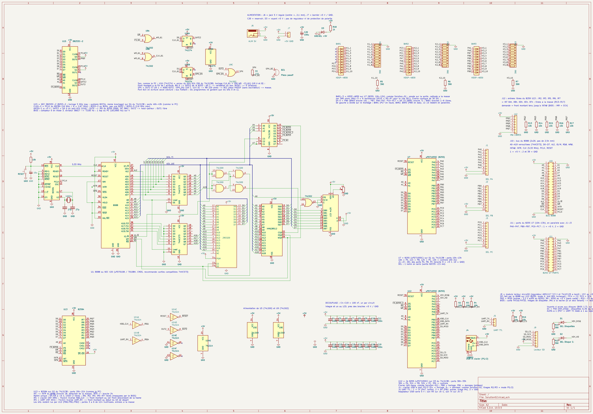
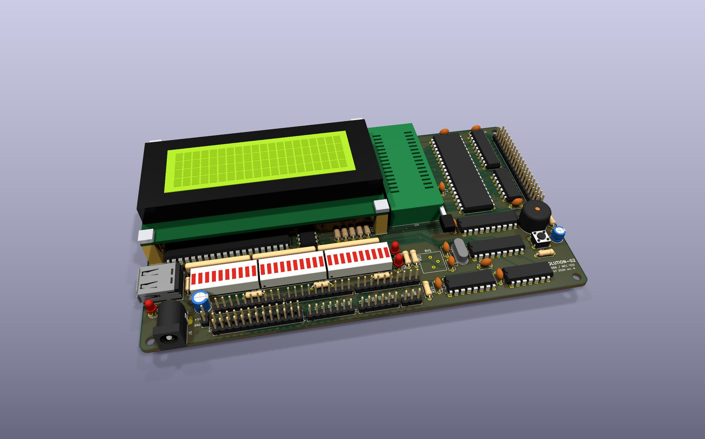
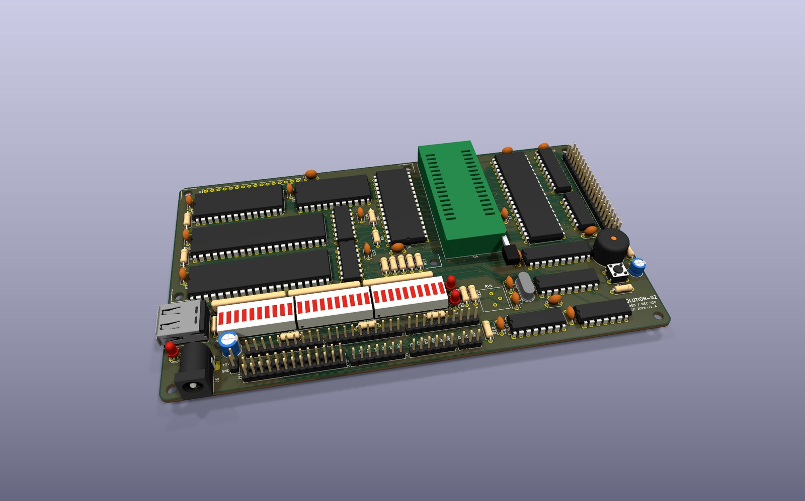
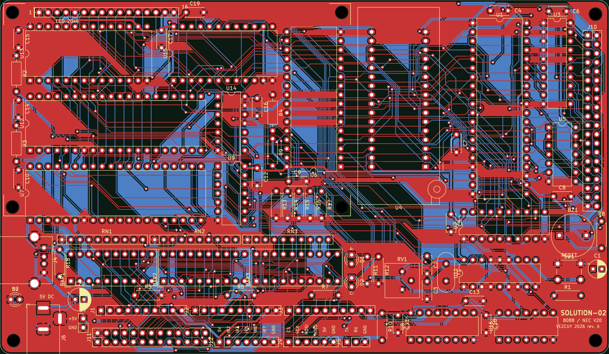

# Solution-02 — ordinateur 8088 / NEC V20 autonome (VE2CUY)

*[English version](README.md)*

Ordinateur 8088 (ou NEC V20) monté sur breadboard, **sans pont STM32** :
le processeur pilote directement son LCD et sa mémoire.

- Horloge : 82C84 + quartz 16 MHz → **5,33 MHz** (16 / 3)
- ROM : 29C020 (W29C020C), 256 Ko
- RAM : HM628512, 512 Ko
- Verrous d'adresses : 2 × 74HC573 (U2 : A0–A7, U3 : A16–A19)
- Décodage : 74LS00 (U5), 74LS138 (U8), 74LS02 (U9)
- Afficheur : LCD 20×4 (HD44780 / ST7066U), bus 8 bits, en écriture seule
- E/S parallèles : 8255 (U7, µPD71055C) en 10h–13h, 24 DEL sur J1–J3
- Clavier et UART : 2e 8255 (U12) en 30h–33h — clavier PS/2 (prise USB-A J4) et UART
  logiciel 9600 8N1 (J5), en bit-bang comme dans Solution-01
- **PC-DOS 2.1 en ROM** : la disquette de 180 Ko est dans la ROM (lecteur A:,
  lecture seule) ; BIOS de type IBM PC (INT 10h, 13h, 16h…) par interruptions
  logicielles, écran DOS de 24 × 80 vu par une fenêtre de 20 × 4 sur le LCD

Schéma : [Solution02.kicad_sch](Solution02.kicad_sch).
PCB : [Solution02.kicad_pcb](Solution02.kicad_pcb) (172 × 100 mm, 2 couches ; voir [PCB](#pcb)).
Journal des étapes : [Directives.md](Directives.md).

<p align="center">
  <a href="medias/schema.png"></a><br>
  <em>Schéma de Solution-02 (cliquer pour l'agrandir).</em>
</p>

## Carte mémoire

| Adresses | Contenu | Sélection |
|---|---|---|
| 00000h–7FFFFh | RAM 512 Ko | CE# = NAND(/A19, M) — U5 broche 8 |
| 80000h–FFFFFh | ROM 256 Ko | CE# = NAND(A19, M) — U5 broche 6 |

A18 n'est pas reliée à la ROM : l'image de 256 Ko apparaît deux fois
(80000h–BFFFFh et C0000h–FFFFFh). Le BIOS occupe les 64 derniers Ko de
l'image (décalage 30000h), vus en **F000:0000**. Au reset, le 8088 démarre
en FFFF:0000 = FFFF0h = F000:FFF0 (décalage 3FFF0h de l'image), où se trouve
un `JMP F000:0000`.

Contenu de la ROM et de la RAM avec le BIOS 2.3 :

| Adresses | Contenu |
|---|---|
| 00000h–003FFh | table des vecteurs d'interruption (remplie par « Load DOS ») |
| 00400h–004FFh | zone de données du BIOS (BDA) : équipement, mémoire, mode vidéo |
| 00500h–5EBFFh | DOS et programmes (**379 Ko** annoncés par INT 12h ; **507 Ko** quand B: est l'image DOS 2.1 de la carte) |
| 5EC00h–5EFFFh | pile privée d'INT 10h (1 Ko, BIOS 2.5 ; en 7EC00h–7EFFFh quand le DOS a 507 Ko) |
| 10000h–1FFFFh | (hors DOS) segment du **BASIC** (menu 6) : programme, variables, pile |
| 5F000h–7EFFFh | **lecteur B:** : disque virtuel de 128 Ko (conservé après Ctrl + Alt + Suppr) |
| 7F000h–7FFFFh | données du BIOS (DSEG = 7F00h) : écran 24 × 80, variables, files, copie du LCD, pile des animations (900h–AFFh), pile du menu |
| C0000h–ECFFFh | **disquette PC-DOS 2.1 réduite** (180 Ko : 40 cylindres, 1 tête, 9 secteurs) = décalage 0 de l'image |
| ED000h–EFFFFh | libre (FFh) |
| F0000h–F7FFFh | BIOS |
| F8000h–FFFEFh | **BASIC** (basic_s02.asm : le BASIC de Solution-01, ~25 Ko) |
| FFFF0h | RESET |

La broche PGM (WE#) de la ROM est au +5 V : une écriture du DOS ou d'un
programme dans la zone de la ROM (par exemple en B8000h, la mémoire vidéo d'un
PC) est sans effet.

## Ports d'E/S (74LS138, U8)

U8 décode **A7 = 0**, **IO/M = 1** (E1# = E2# = A7, E3 = IO/M) et
**A6–A4** (entrées A, B, C). Chaque sortie, active au niveau bas, couvre un
bloc de 16 ports :

| Sortie | Broche U8 | Ports | Usage |
|---|---|---|---|
| O0 | 15 | 00h–0Fh | **LCD (occupé)** : 00h = commande, 01h = donnée (RS = A0) |
| O1 | 14 | 10h–1Fh | **8255 (U7, occupé)** : 10h = PA, 11h = PB, 12h = PC, 13h = contrôle (A0–A1) |
| O2 | 13 | 20h–2Fh | **8259A (U13)** : 20h = ICW1/OCW2/OCW3 (A0 = 0), 21h = ICW2-4/OCW1 (masque) — comme le PC |
| O3 | 12 | 30h–3Fh | **2e 8255 (U12, occupé)** : 30h = PA, 31h = PB, 32h = PC, 33h = contrôle (clavier, UART logiciel, lecteur SD) |
| O4 | 11 | 40h–4Fh | **8253-2 (U15)** : 40h–42h = compteurs 0–2, 43h = mode (A0–A1) |
| O5 | 10 | 50h–5Fh | libre |
| O6 | 9 | 60h–6Fh | **verrou du port 61h (U16)** : bit 0 = GATE2, bit 1 = haut-parleur (écriture seule) |
| O7 | 7 | 70h–7Fh | libre |

À savoir :

- **A0–A3 ne passent pas par le 138.** Elles vont directement au
  périphérique pour choisir ses registres. Un périphérique qui n'en utilise
  que quelques-unes, comme un 8255 (A0–A1), apparaît plusieurs fois dans
  son bloc : 60h–63h, puis 64h–67h, etc.
- **A8–A15 ne sont pas décodées.** Avec `IN/OUT port, AL` (port sur 8 bits),
  elles valent 0. Avec `IN/OUT DX`, chaque bloc se répète tous les 256 ports.
- **Les ports 80h–FFh (A7 = 1) ne sont pas décodés.** Un second 138 activé
  par A7 = 1 et IO/M = 1 fournirait 8 blocs de plus.
- **Pas de RD#/WR# dans le 138.** Ses sorties ne dépendent que de l'adresse.
  Elles conviennent telles quelles au CS# des puces qui reçoivent RD# et WR#
  séparément (8255, 8253, 8259, 16550…). Pour un simple verrou
  (74LS374/573) ou un tampon (74LS244), il faut combiner la sortie avec
  WR# ou RD#, comme pour le LCD : E = NOR(WR#, O0) (U9) et le verrou du port
  61h : horloge = OR(WR#, O6) (U9). Les 4 portes NOR de U9 sont utilisées.
- Le décodage tombe sur les mêmes blocs qu'un PC/XT : un 8259 sur O2, un
  8253 sur O4 et un 8255 sur O6 seraient aux adresses standard (20h, 40h,
  60h), ce qui facilitera un BIOS compatible.

## LCD 20×4

- Bus de données DB0–DB7 relié directement à AD0–AD7 du 8088.
- RS = A0 (verrouillée par U2), E = NOR(WR#, O0) (U9 broche 13).
- R/W à la masse : le drapeau « occupé » ne peut pas être lu, chaque
  écriture est suivie d'un délai logiciel.
- Contraste réglé par RV1 (broche VO).
- L'impulsion E dure environ 2 cycles (≈ 375 ns à 5,33 MHz) : suffisant pour
  un HD44780U (230 ns minimum), à surveiller avec un contrôleur plus lent.

## 8255 (U7) et DEL

8255 CMOS (µPD71055C) sélectionné par **O1** du 74LS138 : ports **10h–13h**
(répétés jusqu'à 1Fh, car seules A0–A1 vont au 8255).

| Broche 8255 | Signal | Vient de |
|---|---|---|
| 34, 33, 32, 31, 30, 29, 28, 27 | D0–D7 | AD0–AD7 du 8088 |
| 9, 8 | A0, A1 | U2 (74HC573) Q0, Q1 |
| 6 | CS# | U8 (74LS138) broche 14 (O1) |
| 5 | RD# | RD# (8088 broche 32) |
| 36 | WR# | WR# (8088 broche 29) |
| 35 | RESET | RESET du 82C84 (U11 broche 10, 8088 broche 21) |
| 26 / 7 | VCC / GND | +5 V / GND (+ 100 nF) |
| 4, 3, 2, 1, 40, 39, 38, 37 | PA0–PA7 | J1 broches 1–8 |
| 18–25 | PB0–PB7 | J2 broches 1–8 |
| 14, 15, 16, 17, 13, 12, 11, 10 | PC0–PC7 | J3 broches 1–8 |

J1, J2 et J3 (1×10) : broches 1–8 = PA/PB/PC 0–7, broche 9 = +5 V,
broche 10 = GND.

DEL : une sortie à 1 allume la DEL si elle est câblée **sortie → 1 kΩ →
anode, cathode → GND** (broche 10). Le 82C55 ne fournit que ~2,5 mA par
sortie : pour des DEL plus brillantes, passer par un ULN2803 ou un 74HC245.

**Bargraphes** (comme Solution-01) : trois HDSP-4830 (BAR1–BAR3) en
parallèle sur J1–J3, câblés en **chaîne contiguë de 30 DEL**, comme les lignes
d'adresse de Solution-01 : anode sur la sortie du 8255, cathode à la masse par
**390 Ω** — segments 1 à 9 par un réseau de 9 résistances à point commun
(RN1–RN3, SIP10), segment 10 par une résistance seule (R5–R7).

| Bargraphe | Broches d'anode 1 → 10 | Cathodes |
|---|---|---|
| BAR1 | 1–6 libres (bits 24–29), 7–10 = PC7 → PC4 | RN1 + R5 |
| BAR2 | PC3 → PC0, PA7 → PA2 | RN2 + R6 |
| BAR3 | PA1, PA0, PB7 → PB0 | RN3 + R7 |

Bit 0 (PB0) = broche 10 de BAR3, bit 23 (PC7) = broche 7 de BAR1 : posés de
gauche à droite (BAR1, BAR2, BAR3, broche 1 à gauche), les bargraphes montrent
la rangée du BIOS (PC7 … PB0) avec les 6 DEL de poids fort éteintes à gauche.
Le courant est limité par la sortie du 82C55 (~2,5 mA) plutôt que par les
390 Ω.

Au RESET, le 8255 met ses 3 ports en entrée (sorties flottantes). Le BIOS
envoie le mot de contrôle **80h** (mode 0, PA, PB et PC en sortie) et éteint
les DEL dès le démarrage, juste après l'initialisation du LCD.

## 8253 (U15) : minuterie

**NEC D8253C-2** (horloge jusqu'à **5 MHz**) sélectionné par **O4** du
74LS138 : ports **40h–43h**, comme le PC (répétés jusqu'à 4Fh). L'horloge est
PCLK du 82C84 (16 MHz / 6 = **2,67 MHz**) : il faut une 8253-2 (5 MHz) ou une
8254 (8 MHz) ; une 8253 ou une 8253-5 ordinaire est limitée à 2,6 MHz. Au
schéma, le symbole est celui de la 82C54 (même brochage). Le BIOS n'utilise
que ce qu'ont toutes ces puces : le mode 3 et le verrouillage du compteur
(mot 00h).

| Broche 8253 | Signal | Vient de / va à |
|---|---|---|
| 8 → 1 | D0 → D7 | AD0–AD7 du 8088 |
| 19, 20 | A0, A1 | U2 (74HC573) Q0, Q1 |
| 21 | CS# | U8 (74LS138) broche 11 (O4) |
| 22 / 23 | RD# / WR# | 8088 broches 32 / 29 |
| 9, 15, 18 | CLK0, CLK1, CLK2 | PCLK : U11 (82C84) broche 2 |
| 11, 14 | GATE0, GATE1 | +5 V |
| 16 | GATE2 | bit 0 du port 61h (U16 broche 5) |
| 10 | OUT0 | IR0 du 8259 (U13 broche 18) : **IRQ0, INT 08h** |
| 17 | OUT2 | haut-parleur (par U14 et U9, voir « Son ») |
| 13 | OUT1 | libre |
| 24 / 12 | VCC / GND | +5 V / GND (+ 100 nF) |

Le BIOS programme le compteur 0 en mode 3 (onde carrée) avec le diviseur
**36617** : IRQ0 à 2 666 667 / 36617 = **72,83 Hz**, soit exactement 4 fois la
cadence du PC (18,2065 Hz, erreur 0,002 %). Un top du PC (compteur du BDA,
INT 1Ch) sur 4.

### Son (compteur 2 et port 61h), comme le PC — pas encore câblé

| Élément | Rôle |
|---|---|
| U16 (74LS74) | **verrou du port 61h** : bascule A = bit 0 (D0) → GATE2 ; bascule B = bit 1 (D1) → validation du haut-parleur (~Q = ~SPK_EN) ; ~PRE à +5 V, ~CLR = ~RESET (silence à la mise sous tension) |
| U9 A, B (74LS02) | horloge du verrou CLK_61 = OR(WR#, O6) : front montant à la **fin** de l'écriture (données stables, maintien du 8088 ≥ 88 ns) |
| U14 C (74LS14) | ~RESET = RESET inversé (le RESET du 82C84 est actif haut) |
| U14 D, U9 C | SPK = NOR(~OUT2, ~SPK_EN) = **OUT2 ET bit 1** |
| R8 220 Ω, BZ1 | **buzzer piézo passif** (sans oscillateur intégré) entre SPK (par R8) et la masse |

Fréquence = 2 666 667 / N (compteur 2 en mode 3) : de **40,7 Hz** (N = 65536)
jusqu'au-delà de l'audible ; la 440 Hz = N 6061 (439,97 Hz). Le port 61h est en
**écriture seule** (une lecture rend le bus flottant) : les programmes du PC font
`IN AL,61h / OR AL,3 / OUT 61h,AL` puis `AND AL,0FCh` ; seuls les bits 0 et 1
comptent, ça marche. **Hauteur des sons des programmes du PC** : ils calculent
N pour une horloge de 1,193 MHz ; ici elle vaut 2,667 MHz, leurs notes sortent
**2,235 fois plus aiguës** (~1 octave + 4 demi-tons ; `BEEP`, `SOUND`, `PLAY` de
BASICA). Les sons du BIOS sont justes.

## 2e 8255 (U12) : clavier PS/2 et UART

8255 CMOS (µPD71055C) sélectionné par **O3** du 74LS138 : ports **30h–33h**
(20h = 8259, U13 ; 40h et 60h restent libres pour un futur 8253 ou 8255 aux
adresses d'un PC/XT). Mot de contrôle **82h** : PA et PC en sortie, PB en
entrée. Mêmes bits que Solution-01 pour le clavier.

| Broche 8255 | Signal | Vient de / va à |
|---|---|---|
| 34, 33, 32, 31, 30, 29, 28, 27 | D0–D7 | AD0–AD7 du 8088 (**dans l'ordre**) |
| 9, 8 | A0, A1 | U2 (74HC573) Q0, Q1 |
| 6 | CS# | U8 (74LS138) broche **12** (O3) |
| 5 / 36 | RD# / WR# | 8088 broches 32 / 29 |
| 35 | RESET | RESET du 82C84 (U11 broche 10) |
| 26 / 7 | VCC / GND | +5 V / GND (+ 100 nF) |
| 18 | PB0 = KBD_CLK | J4 D+ (horloge PS/2), tirage R2 10 kΩ au +5 V |
| 14 | PC0 = AVR_SS | SS de l'ATmega (U17 broche 16), R21 10 kΩ au +5 V — schéma du 2026-11-21 (avant : blocage du clavier, diode non posée) |
| 19 | PB1 = KBD_DATA | J4 D− (données PS/2), tirage R3 10 kΩ au +5 V |
| 20 | PB2 | libre depuis le schéma du 2026-11-21 (était UART_RX) |
| 22 | PB4 = AVR_MISO | MISO de l'ATmega (U17 broche 18), R20 10 kΩ au +5 V — schéma du 2026-11-21 |
| 37 | PA7 | libre depuis le schéma du 2026-11-21 (était UART_TX) |

- **J4, prise USB-A femelle** : pour un clavier USB **à repli PS/2** (la
  plupart des claviers USB ordinaires). VBUS = +5 V, **D+ = horloge,
  D− = données** (comme Solution-01), GND et blindage à la masse. Les tirages R2/R3 sont
  indispensables : c'est en voyant D+ et D− tirés au +5 V que le clavier
  choisit le mode PS/2. Un clavier PS/2 natif se branche sur les mêmes
  signaux (horloge, données, +5 V, GND).
- **J5, UART TTL 5 V** : 1 = TX (sortie), 2 = RX (entrée), 3 = GND. Avec un
  adaptateur USB-série 5 V : **RX de l'adaptateur sur J5-1, TX de
  l'adaptateur sur J5-2**, GND sur J5-3. Terminal : 9600 bauds, 8N1, sans
  contrôle de flux. Depuis le schéma du 2026-11-21, J5 est relié à l'UART de
  l'ATmega U17 (TX = PD1, RX = PD0) et J8 porte RTS/CTS (voir
  [ATmega328P (U17)](#atmega328p-u17--uart-matériel-sur-le-bus-spi--schéma-du-2026-11-21-à-valider)).

### Blocage du clavier (diode sur PC0) — abandonné

Sous DOS, le BIOS n'écoute le clavier que pendant les appels de INT 16h ; à
l'invite, PC-DOS 2.1 boucle sur INT 16h AH=01h puis INT 28h. Une trame qui
commence entre deux appels serait perdue (une touche qui manque, ou un code de
relâchement perdu qui fait répéter la touche). Comme le contrôleur de clavier
du PC/AT, le BIOS (depuis la version 0.6) **bloque l'horloge du clavier** quand il n'écoute pas :
PC0 = 0 tire KBD_CLK à la masse par la diode ; le clavier garde alors ses
touches en mémoire et les envoie dès que l'horloge est relâchée (une trame
interrompue avant son 10e bit est renvoyée). PC0 est commandé par les mots de
mise à 0/1 d'un bit du 8255 (BSR) : PA7 (TX de l'UART) n'est pas touché.

Sans la diode, rien ne change (PC0 n'est relié à rien) : le BIOS compense en
écoutant plus longtemps (~8 ms) quand DOS attend sans rien afficher, mais une
touche peut encore se perdre de temps en temps. **Décision (2026-11-14) : la
diode ne sera pas posée** ; le 8259 (U13, ci-dessous) signale le début de
chaque trame du clavier et de chaque octet de l'UART par une interruption.

## Lecteur de carte SD (J9)

Dans l'esprit des émulateurs de disquette d'époque (Gotek, HxC) : un module
lecteur microSD sur **U12**, le protocole SPI produit **bit par bit par le
8088**, et le BIOS lit la carte (FAT16 ou FAT32) pour démarrer sur une image de
disquette `.IMG`. Aucun microcontrôleur.

| Signal du module (J9) | U12 (8255, mode 0, mot 82h inchangé) | Sens |
|---|---|---|
| 1 CS | **PC4** (broche 13) ; R10 10 kΩ au +5 V (carte désélectionnée pendant le RESET, 8255 en entrée) | sortie |
| 2 SCK | **PC5** (broche 12) | sortie |
| 3 MOSI | **PC6** (broche 11) | sortie |
| 4 MISO | **PB3** (broche 21) ; R9 10 kΩ au +5 V (niveau défini sans carte) | entrée |
| 5 VCC | **+5 V** (le régulateur AMS1117 du module fait le 3,3 V de la carte) | |
| 6 GND | masse | |

Le 74LVC125 du module abaisse CS, SCK et MOSI à 3,3 V ; MISO sort en 3,3 V,
assez pour une entrée du 8255 (seuil 2,2 V). Le clavier (PB0, PB1) ne change
pas. Débit attendu du SPI logiciel : ~60 µs par octet, ~15 Ko/s (une disquette
d'XT : 25 à 40 Ko/s). Depuis le schéma du 2026-11-21, l'ATmega U17 partage SCK
et MOSI (ci-dessous).

### ATmega328P (U17) : UART matériel sur le bus SPI — schéma du 2026-11-21, à valider

L'UART logiciel perd des caractères dès qu'un système garde les interruptions
masquées plus d'environ 50 µs (ELKS : 2 à 3 % des frappes, voir
[elks/](elks/README_fr.md)), et il occupe le 8088 environ 1 ms par caractère
émis, interruptions masquées. Un ATmega328P reprend l'UART : il reçoit et émet
lui-même, garde les octets reçus dans sa RAM, et le 8088 lui parle en SPI, à
son rythme, sur le bus de la carte SD. Il avait été retiré le 2026-11-16 pour
rester dans l'esprit vintage ; il revient pour cette raison, sur le SPI au lieu
de U12 en mode 2 (PC4–PC6 portent maintenant la carte SD).

| ATmega328P (U17, DIP-28 sur support) | Net | Vient de / va à |
|---|---|---|
| 19 PB5 SCK | SD_SCK | U12 PC5 (partagé avec la carte SD) |
| 17 PB3 MOSI | SD_MOSI | U12 PC6 (partagé avec la carte SD) |
| 18 PB4 MISO | AVR_MISO | U12 **PB4** ; R20 10 kΩ au +5 V. Ligne à part : beaucoup de modules microSD ne libèrent jamais leur MISO |
| 16 PB2 SS | AVR_SS | U12 **PC0** ; R21 10 kΩ au +5 V (ATmega non sélectionné pendant le RESET, 8255 en entrée) |
| 14 PB0 (ICP1) / 15 PB1 (OC1A) | UART_RX / UART_TX | J5 broches 2 / 1 (R4 garde RX au repos). **Terminal sur un UART logiciel de l'ATmega** (schéma du 2026-11-22) : capture d'entrée de la minuterie 1 en réception, comparaison de sortie en émission, de 2400 à 115200 bauds, 57600 à la mise sous tension |
| 2 PD0 RXD / 3 PD1 TXD | WIFI_TX / WIFI_RX | USART matériel → **module Grove - UART WiFi V2** (J13, schéma du 2026-11-23) : RXD ← J13-1 (TX du module, 3,3 V) ; TXD → J13-2 (RX du module, adapté à bord) |
| 4 PD2 | IRQ4 | U13 IR4 : front montant = un octet reçu attend |
| 12 PD6 / 13 PD7 | UART_RTS / UART_CTS | J8 broches 1 / 2 (3 = GND) ; R22 10 kΩ tire CTS à la masse (actif sans terminal) |
| 9 / 10 XTAL1 / XTAL2 | AVR_XTAL1 / AVR_XTAL2 | Y2 16 MHz, C21 / C22 22 pF à la masse |
| 1 RESET | AVR_RESET | R19 10 kΩ au +5 V seulement : aucun lien avec le RESET du 8088 |
| 7 VCC, 20 AVCC / 8, 22 GND | | +5 V / masse ; C23 100 nF |
| | | PC0–PC5, PD3–PD5 et AREF libres |

- L'ATmega se programme **hors du montage**, dans le support du TL866 : pas de
  connecteur ISP.
- En esclave SPI, ses broches SPI sont des entrées tant que SS = 1 (MISO
  compris) : aucun conflit avec la carte SD, qui ignore de son côté l'horloge
  tant que son CS = 1. Le micrologiciel ne doit jamais passer en maître SPI.
- U12 garde le mot de contrôle 82h (PC0 en sortie, PB4 en entrée). PA7 et PB2
  sont libres ; la porte U14B (ancien UART_RX inversé vers IR4) est inutilisée,
  entrée à la masse.
- **Micrologiciel** : [arduino/atmega_uart/](../arduino/atmega_uart/README_fr.md),
  protocole SPI version 3 (2026-11-23) : IDENT, ETAT, LIRE, ECRIRE, VITESSE, VIDER pour le
  terminal (00h–05h, comme la version 2), et les mêmes pour le module Wi-Fi (11h–15h).
- Câblé et validé avec le BIOS 2.7 (2026-11-21) ; le BIOS garde l'UART logiciel quand
  l'ATmega est absent. Le PCB (172 × 100 mm) est à reprendre.

### Module Wi-Fi (J13) : Grove - UART WiFi V2 (schéma du 2026-11-23)

L'USART matériel de l'ATmega va au module **Grove - UART WiFi V2** de Seeed (ESP8285,
micrologiciel AT, 115200 bauds) ; le terminal reste sur l'UART logiciel de l'ATmega
(PB0/PB1). Le schéma de l'ESP32 du 2026-11-22 (Q1/Q2, R23–R30, J13 1 × 7) est retiré.

| J13 (1 × 4, ordre du câble Grove) | Net | Module |
|---|---|---|
| 1 (jaune) | WIFI_TX | TX du module (U0TXD, 3,3 V, direct) → PD0 RXD de l'ATmega |
| 2 (blanc) | WIFI_RX | RX du module ← PD1 TXD de l'ATmega (5 V admis : 2N7002 et tirage de 1 kΩ à VCC à bord) |
| 3 (rouge) | +5V | VCC du module (abaisseur ETA3410 à bord, 3 V à 5 V) ; C25 100 µF pour les pointes du Wi-Fi |
| 4 (noir) | GND | GND |

- Branchement direct : le module adapte lui-même son entrée ; sa sortie de 3,3 V dépasse
  le seuil de l'ATmega (VIH = 3,0 V à 5 V). Pas de RTS/CTS : PD3 et PD4 sont libres, et le
  canal 2 de l'ATmega a un tampon de réception de 1 Ko.
- Empreinte : barrette 1 × 4 au pas de 2,54 mm (câble Grove vers Dupont).
- Le BIOS parle au module par le menu **9) Wi-Fi** et par **INT 14h, DX = 1** (COM2).
- **Le module a été regravé en routeur SLIP** (esp_slip_router de martin-ger, 2026-11-23) : SLIP
  à 115200 bauds, module en 192.168.240.1, client en 192.168.240.2, NAT vers le Wi-Fi ; console
  de configuration en TCP sur 192.168.240.1:7777 (`set ssid`, `set password`, `save`,
  `portmap add TCP 23 192.168.240.2 23`…). La gravure s'est faite **à travers la carte** (menu 9,
  Ctrl+B : pont de l'ATmega) avec esptool (`--baud 115200 --before no-reset`, boutons du module
  pour le mode chargement) ; le micrologiciel AT d'origine est sauvegardé dans
  `wifi/sauvegarde/` (hors de git). `wifi/slip_outil.py` parle SLIP depuis un PC à travers le
  pont (ping, console du module), sans pilote ni droits d'administrateur.
- **ELKS en réseau** : voir [elks/README_fr.md](elks/README_fr.md) (`net start slip`).

## 8259A (U13) : interruptions du clavier et de l'UART

8259A sélectionné par **O2** du 74LS138 : ports **20h–21h**, comme dans un
PC (A0 du bus = A0 du 8259). Contrôleur unique (maître) : SP/EN au +5 V,
CAS0–CAS2 libres. Le 8088 n'avait aucune interruption matérielle : **INTR
(broche 18) est détachée de la masse** et reçoit INT du 8259 ; INTA (broche
24, mode minimum) va au 8259. NMI, TEST et HOLD restent à la masse.

| Broche 8259 | Signal | Vient de / va à |
|---|---|---|
| 11, 10, 9, 8, 7, 6, 5, 4 | D0–D7 | AD0–AD7 du 8088 (**dans l'ordre**) |
| 27 | A0 | U2 (74HC573) Q0 |
| 1 | CS# | U8 (74LS138) broche **13** (O2) |
| 3 / 2 | RD# / WR# | 8088 broches 32 / 29 |
| 17 | INT | 8088 broche **18** (INTR) |
| 26 | INTA# | 8088 broche **24** (INTA#) |
| 16 | SP#/EN# | +5 V (maître unique) |
| 12, 13, 15 | CAS0–CAS2 | libres |
| 18 | IR0 = IRQ0 | OUT0 de la 8253 (U15 broche 10) : minuterie |
| 19 | IR1 = IRQ1 | U14 (74LS14) broche 2 = KBD_CLK inversée |
| 22 | IR4 = IRQ4 | PD2 de l'ATmega U17 (octet reçu) depuis le schéma du 2026-11-21 ; avant : U14 broche 4 = UART_RX inversée |
| 20, 21, 23–25 | IR2, IR3, IR5–IR7 | libres : J12 broches 2–6, tirées à la masse par R13–R17 (10 kΩ) ; masquées par le BIOS |
| 28 / 14 | VCC / GND | +5 V / GND (+ 100 nF) |

Le 8259 réagit au **front montant** (mode front, comme le PC) ; or une trame
PS/2 commence par un front **descendant** de l'horloge et un octet série par un
front descendant de RX (bit de départ). **U14 (74LS14, trigger de Schmitt)
inverse donc KBD_CLK** (broche 1 → 2, vers IR1) **et UART_RX** (broche 3 → 4,
vers IR4) ; porte 3 : RESET → ~RESET (broche 5 → 6, verrou du port 61h) ;
porte 4 : OUT2 → ~OUT2 (broche 9 → 8, son) ; portes 5 et 6 inutilisées, entrées
à la masse (VCC broche 14, GND broche 7). Les bits eux-mêmes restent lus par U12 (PB0, PB1,
PB2) : la routine d'interruption lit la trame ou l'octet entier par
scrutation, comme le BIOS 0.7, mais elle démarre dès le premier front, même
quand le DOS ne demande rien (BIOS 0.8). Numéros comme le PC : IRQ1 = INT 09h (clavier),
IRQ4 = INT 0Ch (COM1). Depuis le schéma du 2026-11-21, IR4 vient de l'ATmega
U17 (PD2) : la porte 2 de U14 est inutilisée, entrée à la masse.

À retenir pour le logiciel : le 8259 doit servir l'interruption pendant que
l'entrée est encore haute (horloge du clavier basse, ~40 µs ; bit de départ,
104 µs) ; sinon il produit une interruption « IRQ7 » parasite. Le BIOS doit
donc éviter les longues sections sans interruptions (CLI).

### Calibration de l'UART

L'UART est logiciel : la durée d'un bit dépend du processeur et de son
horloge. `UART_N` (dans `bios.asm`, valeur par défaut 29 pour un 8088 à
5,33 MHz) est une **estimation** à vérifier :

1. Brancher l'oscilloscope sur J5-1 (TX) et redémarrer : la bannière est
   émise juste après le test de la RAM.
2. Mesurer la largeur d'un bit (le plus court palier) : il faut
   **104,2 µs** (9600 bauds).
3. Trop long → diminuer `UART_N` ; trop court → l'augmenter. Une unité
   ≈ 3,2 µs (3 % d'un bit) sur un 8088 à 5,33 MHz. Le récepteur utilise la
   même constante.
4. Recompiler avec la nouvelle valeur, sans modifier le source :
   `make clean && make UART_N=28` (puis graver). Un V20 (instructions plus
   rapides) demande une valeur plus grande.

## Connecteurs d'extension (J10, J11, J12)

Trois barrettes mâles au pas de 2,54 mm donnent accès aux signaux de la carte (sondes,
analyseur logique, extensions). Elles sont au schéma et dans le simulateur ; pas encore câblées
sur le montage.

**J10 (2 × 20) : bus du 8088.** Adresses verrouillées (sorties des 74HC573), données AD0–AD7 et
signaux de commande.

| Broches | Signaux |
|---|---|
| 1 / 2 | +5 V / GND |
| 3–22 | A0–A19 (A0–A7 de U2, A8–A15 du 8088, A16–A19 de U3) |
| 23–30 | D0–D7 |
| 31, 32 | ALE, IO/M# |
| 33, 34 | RD#, WR# |
| 35, 36 | INTA#, INTR |
| 37, 38 | CLK (5,33 MHz, 82C84 broche 8), RESET |
| 39 / 40 | GND / PCLK (2,67 MHz) |

**J11 (2 × 13) : ports du 8255 U7 (10h–13h)**, en parallèle avec J1–J3 (DEL) : 1 = +5 V,
2 = GND, 3–10 = PA0–PA7, 11–18 = PB0–PB7, 19–26 = PC0–PC7.

**J12 (1 × 7) : interruptions libres du 8259 (U13)** : 1 = +5 V, 2 = IR2, 3 = IR3, 4 = IR5,
5 = IR6, 6 = IR7, 7 = GND. Chaque entrée est tirée à la masse par R13–R17 (10 kΩ). Numéros
comme le PC : IR2 = INT 0Ah, IR3 = INT 0Bh, IR5 = INT 0Dh, IR6 = INT 0Eh, IR7 = INT 0Fh.

Pour s'en servir : le 8259 est en mode front ; une demande est un **front montant tenu jusqu'à
INTA**. Le BIOS masque ces entrées (IMR = ECh) et pointe leurs vecteurs sur un IRET seul, sans
EOI : un programme qui les utilise doit installer son gestionnaire, démasquer l'entrée (port 21h)
et envoyer l'EOI (`mov al, 20h` / `out 20h, al`). Sans EOI, l'entrée reste en service et bloque
les entrées de priorité plus basse (dont IR4, l'UART, après IR2 ou IR3). IR7 sert aussi aux
interruptions parasites (gestionnaire `irq_parasite` du BIOS). Le simulateur permet de les
activer et de les déclencher (onglet IRQ).

## BIOS 2.4

Le BIOS 2.4 existe en **français** (`make` : `build/solution-02-bios.bin`) et en **anglais**
(`make en` : `build/solution-02-bios-en.bin`, textes sous `%ifdef LANG_EN`). Gravure :
`make flash FLASH_LANG=fr|en PUCE=ok`. Nouveautés par rapport au 2.3 :

- **Menu 7) : animations des DEL ON/OFF**. Ligne 3 du menu :
  `3) Anim. DEL 7) ON` ou `3) LED Show  7) ON` (anglais), avec `ON` ou `OFF`. Sur OFF, la
  tâche des animations ne reçoit plus la main de l'IRQ0 (`V_LED_OFF`, DSEG 7B8h) : les
  DEL restent éteintes au menu et sous DOS. L'écran du menu 3) les anime toujours
  (`V_LED_ECRAN`, 7B9h). Le réglage revient à ON au démarrage.
- **Menu en français** dans le BIOS français : `1) DOS`, `2) Test memoire`. Le BIOS anglais
  garde `1) Load DOS` et `2) Test memory`. Tous les textes du LCD et de l'UART sont
  traduits, y compris l'accueil ANSI (`accueil_en.inc`, généré par `tests/gen_accueil.py`)
  et le rapport du test de la RAM.
- **Clavier plus robuste** : une trame PS/2 illisible (par exemple arrivée pendant un envoi
  à l'UART, interruptions masquées) remet à zéro les préfixes F0/E0 en attente. Avant,
  si le 2e octet d'un relâchement (`F0 xx`) était perdu, la touche suivante était prise
  pour un relâchement et disparaissait.

Sources : [bios/bios.asm](bios/bios.asm) (démarrage, menu, test de la RAM,
DEL, clavier, UART) et [bios/services.inc](bios/services.inc) (services de
type IBM PC). Déroulement :

1. **Écran d'ouverture** (~2 s) : `SOLUTION-02 BIOS 2.3`,
   `CPU 8088/V20 5.33MHz`, `RAM 512 Ko  LCD 20x4`, `VE2CUY - 2026`.
2. **Vérification rapide** des 4 Ko de données du BIOS (7F000h–7FFFFh) ; en
   cas d'échec, le test complet de la RAM part d'office. Bannière sur l'UART.
   Programmation de la **8253** (compteur 0, mode 3, diviseur 36617) et
   détection : deux lectures verrouillées du compteur, à ~20 µs d'intervalle,
   doivent différer et ne pas dépasser 36617 (sans 8253, le bus flottant rend
   toujours la même valeur).
3. **Menu**, au clavier PS/2 (touches 1 à 5). En entrant au menu, le BIOS
   installe les vecteurs, réinitialise le 8259 et le **détecte** en relisant
   son registre de masque (A5h puis 5Ah) :
   - **8259 présent** : le clavier (IRQ1, INT 09h) et la réception de l'UART
     (IRQ4, INT 0Ch) passent par les **interruptions**. La routine lit la trame
     ou l'octet par scrutation de U12 dès le premier front, le décode et le met
     dans une file (16 touches, 32 octets). Rien n'est perdu pendant que le
     programme fait autre chose (affichage, `DIR`…). IRQ7 (INT 0Fh) compte les
     interruptions parasites (demande retombée avant INTA) ;
   - **8259 absent** (pas encore câblé) : scrutation pendant les attentes,
     comme le BIOS 0.7.

   Avec le 8259 **et** la 8253, IR0 est aussi ouverte : **IRQ0 (INT 08h) à
   72,83 Hz**. IRQ0 envoie l'EOI et rétablit les interruptions tout de suite
   (une demande du clavier retombe en ~40 µs : elle ne doit pas attendre), puis :
   - **temps** : un appel sur 4 = un top du PC (18,2065 Hz) : compteur du BDA
     (0040:006C), passage de minuit (1800B0h tops, 0040:0070), INT 1Ch. L'heure
     du DOS avance (`TIME`, dates des fichiers) ;
   - **animations des DEL en arrière-plan**, partout (menu, Info, DOS…) : les
     animations sont une **tâche** sur sa propre pile ; en attendant son pas
     suivant, elle rend la main à IRQ0 (`tache_cede`), qui la reprend le
     nombre de tops voulu plus tard (3 = ~41 ms, 5 = ~69 ms, 12 = ~165 ms).
     Un pas dure quelques dizaines de µs, interruptions permises.
   - **son** : au premier affichage du menu après le démarrage, une petite
     mélodie (do5, mi5, sol5, do6) ; sous DOS, le caractère **BEL** (07h, écrit
     par INT 10h) donne un bip de 880 Hz, ~0,25 s. Durées comptées en IRQ0 :
     sans 8259 ou sans 8253, pas de son.

```
1) Load DOS 6) BASIC
2) Test memory
3) LED Show
4) Info  5) UART:ON
```

La **console sur l'UART** est à **ON au démarrage** (et après Ctrl + Alt +
Suppr ou le test de la RAM) ; la touche **5** la bascule (`UART:ON` ↔
`UART:OFF`). Elle vaut **dans tous les modes** :

- au premier menu après le démarrage (et à chaque passage à ON), un **écran d'accueil en couleur** (séquences ANSI : écran
  effacé, titre en blanc, adresses du dépôt en rouge, logo « 88 // PC » en vert,
  slogans), inspiré de l'accueil de z/OS ([medias/Z88.png](../medias/Z88.png)),
  sans la section LOGON ; il est généré par `tests/gen_accueil.py`
  (`accueil.inc` ; `--apercu` l'affiche dans la console) ;
- les écrans du BIOS (menu, Info, LED Show) sont recopiés sur le terminal : le
  BIOS garde une copie des 4 lignes du LCD (tenue à jour par `lcd_cmd` et
  `lcd_car`) et l'envoie, sans les espaces de fin, quand l'écran est dessiné.
  Avant l'envoi, il attend que le clavier PS/2 soit calme (~130 ms sans
  trame, au plus ~1 s) : l'envoi masque les interruptions et ferait perdre le
  relâchement de la touche qui vient d'être frappée ;
- les octets reçus deviennent des **touches**, comme celles du clavier PS/2 :
  le menu se pilote au terminal (`1` à `5`), Échap quitte le LED Show… ;
- sous DOS : voir « Console UART » plus bas.

### 1) Load DOS

**Carte SD** (J9) : le BIOS initialise la carte (`Carte SD...`), lit la FAT
(FAT16, ou FAT32 : 1er amas de la racine) et liste les images **`.IMG` de la
racine** (16 au plus). S'il en trouve, il propose le choix :

```
Demarrer : Entree
>ROM PC-DOS 2.1
 PCDOS21.IMG  180K
 DOS33.IMG    720K
```

**↑ / ↓** déplacent le choix (la liste défile), **Entrée** démarre, **Échap**
revient au menu ; recopié sur le terminal quand la console UART est à ON
(flèches ANSI). Sans carte, ou sans image, A: est la disquette en ROM, comme
avant. L'image choisie devient **A:** pour INT 13h, en **lecture et écriture**
(les écritures du DOS vont directement dans le fichier de la carte, comme un
Gotek) :

| Taille du fichier | Format | Secteurs/piste, faces, cylindres | DOS |
|---|---|---|---|
| 160 / 180 Ko | 5¼ simple face | 8 ou 9, 1, 40 | 1.0+ / 2.0+ |
| 320 / 360 Ko | 5¼ double face | 8 ou 9, 2, 40 | 1.1+ / 2.0+ |
| 720 Ko | 3½ DD | 9, 2, 80 | 3.2+ |
| 1,2 Mo | 5¼ HD | 15, 2, 80 | 3.0+ |
| 1,44 Mo | 3½ HD | 18, 2, 80 | 3.3+ |

Refus (message 1 s, retour à la liste) : `Taille inconnue !`, `Image
fragmentee !` (le fichier doit être **d'un seul tenant** : le copier sur une
carte fraîchement formatée), `Erreur de lecture !`. INT 13h AH=08h rend la
géométrie et le type de lecteur (BL) de l'image ; AH=05h (formatage), 16h, 17h,
18h répondent « fait ». Débit du SPI logiciel : ~40 ms par secteur (réception
déroulée, ~12 Ko/s).

**Progression et voyant** : pendant le démarrage depuis une image de la carte
(jusqu'à la première attente d'une touche par le DOS), la ligne 4 du LCD montre
`Lecture A: nnn Ko` et le **bargraphe se remplit** (une DEL de plus tous les
8 Ko, il recommence après 24) ; les animations reprennent ensuite.

**Voyants d'accès** (BIOS 1.7, à part du LED Show) : deux DEL sur **U12** —
**D1 sur PA0** pendant chaque accès à une **disquette** de la carte (A: ou B:),
**D2 sur PA1** pendant chaque accès au **disque dur C:** (390 Ω à la masse,
actives à 1, comme les bargraphes). PA est écrit en entier avec PA7 (TX de
l'UART) au repos à 1 ; `uart_tx`, le seul autre à écrire PA, ne tourne jamais
pendant un accès. (BIOS 1.6 : PC7/PC6 du bargraphe et LED Show suspendu,
abandonné : la combinaison avec les animations portait à confusion.)

**Disque dur C:** (BIOS 1.6 ; plusieurs images au 1.7) : chaque fichier `.IMG`
de la racine **plus grand que 1,44 Mo** est une image de disque dur ; elles
s'ajoutent en bas de la liste (16 lignes au plus en tout, disquettes en tête).
L'image qui sera **C:** (INT 13h DL = 80h) porte un `*` : la première trouvée
au départ, **Espace** sur une autre ligne `C:` la choisit.

```
Demarrer : Entree
 ROM PC-DOS 2.1
 DOS33.IMG    360K
*C:DOS622_C.IMG 31M
>C:FREEDOS_C.IMG 31M
```

C: est monté **après le choix**, quel qu'il soit (ligne 1 : `Verification
C:...` ; la vérification de la FAT, image d'un seul tenant, prend quelques
secondes avec le SPI logiciel ; refus : `Image C: refusee !` et retour à la
liste). **Entrée** sur une ligne `C:` choisit cette image et démarre depuis le
disque dur (MBR → secteur d'amorce de
la partition active, DL = 80h ; A: reste la disquette en ROM). Géométrie :
têtes et secteurs par piste lus à la fin de la 1re partition du MBR (sinon 16 ×
63), cylindres = taille / (têtes × secteurs), 1024 au plus (~504 Mo). Le
fichier doit être d'un seul tenant. BDA 0040:0075 = 1 disque fixe, INT 41h →
table des paramètres (DSEG:0C80h). INT 13h pour C: : AH = 02h, 03h, 04h, 08h,
15h (type 3 et nombre de secteurs), 01h ; 00h, 0Ch, 0Dh, 10h, 11h, 14h
répondent « fait » ; le reste, erreur 01h. Le DOS 3.x et plus voit C: dès son
démarrage, même depuis une disquette.

Images prêtes (dans `PC-DOS/`, **hors de git**, à copier à la racine de la
carte fraîchement formatée), produites depuis les disquettes d'installation :

| Image | Contenu | Générateur |
|---|---|---|
| `DOS622_C.IMG` (32 Mo, FAT16) | MS-DOS 6.22 français installé : `IO.SYS`, `MSDOS.SYS`, `COMMAND.COM`, `CONFIG.SYS`, `AUTOEXEC.BAT` à la racine, tout `C:\DOS` (fichiers `*.??_` décompressés : format KWAJ de MS-DOS 6, noms d'origine par `PACKING.LST`) | `python tests/gen_dos622.py` (archive `.7z` des 4 disquettes) |
| `FREEDOS_C.IMG` (32 Mo, FAT16) | FreeDOS 1.4 version 8086 : `KERNEL.SYS` de l'édition disquette (x86), `COMMAND.COM`, `FDCONFIG.SYS`, `FDAUTO.BAT` ; les 50 paquets BASE de l'édition LiteUSB dans `C:\FREEDOS` (sans sources ni paquets 286/386) | `python tests/gen_freedos.py` (`FD14-FloppyEdition.zip`, `FD14-LiteUSB.zip`) |

Console UART (BIOS 2.0) : INT 10h AH=02h (position du curseur) est recopié au
terminal en déplacement relatif (`ESC [ n A/B/C/D`) et AH=09h/0Ah (caractère à
la position) en caractères suivis d'un retour du curseur ; la position du
curseur est aussi tenue dans le BDA (0040:0050), que FreeCOM lit directement
(sans elle, le retour arrière effaçait au mauvais endroit : un espace au
terminal).

`FDCONFIG.SYS` porte **`STACKS=0,0`** : sans lui, le noyau de FreeDOS détourne
IRQ0, IRQ1 et IRQ4 (INT 08h, 09h, 0Ch) par un relais qui change de pile ; ce
délai fait manquer le bit de départ de l'UART logiciel (octets décalés d'un
bit) et les premiers fronts du clavier PS/2, lus bit par bit dès l'interruption.

Les deux ont un MBR 8086 (`tests/mbr8086.asm` : partition active, CHS, 3
essais) et une partition FAT16 active de 16 têtes × 63 secteurs (bibliothèque
`tests/fatlib.py`). Sans KEYB ni HIMEM (8088).

**Changer la disquette de A:** (BIOS 1.7) pendant que le DOS tourne :
**Ctrl+Alt+Inser** au clavier PS/2 ; sur le terminal (BIOS 2.2) **Ctrl+\**
(1Ch, comme Solution-01), **F12** (`ESC [ 2 4 ~`), Ctrl+] (1Dh) ou
Ctrl+Alt+Inser quand le terminal l'envoie (`ESC [ 2 ; 7 ~`). La
touche ne fait que lever une demande ; la liste (`Disquette A: Entree`, la ROM
et les images de disquette, sans les lignes C:) s'ouvre quand le DOS attend
vraiment une touche, jamais au milieu d'un accès disque : INT 16h AH=00h, ou
(BIOS 1.9) une dizaine d'INT 16h AH=01h de suite sans touche et sans INT 13h
entre eux (le DOS au repos interroge AH=01h en boucle et n'appelle AH=00h qu'une
fois la touche là). La
carte est relue (on peut en changer ; C: et B: gardent la position de leur
image). Entrée monte l'image (ou la ROM) en A:, Échap ne change rien ; le LCD
reprend ensuite l'écran du DOS. INT 13h AH=15h annonce maintenant une **ligne
de changement** pour A: et AH=16h rend « disquette changée » (06h) une fois
après chaque changement : le DOS 3.x et plus relit la FAT. (Le DOS 2.1 n'en
tient pas compte et ne lit que les disquettes 5¼ de 160 à 360 Ko.) Le tampon de
la carte (00500h, au DOS) est sauvé puis remis ; pile propre en DSEG.

**B: = image DOS 2.1 de la carte** : si l'on choisit `ROM PC-DOS 2.1` et que la
carte porte une image PC-DOS 2.x (secteur d'amorce OEM `IBM  2.`, la première
trouvée), elle devient **B:** (lecture-écriture) à la place du disque virtuel en
RAM, et le DOS reçoit **507 Ko** au lieu de 379. On a ainsi, à côté de la
disquette réduite de la ROM, la disquette complète (BASICA, utilitaires, et
DEBUG si on l'y ajoute).

**Disquette de la ROM** (`PC-DOS/pcdos2_1_rom.img`, fabriquée par
`tests/gen_dos_rom.py` à partir de `pcdos2_1.img`) : IBMBIO.COM, IBMDOS.COM,
COMMAND.COM, EDLIN.COM, CHKDSK.COM, FORMAT.COM de PC-DOS 2.1, **MASM.EXE**
(Microsoft MACRO Assembler 1.00, 1981) et **LINK.EXE** (Object Linker 1.08)
de `PC-DOS/MASM/` (MASM1.EXE, LINK1.EXE : les versions pour DOS 1.1/2.x) ;
11 Ko libres. Pas de DEBUG : aucun DEBUG pour DOS 2.x dans le dépôt, et il ne
tiendrait pas (il manquerait 2 amas) ; le mettre sur l'image de la carte (B:).

Le BIOS remplit la table des vecteurs (256 vecteurs vers un `IRET`, puis les
siens), la zone de données (BDA : 2 lecteurs de disquette, vidéo 80 colonnes,
379 Ko), prépare le lecteur B:, vide l'écran et amorce A: (INT 19h : secteur 0
en 0000:7C00). Les
services du BIOS rétablissent les interruptions (STI) : IRQ1 et IRQ4 sont
servies même pendant l'affichage. PC-DOS 2.1 demande la date et l'heure (il n'y a
pas d'horloge sauvegardée : le compteur repart de 0:00:00 ; l'heure tapée est
ensuite tenue par IRQ0), puis affiche `A>`.

**Lecteur B:** : disque virtuel de **128 Ko en RAM** (5F000h–7EFFFh), en
lecture-écriture (`COPY`, `DEL`, `MD`…). Le DOS 2.1 ne connaît que des formats
de disquette fixes : B: est donc un **160 Ko** (descripteur FEh : 40 pistes,
1 face, 8 secteurs) dont seuls les 256 premiers secteurs existent ; les amas
au-delà de 128 Ko (251 à 314) sont **marqués défectueux** dans la FAT, le DOS
ne les utilise jamais (`CHKDSK B:` : 32768 octets dans des secteurs
défectueux ; 127 488 octets libres). À chaque Load DOS, le BIOS garde le
contenu s'il porte sa signature (OEM `SOL02 B:`, 55AAh, FEh dans la FAT),
sinon il le formate (amorce, 2 FAT, répertoire vide). Le contenu survit à
Ctrl + Alt + Suppr, pas à la mise hors tension ni au test de la RAM.

| INT | Service |
|---|---|
| 10h | écran : AH = 00h, 02h, 03h, 06h, 07h, 08h, 09h, 0Ah, **0Eh (télétype, recopié sur l'UART si console ON)**, 0Fh |
| 08h / 1Ch | IRQ0 (8253) : temps et animations ; INT 1Ch à chaque top (18,2 Hz) |
| 11h / 12h | équipement (0061h : 2 lecteurs) / mémoire (379 Ko) |
| 13h | A: **en ROM**, lecture seule : AH = 00h, 01h, 02h, 04h, 08h, 15h, 16h ; écriture/formatage → erreur 03h (protégée). B: **en RAM** : lecture, **écriture** (AH = 03h), formatage sans effet ; secteur au-delà de 128 Ko → erreur 04h. Autre lecteur → erreur |
| 09h / 0Ch / 0Fh | IRQ1 clavier / IRQ4 UART / IRQ7 parasite (8259) |
| 14h | AH = 01h : envoi sur l'UART logiciel ; AH = 02h : octet reçu par IRQ4 (attente ~0,5 s, sinon AH = 80h) ; AH = 03h : état (AH bit 0 = octet en attente) — réception seulement avec le 8259 |
| 16h | clavier : AH = 00h, 01h, 02h, 05h (et 10h–12h) ; AH = code XT, AL = ASCII, comme un PC ; file remplie par IRQ1 (et par IRQ4 si console ON) |
| 15h, 17h | sans objet (pas de services AT, pas d'imprimante) |
| 18h | retour au menu |
| 19h | amorçage de A: |
| 1Ah | compteur de tops du BDA, avancé par IRQ0 (AH = 00h, 01h) ; sans 8253, l'heure ne change pas |

**Écran** : le DOS écrit dans un tampon de **24 lignes × 80 colonnes** (en
7F000h), en mode télétype (retour à la ligne en colonne 80, défilement en bas).
Le LCD montre une **fenêtre de 20 × 4** de ce tampon. Verticalement, elle suit
le curseur : ce sont les dernières lignes écrites par le programme.
Horizontalement, elle ne bouge pas pendant l'affichage : seuls les caractères
de ses 20 colonnes sont envoyés au LCD (les autres ne vont que dans le tampon).
Quand le DOS attend une touche (lecture INT 16h AH=00h, ou 10 appels AH=01h de
suite sans affichage), la fenêtre se place, par pas de 10 colonnes, pour
montrer le curseur s'il est hors champ (par exemple en tapant une commande de
plus de 20 caractères). Le curseur du LCD (souligné) marque la position du
curseur quand elle est dans la fenêtre.

**Navigation** (sous DOS, pendant que le clavier est lu, par exemple à l'invite
`A>`) :

| Touches | Effet |
|---|---|
| Maj (gauche ou droite) + ↑ / ↓ | fenêtre d'une ligne vers le haut / le bas |
| Maj (gauche ou droite) + ← / → | fenêtre de 10 colonnes vers la gauche / la droite |
| Ctrl + Alt + Suppr | redémarrage du BIOS (écran d'ouverture, menu) |

Le prochain affichage ramène la fenêtre sur la ligne du curseur ; la colonne
choisie reste jusqu'à la prochaine attente du clavier qui suit un affichage.
**Caractères accentués** (page de codes 437 du DOS, 80h–FFh) : sur le
**terminal**, convertis en **UTF-8** (comme Solution-01 ; le terminal doit être
en UTF-8, pas en CP437/CP850) ; sur le **LCD**, dont la ROM (A00) n'a pas ces
lettres, les 8 caractères programmables (CGRAM, chargés par `ecran_init`)
dessinent **é è ê à ç ù ô** et la **barre oblique inverse** (BIOS 1.8 : la ROM
A00 a le symbole yen en 5Ch, d'où un caractère japonais à la place de `\` ; â
devient a pour lui laisser sa place) ; les autres lettres perdent leur accent
(ë → e, ü → u…), quelques symboles viennent de la ROM du LCD (α β µ π Σ ° ÷ √ █)
et les cadres deviennent `+ - | =`. Le tilde (7Eh) reste une flèche → (ROM A00).

**Maj inverse Verr Num**, comme sur un PC : Maj + une touche de déplacement du
pavé numérique (8 2 4 6, 7 1 9 3, 0 .) donne la fonction de curseur (flèche,
Début, Fin, Page…, Inser, Suppr) et non le chiffre. La navigation marche donc
aussi avec les flèches du pavé, et quand le préfixe E0 d'une flèche est perdu
(le BIOS 1.4 et avant écrivait alors « 8 », « 2 »… à l'invite).
La Maj est aussi reconnue par le « relâchement factice » (E0 F0 12h ou
E0 F0 59h) que le clavier envoie juste avant la flèche : la navigation marche
même si l'appui de Maj a été perdu (montage sans diode).

**Console UART** sous DOS (menu 5 à `UART:ON`, terminal 9600 8N1 sans écho local) :

- **sortie** : chaque caractère écrit par INT 10h en télétype (AH = 0Eh, ce
  qu'utilise le DOS) part aussi sur TX, tel quel (CR, LF, BS, BEL ; les
  séquences `ESC [ …` de `CLS` sont donc comprises par le terminal) ;
- **entrée** (avec le 8259) : les octets reçus par IRQ4 deviennent des
  touches d'INT 16h, mêlées à celles du clavier PS/2. CR → Entrée, BS ou DEL
  → retour arrière, TAB, ESC ; LF et NUL ignorés. Séquences ANSI du terminal
  (envoyées d'un trait, lues dans IRQ4 par scrutation) : `ESC [` ou `ESC O`
  suivi de A/B/C/D (flèches), H/F (Début/Fin), P/Q/R/S (F1–F4), ou de 1 à 6
  puis `~` (Début, Inser, Suppr, Fin, Page préc./suiv.). ESC seul (rien dans
  les ~2,7 ms) : Échap.

À `UART:OFF`, rien du DOS ne passe par l'UART (INT 14h reste disponible). Limites
de la console : l'UART est logiciel, chaque caractère envoyé prend ~1 ms
**interruptions masquées** : l'affichage est plus lent (`DIR` : ~1,5 s de plus pour ~1 400 caractères)
et une trame du clavier PS/2 ou un octet reçu qui commence pendant un envoi
peut être perdu (un relâchement de touche perdu peut doubler la touche) ; un
texte collé dans le terminal pendant que le DOS l'écrit en écho perd des
caractères. Sans 8259 : sortie seulement. Ctrl + Alt + Suppr remet la console à
OFF. Une puce UART (8250/16550) est prévue pour la suite.

Limites : pas d'horloge sauvegardée (l'heure repart de 0 à chaque démarrage),
sons des programmes du PC trop aigus (voir « Son »), pas de mémoire vidéo (un programme
qui écrit directement en B800h n'affiche rien), A: en lecture seule (`COPY`,
`DEL`… vers A: → « Write protect error » ; utiliser B:), disposition de
clavier US.

### CP/M-86 (BIOS 2.5)

CP/M-86 pour l'IBM PC passe par le BIOS (INT 10h, 13h, 16h) : il tourne sur la carte.

- **Disque dur** : copier `PC-DOS/CPM86_C.IMG` (30 Mo, hors de git) sur la carte SD,
  puis 1) Load DOS → ligne `C:CPM86_C.IMG` → Entrée : *Loading CPM.SYS...*, invite `C>`.
  CP/M-86 1.1 pour PC/XT (Digital Research, 1983), installé dans le simulateur comme sur
  un XT : HDMAINT (partition CP/M de type DBh, cylindres 0–15, 8064 Ko, 896 entrées de
  répertoire, testée), PIP de tous les fichiers de la disquette (CPM.SYS, ASM86, DDT86,
  ED, PIP, STAT, SUBMIT, HDMAINT, SETUP…) et HELP.CMD/HELP.HLP de la 2e disquette DRI,
  partition rendue amorçable. CP/M-86 ne lit pas plus de 8 Mo par volume : les
  cylindres 16–60 (≈ 22 Mo) restent libres (Concurrent CP/M-86 ou une partition DOS).
- **Disquettes** : `PC-DOS/CPM86_11.IMG` (1.1, 320 Ko, amorçable) et `PC-DOS/CPM86.IMG`
  (1.0, 160 Ko) ; Ctrl+\ change la disquette de A: (puis Ctrl+C sous CP/M).
- **Terminal** : la ligne d'état de CP/M (25e ligne : heure, date) n'est pas affichée ;
  HDMAINT et SETUP se servent de F1–F10 (PuTTY : `ESC [ 11 ~`…`21 ~` ou `ESC O P`…`S`).
- Les tests de surface de HDMAINT (lecture/écriture de chaque cylindre par la carte SD)
  prennent ~7 min par cylindre sur le montage.

### ELKS (sous-ensemble de Linux, simulateur)

[ELKS 0.9.2](https://github.com/ghaerr/elks) recompilé pour la carte (console par le
BIOS, EOI du 8259 au début des interruptions pour l'UART logiciel) : sources, correctif
et script de construction dans [elks/](elks/README_fr.md). Au simulateur, il démarre
jusqu'à `login:` (`root`, sans mot de passe). Avec l'UART logiciel, environ 2 à 3 % des
caractères tapés se perdent encore (couper d'abord les animations des DEL, touche 7) ;
avec l'ATmega U17 et le BIOS 2.7, aucun (lignes tapées ou collées). QNX 2.15C et PC/IX ne
tournent pas : ils pilotent eux-mêmes la carte vidéo, le contrôleur de disquette et le
clavier du PC.

### Terminal par l'ATmega U17 (BIOS 2.7)

Le BIOS 2.7 (`avr.inc`) détecte l'ATmega328P à la mise en route (IDENT : `A5h 'S' '2'`).
Sans lui, l'UART logiciel du BIOS 2.6 reste (PA7, PB2) : **une seule ROM pour les deux
cartes**. Avec l'ATmega :

- **Émission** : `uart_tx` devient une transaction ECRIRE (~0,3 ms, interruptions
  permises) au lieu de 1 ms interruptions masquées ; si l'ATmega est plein (terminal qui
  retient RTS), il réessaie ~1,3 s.
- **Réception** : IRQ4 note seulement qu'un octet attend (`irq_uart_avr`). Les octets sont
  lus au premier plan quand on consulte les files (`file_regarde`, `file_retire`,
  `ufile_retire` → `avr_service`), seulement autant que la file du BIOS peut en prendre :
  le reste attend dans l'ATmega (1 Ko), qui retient le terminal par RTS. Séquences ANSI et
  UTF-8 : les octets suivants sont demandés à l'ATmega (`avr_suivant`, ~5 ms).
- **Bus SPI partagé** : aucune transaction SPI en interruption. Une transaction ne commence
  que si aucune autre n'est en cours et que la carte SD est désélectionnée (U12 PC4 = 1 :
  tout accès à la carte finit par `sd_libere`). Sinon (INT 10h appelé depuis une
  interruption au milieu d'un accès SPI), l'octet à émettre est abandonné et compté.
- `kbd_libere` / `kbd_bloque` ne touchent plus PC0 (devenu le SS de l'ATmega) ; à la mise
  en route, PC est mis à 51h juste après le mot de mode (carte SD et ATmega désélectionnés).
- INT 14h AH=00h ne change pas la vitesse : PC-DOS met ainsi AUX à 2400 bauds au
  démarrage, ce qui couperait la console du terminal.
- **Menu 8) vitesse de l'UART** : un sous-menu (LCD et terminal) montre la vitesse en
  service et 1) 9600, 2) 19200, 3) 38400, 4) 57600, 5) 115200 ; Échap revient sans rien
  changer. Le menu l'affiche en ligne 2 (`2)RAM 8)19200 9)WiFi` ; 115200 s'y écrit `115k2`). La nouvelle vitesse est annoncée au terminal à l'ancienne
  (« UART : 19200 bauds (regler le terminal) »), puis l'ATmega change quand tout ce qui attend
  est parti. Gardée au RESET et à Ctrl+Alt+Suppr (l'ATmega n'est pas remis à zéro ; le
  micrologiciel rend sa vitesse par IDENT) ; mise sous tension = **57600** (micrologiciel
  version 3, BIOS 2.9 ; 9600 avant). Au-dessus de 9600, activer le contrôle de flux RTS/CTS du
  terminal pour coller du texte : le BIOS lit environ 3 Ko/s dans l'ATmega.
- **Menu 9) Wi-Fi, Ctrl+B = pont** (BIOS 3.0, micrologiciel version 4) : le terminal passe à
  115200 bauds et parle directement au module (gravure par esptool, configuration) ; Échap au
  clavier PS/2 termine le pont et rend la vitesse d'avant. Pendant le pont, le BIOS n'envoie
  rien au terminal.
- **Menu 9) Wi-Fi** (BIOS 2.9, micrologiciel version 3) : le terminal et le clavier PS/2
  parlent au module Grove - UART WiFi V2 (commandes AT à 115200 bauds). Les touches vont au
  module (Entrée = CR LF, retour arrière transmis) ; ce qu'il rend va tel quel au terminal (il
  renvoie lui-même l'écho : ATE1) et, ligne par ligne, aux lignes 2 et 3 du LCD ; la commande
  tapée s'affiche en ligne 4 après `>`. Échap revient au menu. Exemples : `AT`, `AT+GMR`,
  `AT+CWMODE_CUR=1`, `AT+CWJAP_CUR="reseau","mot de passe"`, `AT+CIFSR`.
- **INT 14h, DX = 1** (COM2) = module Wi-Fi : AH = 01h envoie AL, AH = 02h rend l'octet le plus
  ancien (attente ~0,5 s, puis AH = 80h), AH = 00h/03h rend l'état (AH bit 0 = octet en
  attente). Sans ATmega de version 3 : AH = 80h. DX = 0 (COM1) reste le terminal.
  Par blocs (BIOS 3.1) : AH = 08h lit au plus CX octets (1 à 255) vers ES:BX sans attendre,
  AH = 09h envoie CX octets de ES:BX (attend la place, ~1 s au plus) ; CX = octets traités,
  une transaction SPI pour jusqu'à 255 octets. Utilisé par le pilote `ttyS1` d'ELKS.
- Info (menu 4) : ligne 3 = diagnostic de l'ATmega `AVR02 L0200 P00 FC0` (version, place libre
  dans l'ATmega, octets abandonnés par le BIOS, drapeaux d'ETAT : C0h = CTS et RTS actifs,
  02h = erreurs de trame).
- Sans 8259 (panne), l'ATmega est interrogé à chaque consultation des files ; l'attente
  du LED Show ne le lit pas.

### 2) Test memory

BIOS 2.3 (`ramtest.inc`) : le **test exhaustif de Solution-01** (`test_ram`,
`test_ram_map`, `test_ram_loop`), rapport complet sur l'**UART** (toujours) et
progression sur le **LCD**. Sous-menu : **1) Trace** (une ligne par bloc de
1 Ko : plage, adresse physique en binaire, OK/DEFAUT, Ko testés ; chaque octet
défectueux détaillé : adresse, attendu, lu), **2) MAP** (mêmes essais, carte
et bilan à la fin, LCD tous les 64 Ko), **3) Loop** (MAP en boucle ; Échap,
pressé pendant une passe, l'arrête à la fin de la passe ; bilan des passes).
Échap : menu. LCD : `Bloc:NNN/512 Def:NNN`, la plage et l'état du bloc (Trace),
les lignes d'adresse, puis `RAM OK` ou `RAM DEFECTUEUSE`.

Non destructif (chaque octet est sauvé puis remis), dans cet ordre :

1. **Lignes d'adresse A0–A18** d'abord (écritures par DS avec IF = 1,
   relectures par ES avec IF = 0, comme Solution-01 : base 35555h et ses 19
   voisines ; la ligne fautive est nommée, même quand la base est écrasée).
   En défaut, deux adresses se recouvrent : l'essai octet par octet écrirait
   aussi dans la table des vecteurs et dans DSEG (pile du BIOS) ; il est
   **sauté** (message), au lieu de planter.
2. **00000h–7EFFFh octet par octet**, 4 motifs (AAh, 55h, 00h, FFh) ;
   interruptions masquées pendant le segment 0 (vecteurs, BDA, carte en
   0000:8000h), permises ailleurs (les gestionnaires n'utilisent que DSEG).
3. **DSEG** (7F000h–7FFFFh, 4 Ko : données, écran et pile du BIOS) : pile
   déplacée dans un bloc bas trouvé bon, aucun appel pendant l'essai, défauts
   notés (64 au plus) puis rapportés.
4. **Carte mémoire** (8 lignes de 64 blocs : `.` bon, `X` défectueux, `R` non
   testé) et bilan (Ko testés, bons, défectueux, octets défectueux).

Le **test au démarrage** ne change pas : vérification rapide de DSEG, et test
complet sans pile (LCD) si DSEG est défectueux.

### 3) LED Show

9 animations en boucle sur les 24 sorties du 8255 U7 (bargraphes BAR1–BAR3),
vues comme une seule rangée disposée ainsi sur le montage, de gauche à droite :
**PC7 … PC0, PA7 … PA0, PB7 … PB0**. Un cycle complet dure ~35 s.

Avec la 8253, les animations tournent **en permanence, en arrière-plan**
(IRQ0), depuis le démarrage : au menu, sous DOS, partout. Le menu 3 n'est que
leur **écran** : nom de l'animation en cours et nombre de cycles complets
depuis le démarrage, et le terminal ci-dessous. **Échap** ramène au menu (les
DEL continuent). Sans 8253 : les animations tournent seulement dans le menu 3,
au premier plan, comme avant.

| Animation | Effet |
|---|---|
| Chenillard | une DEL parcourt la rangée de gauche à droite (2 tours) |
| Balayage | 3 DEL font l'aller-retour, de gauche à droite puis retour (3 fois) |
| Remplissage | la rangée se remplit de gauche à droite, puis se vide (2 fois) |
| Explosion | 2 DEL partent du centre vers les bouts, puis reviennent (2 fois) |
| Alternance | damier qui s'inverse (10 pas lents) |
| Compteur/Gray | PB (droite) = compteur binaire, PA (centre) = son code de Gray, PC (gauche) = compteur / 8 |
| Ports C A B | PC, PA puis PB allumés à tour de rôle (de gauche à droite), puis tout clignote |
| Etincelles | DEL allumées au hasard (~1 sur 4) |
| Vu-metre | une barre partie de la gauche (0 à 24 DEL) monte et descend vers des niveaux aléatoires |

Pendant les animations, terminal clavier / UART :

- **touche** → ligne 3 du LCD et envoi sur l'UART (Entrée = CR LF et
  efface la ligne, retour arrière = efface le dernier caractère,
  flèches = séquences ANSI `ESC [ A/B/C/D`) ;
- **octet reçu sur l'UART** → ligne 4 du LCD et **écho** sur l'UART.

Écran : `LED SHOW  Echap=menu`, le nom de l'animation et le nombre de cycles
complets, puis `Clavier PS/2 >` et `UART 9600 8N1 >`, remplacés par le texte
au premier caractère.

Avec le 8259, les touches et les octets reçus arrivent par IRQ1/IRQ4 et sont
traités par l'écran du LED Show. Console UART à ON : les octets reçus sont des
touches (ligne 3 et écho), pas la ligne 4. Limites : l'envoi d'un caractère
sur l'UART masque les interruptions (~1 ms) : une trame du clavier ou un octet
qui commence à ce moment peut être perdu (ou donner une IRQ7 parasite), de même
qu'un octet reçu pendant la lecture d'une trame du clavier (et inversement).
Sans 8259 : scrutation, une touche frappée pendant l'envoi d'un caractère ou le
changement d'animation peut être perdue.

### 6) BASIC

Le **BASIC « GW-BASIC-like » de Solution-01** (`Solution-01/lib/basic*.asm`,
inchangé), assemblé à part par `basic_s02.asm` (`build/basic_s02.bin`,
F000:8000) avec une couche d'adaptation : affichage par **INT 10h** (écran
24 × 80, fenêtre du LCD avec Maj + flèches, et le terminal si la console est à
ON), clavier par **INT 16h** (clavier PS/2 et terminal), heure de **TIME$** et
**TIMER** tirée du compteur de tops du BDA (IRQ0), date en RAM. Son segment est
10000h (libre hors DOS). Bannière `VE2CUY 86 BASIC Version 1.0 (inspired by
GW-BASIC)`, puis `Ok` ; **SYSTEM** ramène au menu.

**Terminal** (BIOS 2.2) : les caractères UTF-8 envoyés par le terminal (2 ou 3
octets, PuTTY) deviennent ceux de la page de codes 437 du DOS (à → 85h…),
l'inverse de l'affichage ; chaque octet d'une séquence (UTF-8, `ESC [ …`) est
lu aussitôt, le suivant arrivant 3/4 de bit plus tard. **Ctrl+Alt+Suppr** au
terminal : `ESC [ 3 ; 7 ~`. Les messages du chargement (`Carte SD...`,
`Verification C:...`, `Lecture : nnn Ko` tous les 64 Ko, refus) vont aussi au
terminal.

**Fichiers** (BIOS 2.0, `fs_s02.inc`) : à la place du pont STM32 de Solution-01
(même API `fs_*`, voir `Solution-01/lib/bridge.asm`), un petit système **FAT12**
(racine seulement, un fichier ouvert à la fois) sur la **disquette A:** par
INT 13h : `SAVE`, `LOAD`, `MERGE`, `RUN "f"`, `FILES` (avec l'espace libre),
`KILL`, `OPEN`/`PRINT#`/`WRITE#`/`INPUT#`/`LINE INPUT#`/`CLOSE`, `FORMAT "YES"`
(vide la FAT et la racine, garde le BPB), `DSKREAD`/`DSKWRITE` (secteur LBA).
Données en 20000h (FAT et racine entières, tampon d'un secteur) ; la disquette
est relue à la première opération et après un changement (INT 13h AH=16h). A:
est l'image de la carte choisie (Load DOS, **Ctrl+Alt+Inser** ou Ctrl+] au
terminal, ou `BOOT "NOM.IMG"`) ; sinon la disquette en ROM, en lecture seule
(écrire donne *Disk I/O error*). `USB ON/OFF` : *Device unavailable*.

**Charger une disquette** : Ctrl+Alt+Inser (liste des images de la carte) ;
`BOOT "NOM.IMG"` monte l'image (INT 13h **AH=F0h**, propre au projet comme à
Solution-01 ; « .IMG » ajouté sans point ; AH=F1h : la ROM) puis démarre dessus
(INT 19h prépare d'abord le DOS comme Load DOS : BDA, vecteurs, B:).

**Flèche haut** (rappel de la dernière commande au prompt) : les touches
étendues d'INT 16h (flèches, Début, Fin) deviennent les séquences ANSI que
l'éditeur de ligne du BASIC attend (`ESC [ A`…), au clavier PS/2 comme au
terminal.

### 4) Info (SysInfo)

Version du BIOS, processeur (**8088** ou **NEC V20**, reconnu par
l'instruction AAD : le V20 ignore son opérande), mémoire et ROM, et en ligne 4 :
`8259+8253 OK I7 nnnn` (nombre d'IRQ7 parasites, en hexadécimal, depuis le
démarrage), `8259 OK  8253 absent` ou `8259 absent (scrut.)` (le BIOS 1.0
écrivait « 8254 »). Une touche ramène au menu.

### Clavier

Disposition **US** (tables `clavier_us.inc`, générées par
`tests/gen_clavier.py` : ASCII sans et avec Maj, et code XT rendu dans AH par
INT 16h), Maj, Ctrl (Ctrl+lettre = 01h–1Ah), Alt (ASCII 0), Verr Maj (sans
voyant), pavé numérique (Verr Num supposé actif), touches de fonction F1–F12,
flèches, Inser, Suppr, Début, Fin, Page préc./suiv. (ASCII 0, code XT dans
AH). Les Maj « factices » que le clavier envoie autour des flèches (E0 12,
E0 F0 12) sont ignorées.

Écran du test :

| Ligne | Pendant le test | RAM bonne | RAM défectueuse |
|---|---|---|---|
| 1 | `TEST MEMOIRE 512 Ko` | `MEMOIRE 512 Ko : OK` | `RAM DEFAUT  CPT nnnn` |
| 2 | `Ko: nnn  Defauts nnn` (Ko testés, Ko défectueux) | idem | idem |
| 3 | — | `Adresses A0-A18: OK` | `Adresses: ERR Ann` ou `Adresses: ERR base` |
| 4 | premier défaut : `ERR aaaaa ee/ll` | `PILE OK  Touche=menu` | premier défaut |

Le compteur hexadécimal (CPT) montre que le processeur tourne malgré le défaut. Lecture des
erreurs :

- `ERR aaaaa ee/ll` : premier octet fautif, à l'adresse physique aaaaa ;
  ee = valeur attendue, ll = valeur lue. Si ee et ll diffèrent d'un seul bit,
  vérifier la ligne de données correspondante ;
- `Adresses: ERR Ann` : ligne d'adresse Ann coupée, collée ou en
  court-circuit ;
- `Adresses: ERR base` : la case de base ne retient rien (RAM absente ou
  non sélectionnée).

Le simulateur (`make test`, [bios/tests/sim.py](bios/tests/sim.py)) modélise le
LCD, les deux 8255, un **vrai clavier PS/2** et l'UART (la trame part à son
heure, que le BIOS écoute ou non ; perdue si PB n'est pas lu pendant la trame),
le **8259** (ICW, masque, EOI, mode front : demande mémorisée au front montant,
valable seulement si l'entrée est encore haute ; INT levée jusqu'à INTA ; IRQ7
parasite sinon) relié par le 74LS14 (IR1 = horloge inversée, IR4 = RX
inversée), la **8253** (compteur 0, lecture verrouillée, OUT0 en onde carrée
vers IR0 ; 8 périodes de PCLK par instruction ; diviseurs du compteur 2 notés),
une **carte SD** sur le SPI de U12 (`CarteSD` : CMD0, 8, 9, 16, 17, 24, 55, 58,
ACMD41 ; contenu creux fabriqué par `tests/gen_sd.py` : SDHC de 64 Mo en FAT32,
MBR et partition en 2048, images d'un seul tenant ou fragmentées),
le port 61h, les interruptions matérielles
servies entre deux instructions quand IF = 1 (pas juste après STI), et
l'aiguillage des interruptions logicielles du mode réel. 25 scénarios : démarrage et
menu (pile, bannière UART) ; Test memory avec RAM saine puis retour au menu ;
cellule 7B3FFh défectueuse, RAM absente (test complet d'office), ligne A15
coupée, puce de 128 Ko ; LED Show (24 DEL vues allumées et éteintes) en
arrière-plan (IRQ0) et **sans 8253** (premier plan) ;
terminal (Maj+a, b, 1, retour arrière, flèche haut, « Hi » reçu, Échap) ;
Info avec 8259 et 8253, **sans 8259** (repli sur la scrutation) et **sans
8253** ; **console UART hors DOS** (menu et Info recopiés sur TX, menu piloté
au terminal) ; **son** (mélodie de démarrage : diviseurs 5096, 4045, 3401,
2548 et port 61h à 3 puis 0 pour chaque note, la dernière plus longue) ; **Load DOS** :
PC-DOS 2.1 (disquette réduite : MASM, LINK…) démarre depuis la ROM, date et heure (Entrée), `DIR`, Maj + ↑ ×3 et
Maj + →, saisie longue, Ctrl + Alt + Suppr, avec vérification qu'aucune trame
du clavier n'est perdue avant Ctrl + Alt + Suppr, qu'aucun vecteur non géré
n'est appelé et qu'aucun `OUT` du DOS n'atteint le LCD ou les 8255 ; **frappe
anticipée** : `rem abc` tapé pendant que `DIR` s'affiche apparaît à l'invite
suivante (IRQ1) ; **console UART** : menu 5 (`UART:ON`), Load DOS, date,
heure, `DIR` tapés au terminal, flèche gauche ANSI (`ESC [ D` d'un trait) et
Échap seul, avec la sortie du DOS vérifiée sur TX ; **temps** : `TIME` après
`DIR` donne une heure qui a avancé, et les DEL changent sous DOS ; **lecteur
B:** : `COPY EDLIN.COM B:` puis `DIR B:` (122 880 octets libres) ; **BASIC**
(menu 6, `PRINT 2+3` au terminal, `SYSTEM`) ; **Maj + flèche sans E0** puis
Maj + 8 du pavé : la fenêtre remonte, aucun chiffre ; **accents** (`PRINT
CHR$(130);CHR$(135);CHR$(129)` : UTF-8 sur le terminal, CGRAM sur le LCD) ; **ROM + carte** : B: = l'image
PC-DOS 2.1 de la carte (`DIR B:` montre BASICA.COM) et 507 Ko pour le DOS ; **carte
SD** : Load DOS, choix de `PCDOS21.IMG` (flèche bas au terminal, Entrée), le DOS
démarre depuis la carte, `dir > liste.txt` écrit dans l'image (relue sur la
carte), l'autre image intacte ; **image fragmentée** refusée. La ROM de
diagnostic a son scénario : `python tests/sim.py build/solution-02-diag-sd.bin
diagsd` (carte à 2 images, puis sans carte). Réception UART sous DOS par INT
14h AH=02h : pas encore de scénario.

Commandes (depuis `bios/`) :

```sh
make            # build/solution-02-bios.bin (image de 256 Ko)
make test       # simulateur tests/sim.py (25 scénarios, ~30 min ; un seul : python tests/sim.py build/solution-02-bios.bin dos)
make diag       # ROM de diagnostic du 8255 U7 (écritures en rafale) ; graver : make flash PUCE=ok GRAVER=diag
make diag2      # ROM de diagnostic de U12 (PC/PA clignotent, PB et trames PS/2 au LCD) ; GRAVER=diag2
make flash FLASH_LANG=en PUCE=ok   # graver la ROM anglaise (build/solution-02-bios-en.bin) sur la W29C020C
make flash FLASH_LANG=fr PUCE=ok   # graver la ROM française (build/solution-02-bios.bin) ; fr par défaut
make flash PUCE=ok GRAVER=diagsd   # graver la ROM de diagnostic de la carte SD (aussi diag, diag2)
```

La gravure passe par le TL866CS et minipro sous WSL (USB rattaché par `usbipd`, fait par
`make flash`). Insérer d'abord la puce dans le support ZIF : sans `PUCE=ok`, `make flash`
n'affiche qu'un rappel. La commande exécutée, utilisable directement depuis un shell WSL
dans `bios/` :

```sh
MINIPRO_HOME=~/minipro ~/minipro/minipro -p W29C020C -u -w build/solution-02-bios-en.bin
```

Un échec de vérification ponctuel se règle en regravant.

## Câblage de la RAM (HM628512, U6)

| Broche RAM | Signal | Vient de |
|---|---|---|
| 12, 11, 10, 9, 8, 7, 6, 5 | A0–A7 | U2 (74HC573) Q0–Q7 |
| 27, 26, 23, 25, 4, 28, 3, 31 | A8–A15 | 8088 broches 8, 7, 6, 5, 4, 3, 2, 39 |
| 2, 30, 1 | A16, A17, A18 | U3 (74HC573) Q4, Q5, Q6 |
| 13, 14, 15, 17–21 | DQ0–DQ7 | AD0–AD7 du 8088 |
| 22 | CE# | U5 broche 8 (NAND(/A19, M)) |
| 24 | OE# | RD# (8088 broche 32) |
| 29 | WE# | WR# (8088 broche 29) |
| 32 / 16 | VCC / VSS | +5 V / GND |

Attention : sur la RAM, A14 est à la broche 3 et A15 à la broche 31 ; sur la
ROM, A14 est à la broche 29 et A15 à la broche 3.

## À Réaliser plus tard

### Carte SD (accès à des fichiers)

Une carte SD peut être reliée sans nouvelle puce logique : on la pilote en
**mode SPI, en bit-bang**, avec les broches libres du 2e 8255 (U12,
30h–33h). Il faut 3 sorties (SCK, MOSI, CS#) et 1 entrée (MISO), ce que
donne déjà le mot de contrôle **82h** (PA et PC en sortie, PB en entrée).
Aucun changement au décodage, rien de plus sur le bus ; O4–O7 du 74LS138
restent libres.

Broches libres de U12 :

| Port | Déjà pris | Libre |
|---|---|---|
| PA (sortie) | PA7 = UART TX | PA0–PA6 |
| PB (entrée) | PB0 horloge clavier, PB1 données, PB2 UART RX | PB3–PB7 |
| PC (sortie) | — (diode de PC0 non posée) | PC0–PC7 |

Câblage proposé :

| Signal SD | 8255 U12 | Broche | Remarque |
|---|---|---|---|
| SCK | PC1 | 15 | |
| MOSI (DI) | PC2 | 16 | |
| CS# | PC3 | 17 | tirage 10 kΩ au +5 V : au RESET, les sorties du 8255 flottent, la carte reste désélectionnée |
| MISO (DO) | PB3 | 21 | |

PC0 est évitée (le BIOS la commande encore par des mots BSR), et PA aussi,
pour ne pas toucher à PA7 (TX de l'UART).

**Niveaux 3,3 V / 5 V** : la carte SD fonctionne en 3,3 V.

- **Recommandé** : un module micro-SD « 5 V » du commerce (type Catalex),
  avec régulateur 3,3 V et 74LVC125 intégrés. Il se branche directement :
  VCC = +5 V, GND, SCK, MOSI, MISO, CS. Éviter les modules sans régulateur
  ni tampon.
- **À monter soi-même** : régulateur 3,3 V (AMS1117/LM1117) et 74HC4050
  alimenté en 3,3 V pour abaisser SCK, MOSI et CS#. MISO (3,3 V) peut aller
  directement au 8255 CMOS (VIH ≈ 2,2 V, à vérifier dans la fiche du
  µPD71055C).

**Logiciel (BIOS)** :

- L'horloge SPI est fournie par le 8088 : la carte attend aussi longtemps
  qu'il le faut. Les interruptions du clavier (IRQ1) et de l'UART (IRQ4)
  peuvent couper un transfert sans dommage ; **aucune section CLI**
  n'est nécessaire.
- Débit estimé : ~80–100 cycles par bit, soit **5 à 8 Ko/s** à 5,33 MHz
  (un secteur de 512 octets ≈ 0,1 s ; 180 Ko ≈ 30 s). La limite de 400 kHz
  de l'initialisation est respectée d'office.
- Pilote : CMD0, CMD8, ACMD41, CMD58, puis CMD17/CMD24 (lecture/écriture
  d'un bloc) ; gérer les cartes SDSC (adresse en octets) et SDHC (adresse
  en blocs).
- Intégration : présenter la carte par **INT 13h** comme 2e lecteur (B:)
  ou disque dur (80h), conversion CHS → numéro de bloc. PC-DOS 2.1 gère
  alors lui-même le FAT et les fichiers. Limites : FAT12 seulement sous
  DOS 2.x (partition ≤ ~16 Mo, ou image de disquette de 360 Ko au début de
  la carte) ; un disque dur demande aussi un MBR et une table de paramètres
  (INT 41h). Un lecteur FAT dans le BIOS (charger des fichiers depuis le
  menu) est possible mais plus long à écrire.

**Plus rapide, plus tard** : un registre à décalage SPI matériel
(74HC595 + 74HC165, ou un compteur) sélectionné par O4 ou O5 du 74LS138
donnerait ~50–100 Ko/s, au prix de 3 ou 4 puces et d'un décodage avec
RD#/WR# (comme pour le LCD). Commencer par la version sur U12 : 4 fils et
un module.

## PCB

<p align="center">
  <br>
  <em>Le PCB avec ses composants (rendu 3D de KiCad) : 172 × 100 mm.</em>
</p>

Carte de **172 × 100 mm**, 2 couches, 1,6 mm, entièrement en composants traversants, routée et
vérifiée : [Solution02.kicad_pcb](Solution02.kicad_pcb). Le dossier de fabrication pour JLCPCB
(Gerber, perçages, zip, rapports) est dans [fabrication/](fabrication/README_fr.md).

**Compacité.** Le module LCD (98 × 60 mm) est monté **au-dessus des circuits**, sur une barrette
femelle 1 × 16 et quatre entretoises M3 de 12 mm (trous à 93 × 55 mm). Dessous : la RAM, les deux
8255, le 8259, la 8253, deux 74xx et des résistances. Reste à découvert ce qu'on regarde ou qu'on
touche : le 8088 (ou le V20), la ROM sur son support ZIF, les bargraphes juste sous l'écran, les
voyants, le bouton RESET, le réglage du contraste et tous les connecteurs.

<p align="center">
  <br>
  <em>Sans le module LCD : les circuits logés sous l'écran.</em>
</p>

| Zone | Composants |
|---|---|
| Sous le LCD (coin supérieur gauche) | U13 (8259), U15 (8253), U12 et U7 (8255), U6 (RAM), U14, U9, résistances de tirage |
| Sous l'écran, visibles | BAR1–BAR3 (PC7 … PB0 de gauche à droite), RN1–RN3, voyants D1 (A:), D2 (C:) |
| À droite du LCD | U4 (ROM, support ZIF), U1 (8088), U3, U5, J10 (bus) au bord droit |
| Sous la ROM et le 8088 | U2, U11 + quartz, RESET, contraste (RV1), piézo, U8, U16 |
| Bord inférieur | J11 (ports de U7), J12 (IRQ libres), J9 (carte SD), J5 (UART), J1–J3 (DEL) |
| Coin inférieur gauche | J4 (clavier, USB-A), J6 (jack 5 V), J7 (+5 V / GND), voyant D3 |

**Ajouts au schéma pour le PCB** : alimentation (J6, jack 5 V régulé à centre positif ; J7 ;
C20 100 µF ; voyant D3 + R18), découplage (C4–C19, 100 nF, un par circuit intégré et un au LCD),
empreintes des composants qui n'en avaient pas (support ZIF pour U4), empreinte et modèle 3D du
module LCD 2004A propres au projet (`Solution02.pretty`, `Solution02.3dshapes`). Les pastilles des
bargraphes sont réduites à 1,6 mm : celles de l'empreinte de KiCad (2,03 mm) ne laissent passer
aucune piste entre deux broches. **L'alimentation doit être de 5 V régulés** : il n'y a ni
régulateur ni protection contre l'inversion.

**Routage** (Freerouting, placement fait par script : `pcb/place.py`) : pistes de 0,2 mm (0,6 mm
pour le +5 V et la masse), isolement de 0,18 mm, vias de 0,8 / 0,4 mm, plans de masse sur les deux
faces ; 15,5 m de pistes, 227 vias. Au verso, la sérigraphie donne le brochage de J10 et de J11.

<p align="center">
  <br>
  <em>Routage : cuivre du dessus en rouge, du dessous en bleu.</em>
</p>

**Vérifications** (détail dans [fabrication/](fabrication/README_fr.md)) :

- DRC de KiCad avec parité schéma/PCB : 0 erreur, 0 liaison manquante, 0 écart ;
- contrôle indépendant de toutes les pistes (`pcb/verif_pistes.py`), à partir de la seule géométrie
  du cuivre : chacun des 142 nets à relier est continu, aucun court-circuit, isolement minimal
  mesuré de 0,182 mm ;
- la netliste extraite du cuivre est celle du schéma (183 nets, 685 broches) et, pour les
  57 composants d'origine, celle que le [simulateur](Simulateur/README_fr.md) exécute : la carte est
  câblée comme le montage qui démarre le BIOS et le DOS ;
- limites de JLCPCB respectées (piste ≥ 0,127 mm, isolement ≥ 0,127 mm, vias, bords).

**À vérifier avant de commander** : les cotes de votre module LCD (barrette à 10 mm du bord gauche
et 2,5 mm du bord supérieur, trous à 93 × 55 mm) et la hauteur sous le module (12 mm d'entretoise :
supports tulipe ou à profil bas sous l'écran). La carte n'a pas encore été fabriquée.

## Simulateur

En ligne : <https://ve2cuy.github.io/breadboard-PC/> (publié par `Simulateur/publier.ps1`).



Le dossier [Simulateur](Simulateur/README_fr.md) contient un émulateur complet de Solution-02 en
Rust/WebAssembly qui tourne dans le navigateur (`Simulateur/lancer.cmd`, puis
<http://localhost:8088/>). Il exécute la ROM du BIOS telle quelle, au cycle près pour l'UART logiciel,
le clavier PS/2, le LCD et la carte SD.

- La vue de la carte reprend les 57 composants et les 182 nets du schéma KiCad, chaque broche
  colorée selon son niveau logique.
- L'ordinateur simulé a son LCD 20×4, ses DEL, son clavier PS/2, un terminal UART et une carte SD
  FAT32 avec des images .IMG.
- Les instruments sont un oscilloscope de table 4 voies (DSO-804, qui décode l'UART et le
  PS/2), un analyseur logique 32 voies (décodeurs configurables : bus du 8088, ASCII, UART,
  SPI, I²C, PS/2) et un débogueur.
- L'interface est en français et en anglais ; la langue du navigateur choisit aussi le BIOS.
- Un clic sur un composant ouvre sa fiche technique en PDF.
- On peut simuler les pannes du montage (8259 retiré, bus inversé vers U7…).
- L'onglet IRQ active et déclenche les entrées libres du 8259 (J12) ; le message
  « INT 0Ah Déclenchée » s'affiche quand le 8088 reconnaît l'interruption.

Le processeur passe les 2 004 000 cas de la suite SingleStepTests du 8088 (218 fichiers d'opcodes).

## État

- 2026-11-23 : **ELKS en réseau** : pilote `ttyS1` (module Wi-Fi par INT 14h, blocs du BIOS
  3.1), `ktcp` en SLIP (MTU 512), ping d'Internet et session telnet depuis le PC à travers le
  NAT du module ; image `buf=24` sans `ftpd` pour garder de la mémoire. Module regravé en
  routeur SLIP à travers la carte : micrologiciel de l'ATmega version 4 (commande PONT),
  BIOS 3.0 (menu 9, Ctrl+B) ; correctif de l'ATmega (registres réservés non initialisés :
  gel au démarrage).
- 2026-11-23 : **module Wi-Fi Grove - UART WiFi V2** (J13 1 × 4, direct sur l'USART de
  l'ATmega ; schéma de l'ESP32 retiré). Micrologiciel de l'ATmega en **protocole version 3** :
  terminal sur un UART logiciel jusqu'à 115200 bauds (capture d'entrée et comparaison de la
  minuterie 1, interruptions en assembleur), module Wi-Fi sur l'USART (commandes 11h–15h),
  éprouvé au cycle près sous simavr (`make banc`). **BIOS 2.9** : terminal à 57600 bauds par
  défaut (115200 au menu 8), menu 9) Wi-Fi, INT 14h DX = 1. Simulateur : canal 2 et module AT
  simplifié.
- 2026-11-22 : **image de disque dur ELKS** (`elks/construire-hd.ps1`) : partition MINIX de 32 Mo sur C:, tous les programmes d'ELKS, compilateur C natif C86 (`cpp`, `c86`, `as`, `ld`, `make`, en-têtes, libc86), dcc, Lua, un petit `top`. BIOS 2.8 : le démarrage de C: depuis une partition MINIX retire le disque B: en RAM et donne 507 Ko (nécessaires au compilateur). Simulateur : `hello.c` compilé et exécuté sur le 8088.
- 2026-11-22 : **BIOS 2.8** : les séquences ANSI (ESC [ ... : déplacements A/B/C/D/H/f/G/d, effacements J/K ; les autres sont avalées) envoyées par INT 10h AH=0Eh sont interprétées dans le tampon d'écran du BIOS au lieu d'être écrites au LCD (elles vont toujours telles quelles au terminal). ELKS recompilé sans pilotes Ethernet (leurs sondages ISA tombaient sur le LCD, le 8253 et U12 par le décodage des ports sur 8 bits). Simulateur : session ELKS au LCD propre, essai des séquences depuis le BASIC.
- 2026-11-21 : **BIOS 2.7** : terminal par l'ATmega U17 quand il est présent (détecté par IDENT), UART logiciel sinon ; réception au premier plan sans perte (files remplies au fur et à mesure, RTS), émission sans masquer les interruptions, bus SPI partagé protégé (aucune transaction en interruption, carte SD désélectionnée). Simulateur : DOS, CP/M-86 depuis C:, ELKS sans perte (lignes tapées ou collées) ; suites Rust et Python inchangées sans l'ATmega. Pas encore gravé.
- 2026-11-21 : micrologiciel de l'ATmega328P (`arduino/atmega_uart/`) : UART matériel avec tampons de 1024/512 octets, RTS/CTS, protocole d'esclave SPI version 1, IRQ4 sur octet reçu ; 54 vérifications du protocole sur le PC ; gravé (TL866CS, fusibles du quartz 16 MHz).
- 2026-11-21 : schéma : **ATmega328P (U17)** en esclave SPI sur le bus de la carte SD (SCK/MOSI partagés, MISO → U12 PB4, SS ← U12 PC0), UART matériel sur J5, IR4 ← PD2, RTS/CTS sur J8, quartz Y2 16 MHz ; UART logiciel retiré (U12 PA7 et PB2 libres, U14B à la masse). À valider ; BIOS 2.6 inchangé (pas encore câblé) ; PCB à reprendre.
- 2026-11-21 : **ELKS 0.9.2** recompilé pour la carte (`elks/` : console par le BIOS, EOI du 8259 au début des interruptions) : démarre au simulateur jusqu'à `login:` ; 2 à 3 % des frappes encore perdues avec l'UART logiciel. QNX 2.15C ne tourne pas.
- 2026-11-17 : BIOS 2.6 : terminal plus fidèle à l'écran du BIOS (CP/M-86 au terminal) : le curseur descend par LF (défile en bas du terminal), effacement d'écran (CLS, HELP de CP/M) et de lignes envoyé au terminal, curseur recalé après les messages du BIOS (progression du chargement, changement de A:). BIOS anglais gravé.
- 2026-11-17 : BIOS 2.5 : **CP/M-86** — 1.0 (disquette de 160 Ko) et 1.1 pour PC/XT installé sur un disque dur de 30 Mo (`PC-DOS/CPM86_C.IMG`, hors de git : partition CP/M de 16 cylindres, 8 Mo, la limite de CP/M-86, créée par HDMAINT ; démarrage depuis C:). INT 1Ch jamais réentré, INT 10h sur une pile privée (le DOS a 379 Ko), 25e ligne invisible (ligne d'état de CP/M), défilement AH=06h et écriture AH=09h plus rapides au terminal, F1–F10 de PuTTY (`ESC [ 11 ~`…`21 ~`). Simulé ; BIOS anglais gravé.
- 2026-11-17 : **PCB** de 172 × 100 mm, 2 couches, routé et vérifié (DRC avec parité, contrôle indépendant des pistes, netliste du cuivre = schéma = simulateur) ; LCD monté au-dessus des circuits ; schéma complété (alimentation J6/J7/C20/D3, découplage C4–C19, empreintes) ; dossier de fabrication JLCPCB dans `fabrication/`. Pas encore fabriqué.
- 2026-11-17 : schéma : connecteurs d'extension J10 (2 × 20, bus du 8088), J11 (2 × 13, ports du 8255 U7) et J12 (1 × 7, IR2/IR3/IR5/IR6/IR7 du 8259, tirées à la masse par R13–R17) ; simulateur : onglet IRQ (activer, déclencher, « INT XX Déclenchée »), oscilloscope plus compact.
- 2026-11-17 : BIOS 2.4 en français et en anglais : menu 7) = animations des DEL ON/OFF, clavier plus robuste (une trame illisible efface les préfixes F0/E0) ; simulateur Rust/WebAssembly publié sur GitHub Pages. BIOS anglais gravé.
- 2026-11-16 : BIOS 2.3 : menu 2) = test RAM exhaustif de Solution-01 (Trace, MAP, Loop ; UART et LCD), lignes d'adresse d'abord ; test du démarrage inchangé. Gravé.
- 2026-11-16 : BIOS 2.2 : terminal (PuTTY) : accents tapés en UTF-8 → page 437 ; Ctrl+\ et F12 changent la disquette de A: ; Ctrl+Alt+Suppr au terminal (`ESC [ 3 ; 7 ~`) ; messages du chargement (Carte SD..., Verification C:..., Lecture : nnn Ko tous les 64 Ko, refus) aussi au terminal. Gravé.
- 2026-11-16 : BIOS 2.1 : BOOT "NOM.IMG" du BASIC corrigé (INT 19h hors Load DOS : DS = CS pour la table des vecteurs). Gravé.
- 2026-11-16 : BIOS 2.0 : fichiers du BASIC sur la disquette A: (FAT12 : SAVE, LOAD, FILES, KILL, OPEN…), flèche haut au BASIC, BOOT "NOM.IMG" (INT 13h AH=F0h) ; curseur dans le BDA et recopié au terminal (retour arrière de FreeDOS). Gravé.
- 2026-11-16 : BIOS 1.9 : le changement de A: s'ouvre aussi quand le DOS attend en interrogeant INT 16h AH=01h (sinon jamais) ; image FreeDOS avec `STACKS=0,0` (clavier PS/2 et UART corrects sous FreeDOS). Gravé.
- 2026-11-16 : BIOS 1.8 : la barre oblique inverse s'affiche au LCD (CGRAM 4 ; la ROM A00 a le yen en 5Ch), â → a. Gravé.
- 2026-11-16 : BIOS 1.7 : changement de la disquette de A: sous DOS (Ctrl+Alt+Inser, ou Ctrl+] au terminal) ; plusieurs images de disque dur au choix (Espace), C: vérifié après le choix (liste plus rapide) ; voyants d'accès sur U12 (D1 = PA0 disquettes, D2 = PA1 disque dur ; schéma), LED Show plus suspendu. Gravé.
- 2026-11-16 : BIOS 1.6 : **disque dur C:** = image `.IMG` de plus de 1,44 Mo de la carte SD (INT 13h 80h, démarrage depuis C:, INT 41h) ; voyants : PC7 = disquettes, PC6 = disque dur, LED Show suspendu pendant les accès. Images `DOS622_C.IMG` (MS-DOS 6.22) et `FREEDOS_C.IMG` (FreeDOS 1.4) générées hors de git. Simulé (26 scénarios), gravé.
- 2026-11-16 : schéma : lecteur microSD (J9) sur U12 (PC4 = CS, PC5 = SCK, PC6 = MOSI, PB3 = MISO, R9/R10 10 kΩ), SPI par le 8088 ; ATmega328P retiré (esprit vintage), UART logiciel rétabli.
- 2026-11-16 : BIOS 1.5 : Maj + touche de déplacement du pavé = fonction de curseur (Maj inverse Verr Num) : corrige les chiffres reçus pendant la navigation Maj + flèches (préfixe E0 perdu) ; accents de DOS 6.22 : UTF-8 sur le terminal, CGRAM (é è ê à â ç ù ô) sur le LCD. Gravé.
- 2026-11-16 : BIOS 1.4 : console UART à ON au démarrage (accueil ANSI au premier menu) ; progression du démarrage depuis la carte (LCD et bargraphe) et voyant d'accès (PC7) ; **BASIC** de Solution-01 au menu (6) ; disquette de la ROM réduite (démarrage, EDLIN, CHKDSK, FORMAT, MASM 1.00, LINK 1.08) ; B: = image DOS 2.1 de la carte au démarrage depuis la ROM (508 Ko pour le DOS). Simulé (23 scénarios), gravé.
- 2026-11-16 : BIOS 1.3 : démarrage sur une **image `.IMG` de la carte SD** (choix au Load DOS, A: en lecture-écriture dans l'image, 160 Ko à 1,44 Mo), réception SPI déroulée. Simulé (21 scénarios + diagnostic SD), gravé.
- 2026-11-16 : ROM de diagnostic SD (`make diagsd`) validée sur le montage : la carte et ses 4 images sont reconnues.
- 2026-11-15 : BIOS 1.2 : écran d'accueil ANSI en couleur sur le terminal au passage de la console UART à ON (inspiré de l'accueil de z/OS, sans LOGON). Gravé.
- 2026-11-15 : ATmega328P sur **quartz 16 MHz** (validé sur plaquette, clignotement) ; schéma : Y2 + C5/C6, AVR_CMD → PC4, CTS → PB2, OUT1 de la 8253 libre.
- 2026-11-15 : schéma : UART par **ATmega328P** (U17, RC interne 8 MHz) derrière U12 en mode 2 (PA0–7, poignée de main PC4–PC7, INTRA → IRQ4), OUT1 de la 8253 → référence d'horloge, ISP J7, RTS/CTS J8 ; UART logiciel retiré du schéma. À valider ; BIOS inchangé.
- 2026-11-15 : schéma : sortie du son sur un **buzzer piézo passif** (BZ1, par R8 220 Ω) au lieu du haut-parleur et de son transistor. Le son n'est pas câblé pour l'instant.
- 2026-11-15 : BIOS 1.1 : son (compteur 2 de la 8253, port 61h) : mélodie au démarrage, bip sur BEL ; Info affiche « 8253 ». Simulé (19 scénarios), gravé.
- 2026-11-15 : schéma : son comme le PC : verrou du port 61h (U16 74LS74 sur O6, horloge OR(WR#, O6) par U9 A-B, ~CLR = RESET inversé par U14 C), GATE2 = bit 0, haut-parleur = OUT2 ET bit 1 (U14 D, U9 C) → Q1 PN2222A → LS1 8 Ω (R9 33 Ω, D1 1N4148). 8253 et `TIME` validés sur le montage.
- 2026-11-15 : BIOS 1.0 : 8254 (IRQ0 : heure du DOS qui avance, animations des DEL en arrière-plan partout), console UART dans tous les modes (écrans du BIOS recopiés, menu piloté au terminal), lecteur B: de 128 Ko en RAM (380 Ko pour le DOS). Simulé (18 scénarios), gravé.
- 2026-11-15 : minuterie = NEC D8253C-2 (8253-2, 5 MHz max ; CLK = 2,67 MHz) et non une 8254 : schéma (valeur, ~CS_8253, note) et documentation corrigés.
- 2026-11-15 : schéma : bargraphes en chaîne contiguë de 30 DEL (bits 0–23, 6 DEL de poids fort libres), RN1–RN3 = 9 × 390 Ω (SIP10) + R5–R7 390 Ω, réseaux tournés de 90°.
- 2026-11-15 : schéma : 8254 (U15) sur O4 (40h–43h), CLK = PCLK, OUT0 → IRQ0 ; bargraphes HDSP-4830 (BAR1–BAR3, RN1–RN3 390 Ω) sur PC, PA, PB de U7. BIOS 0.9 validé sur le montage.
- 2026-11-14 : BIOS 0.9 : console du DOS sur l'UART, activée au menu (5) `UART:ON|OFF` : sortie INT 10h télétype sur TX, entrée par IRQ4 dans la file d'INT 16h (séquences ANSI) ; bit d'arrêt lu au quart (octets collés). Simulé (13 scénarios), gravé.
- 2026-11-14 : 8259 (U13) et 74LS14 (U14) câblés : après correction du câblage, SysInfo affiche « 8259 OK   IRQ7 0000 » ; BIOS 0.8 validé (clavier et UART par interruptions).
- 2026-11-14 : U14 = 74LS14 (au lieu de 74HC14), testée au TL866 (6 inverseurs OK) ; BIOS 0.8 gravé.
- 2026-11-14 : BIOS 0.8 : clavier (IRQ1) et réception UART (IRQ4) par le 8259, détecté au menu (sinon scrutation comme le 0.7) ; INT 14h AH=02h/03h ; SysInfo : 8259 et IRQ7 parasites. Simulé (12 scénarios), pas encore gravé.
- 2026-11-14 : schéma : 8259A (U13) sur O2 (20h–21h), INT → INTR, INTA ; 74HC14 (U14) : IRQ1 = KBD_CLK inversée, IRQ4 = UART_RX inversée. Pas encore câblé ; BIOS 0.8 à venir.
- 2026-11-14 : BIOS 0.7 : sous DOS, seules les 20 colonnes de la fenêtre vont au LCD (la fenêtre ne suit plus le curseur horizontalement pendant l'affichage) ; Maj gauche reconnue pour la navigation (Maj gauche/droite suivies séparément, Maj factice). Pas de diode : 8259 à venir.
- 2026-11-14 : BIOS 0.6 : menu, PC-DOS 2.1 en ROM (Load DOS), services INT 10h/13h/16h…, écran 24 × 80 vu par le LCD (Maj + flèches), Test memory, LED Show, SysInfo. Diode de blocage du clavier (PC0) à ajouter.
- 2026-11-14 : clavier PS/2 et UART validés sur le montage (BIOS 0.5) après correction de J4 (D+ = horloge) et pose de R4.
- 2026-11-14 : 2e 8255 (U12) au schéma avec J4 (clavier USB/PS/2) et J5 (UART) ; BIOS 0.5 (clavier + UART) prêt, `UART_N` à calibrer.
- 2026-11-13 : 8255 fonctionnel (D0–D7 avaient été inversés au câblage). BIOS 0.4 (animations adaptées à la disposition des DEL : C7…C0, A7…A0, B7…B0) gravé.
- 2026-11-13 : BIOS 0.2 essayé sur le montage : test complet de la RAM, lignes d'adresse et pile OK.
- 2026-11-13 : 8255 (U7) ajouté au schéma en 10h–13h, avec J1–J3 pour les DEL ; BIOS 0.3 (animations) gravé.
- 2026-11-13 : RAM câblée, `RAM 512 Ko : OK` avec le BIOS 0.1. BIOS 0.2 (test complet + pile) gravé.
- 2026-11-13 : montage fonctionnel avec un **8088 NMOS** et les **74HC573
  sans résistances de tirage** (cause des premiers échecs : A8–A10 non
  reliées). Les 4 lignes s'affichent et le compteur s'incrémente.
- Condensateurs de découplage (100 nF par circuit intégré) et connecteur
  d'alimentation : ajoutés au schéma avec le PCB (2026-11-17).
