# Solution-02 simulator

*[Version française](README_fr.md)*

Emulator of **Solution-02** (an 8088 / NEC V20 computer on a breadboard), written in **Rust** and
compiled to **WebAssembly**. It runs in the browser. The ROM's BIOS runs unmodified, accurate to the
clock cycle for software delays:
- bit-banged UART at 9600 baud: 556 cycles per bit measured, 555.6 expected;
- PS/2 keyboard frames;
- LCD delays;
- bit-banged SPI SD card.

At power-up it behaves like the real build. RAM contents are random and the LCD is not initialized
(lines 1 and 3 show black blocks). BIOS 2.4 then runs its RAM test, shows its splash screen, the
ANSI welcome on the UART and the menu.

**Try it online: <https://ve2cuy.github.io/breadboard-PC/>**



The animation above (38 s, an SVG animated in CSS, 1.6 MB) was recorded in Edge with Playwright. It shows:
1. power-up;
2. the LED Show;
3. choosing the image on the SD card;
4. PC-DOS 2.1 booting;
5. `DIR` typed on the PS/2 keyboard;
6. hovering over a pin (U1.37 = A17);
7. the oscilloscope on the keyboard;
8. J12: IR2 enabled then triggered with a right-click;
9. the "INT 0Ah Triggered" message;
10. the logic analyzer on the 8088 bus (32 channels);
11. zooming down to a single clock cycle;
12. the ASCII decoder on the data bus;
13. the English interface.

## Running

```
lancer.cmd                      (or: python outils\serveur.py)
```

The server copies the disk images from `../../PC-DOS/` into `www/images/`, serves `www/` on
<http://localhost:8088/> and opens the browser. An HTTP server is required: JavaScript modules and
WebAssembly do not load from `file://`.

Online version: <https://ve2cuy.github.io/breadboard-PC/>, published by `.\publier.ps1`.
The script pushes the `gh-pages` branch (site only) and enables GitHub Pages. The online version
uses the floppy images already tracked by git in `PC-DOS/` and the FreeDOS image (GPL). The
MS-DOS 6.22 C: image is not published.

## Building

Tools: Rust (target `wasm32-unknown-unknown`), `wasm-pack`, Python 3. KiCad 10 is optional
(it regenerates the netlist).

```
.\construire.ps1                (ROM, netlist, WebAssembly)
.\construire.ps1 -Essais        (+ native tests)
.\construire.ps1 -Lancer        (+ local server)
```

The script copies the ROM from `../bios/build/` into `www/roms/`. It also exports the schematic's
netlist (`kicad-cli`) and converts it to `www/js/netlist.js` (`outils/netlist.py`). Finally, it
compiles the WebAssembly into `www/pkg/`.

## Features

| Feature | Details |
|---|---|
| Languages | French and English interface (FR/EN in the toolbar, or `?lang=en`). The browser language picks the language on first load, and also BIOS 2.4 (French or English). |
| Board (PCB) | A real-looking printed circuit board: blue solder mask, gold pads (square pin 1), copper traces routed at 45° under the mask with vias, white silkscreen (outlines, references, labels), gold frame and mounting holes. The 57 components of the KiCad schematic with their references, packages (DIP, SIP, headers, LCD module, micro-SD reader) and all their pins. The 74xx chips carry their **logic diagram** drawn on the package (NAND gates of the 74LS00, NOR of the 74LS02, Schmitt inverters of the 74LS14, D flip-flops of the 74LS74, latches of the 74HC573, 3 → 8 decoder of the 74LS138), wired to their pins; the other ICs show the **name of each pin** on the package (in red or blue when tied to +5 V or ground). Each pin takes the color of its level: red = 1, blue = 0, yellow = activity, grey = floating. Hovering shows the pin, the net, the level and the connected pins. Shift+click highlights a net (continuity), the "connections" box shows every connection. Mouse wheel to zoom (pin numbers visible up close), drag to pan, double-click to fit. |
| Netlist | The 182 nets of the schematic (`outils/solution02.xml`) are tied to the simulator's signals: address and data buses, ALE, RD#, WR#, IO/M, 74LS138 outputs, ROM and RAM CE, LCD E, IRQs, ports of both 8255s, sound, SD card SPI… |
| 20×4 LCD | Complete HD44780: DDRAM, CGRAM (the BIOS's accents and backslash), cursor, shift, ROM A00 font (yen at 5Ch, katakana). Contrast is set with RV1. The model also checks command execution delays. |
| LEDs | The 3 HDSP-4830 bar graphs on PC7…PB0 of U7 and the D1/D2 indicators (SD card, C: drive) of U12, on the front panel and on the board. |
| Top panel | The ▴ / ▾ button, in the corner of the board view, hides or shows the top panel (LCD, bar graphs, indicators, readouts): the board then takes the full height. The choice is remembered in the browser. |
| RESET | Toolbar button or SW1 on the board (held = RESET held). It resets the 8088, both 8255s and U16; the LCD, the 8259 and the 8253 keep their state, as on the real build. |
| Headers J10, J11, J12 | The schematic's expansion headers: J10 (2×20) carries the 8088 bus (A0-A19, D0-D7, ALE, IO/M, RD#, WR#, INTA#, INTR, CLK, PCLK, RESET), J11 (2×13) the PA, PB and PC ports of 8255 U7, J12 (1×7) the free inputs of the 8259. Their pins follow the signals like chip pins do: they can be probed with the oscilloscope or the logic analyzer. |
| Free IRQs (J12) | **IRQ** tab: IR2, IR3, IR5, IR6 and IR7 of the 8259 (INT 0Ah, 0Bh, 0Dh, 0Eh, 0Fh), pulled to ground by R13-R17. The BIOS masks them (IMR = ECh). "Enable" unmasks them, like a program writing port 21h; "Trigger" (or right-click on J12) drives the pin to +5 V until the INTA acknowledge. The message **"INT 0Ah Triggered (IR2, J12.2)"** then shows on screen and in the log. A masked input is reported. The BIOS points these vectors to an IRET with no EOI: the "Simulated end of interrupt" box (checked by default) performs the EOI; unchecked, the input stays in service and blocks IR4 (UART), as on the real board. |
| PS/2 keyboard (J4) | Keys are sent as real PS/2 frames (set 2, 10 kHz clock, 1 ms between the bytes of a key) on PB0/PB1 of U12 and IRQ1. A frame the BIOS does not read is lost, as on the real build. |
| UART terminal (J5) | Color VT100/ANSI, UTF-8, 80 columns, scrollback. The terminal sends the same sequences as PuTTY. The PS/2 ⇄ UART button (or Ctrl+Shift+K) selects the keyboard; clicking in the terminal switches to the UART. The "Keys" menu provides Ctrl+Alt+Del, Ctrl+Alt+Ins, F12, Ctrl+\ and text paste. |
| SD card (J9) | Simulated SDHC card over SPI (CMD0/8/9/16/17/24/55/58, ACMD41), formatted FAT32 with the chosen `.IMG` images (floppies, C: disks). Images from the computer can be added (drag and drop) and those modified by DOS can be downloaded. |
| DSO-804 oscilloscope | Front panel of a 4-channel bench oscilloscope: screen with status bars (H, T, trigger state), channel boxes and markers. Traces look analog (0-5 V, edges, slight noise, phosphor). Compact control panel (2×2 grid beside the screen, a single row when it wraps below it; the screen height adapts to the window). Controls: RUN/STOP, SINGLE, AUTO (automatic time base) and CLEAR keys, SCALE and POS knobs, trigger source and slope, Auto/Normal mode, channel buttons 1-4. Four BNC jacks show the name of the probed signal. To probe, pick the channel then click a pin on the board. ΔX and 1/ΔX cursors, period, frequency, width and duty cycle measurements. UART bytes and PS/2 frames are decoded in hexagons under the trace. |
| Logic analyzer | 32 channels, in the style of a PC-based analyzer: time ruler, numbered channels in resistor colors, decoder rows and a searchable results table. Capture triggered on an edge of any channel (click its number: ↑ ↓ ↕ ×), with adjustable pre-trigger. Depth from 20 µs to 2 s, 47 ns resolution (a quarter cycle) and a memory of 4 million edges. Single or continuous mode, wheel zoom, drag to pan. Decoders: a list of instances to add, configure (⚙: channels and parameters) or remove, as on a PC-based analyzer.
<br>• **8088 bus**: MR, MW, IOR and IOW cycles, with address and data.
<br>• **ASCII**: D0-D7 parallel bus, by names or 8 consecutive channels. Sampling on one or two signals (edges ↑ ↓ ↕), or on every data change. Control characters are named (CR, LF, ESC…).
<br>• **UART**: channel, 300 to 115,200 baud, 5 to 8 bits, N/E/O parity, 1 or 2 stop bits, inverted signal, ASCII or hexadecimal display.
<br>• **SPI**: SCK, MOSI, MISO, CS#, modes 0 to 3, MSB or LSB first.
<br>• **I²C**: SCL and SDA. Shows START, repeated START, address with read/write, data, ACK/NACK and STOP.
<br>• **PS/2**: CLK and DATA.
<br>Each preset creates its decoders: **data bus** (D0-D7, RD, WR, IO/M → ASCII), full bus (A0-A19, D0-D7, ALE, RD, WR, IO/M = 32 channels → 8088 bus and ASCII), U12 I/O, SD card, keyboard and UART, LEDs, LCD (ASCII on E). The ⛶ button gives the instruments the full width. |
| Debugger | Pause and step (F10), step over (F11), run to return. Breakpoints (click in the margin or address `F000:E05B`). Editable registers and flags, disassembler, stack, memory (shortcuts: vectors, BDA, BIOS DSEG…) and the last 64 I/O accesses. |
| Datasheets | Click (or right-click) a component: PDF datasheet in a window (`www/pdf/` folder), inspector of the internal state (8255, 8259, 8253, LCD, SD card, keyboard, UART, port 61h), chip removal. |
| ROM | Choice between BIOS 2.4 in French or English and the diagnostic ROMs (SD card, U12, U7), or any 256 KB `.bin` file (Open… button or drag and drop). |
| Faults | Remove the 8259, the 8253, the LCD or the ROM. D0-D7 reversed to U7 (real mistake of Nov. 13), D+/D- swapped on J4 (Nov. 14), R4 missing with the terminal unplugged, cut RAM address line, faulty RAM cell. The BIOS reacts as on the real build: polling fallback without the 8259, "RAM ERR" in the test… **Variant: ATmega328P U17** (schematic of Nov. 21): hardware UART on J5 and SPI slave of the 8088 (SS = PC0, MISO = PB4), IRQ4 = byte received, RTS respected by the terminal; the software UART (PA7, PB2) is removed, so BIOS 2.6 has no terminal in this variant (BIOS 2.7 to come). |
| Sound | Piezo BZ1: counter 2 of the 8253, port 61h (U16), SPK output. Muted by default because it is not wired on the real build; the 🔈 button enables it. |
| Speed | 1/1000 to ×20 and "Max" (about 22 times real time in Edge). |
| Snapshot | Saves the full machine state; ↺ goes back to it. |
| Log | Model messages (LCD delays, unexpected modes…) and statistics: IRQs served and spurious, lost PS/2 frames, framing errors and bit time on TX, sectors read and written on the SD card. |

## Layout

```
Simulateur/
├─ Cargo.toml, construire.ps1, lancer.cmd
├─ src/            Rust core (also used by the native tests)
│  ├─ cpu.rs       complete 8088 (including undocumented instructions); timings: Intel table
│  │               + 4 cycles per word transfer, bounded by the 8-bit bus throughput
│  ├─ machine.rs   board: bus, decoding (U5, U8, U9), RAM, ROM, interrupts (J12), sound, faults
│  ├─ lcd.rs  ppi.rs  pic.rs  pit.rs  serial.rs (PS/2, UART)  sd.rs (SD card, FAT32)
│  ├─ avr.rs       ATmega328P U17: protocol of arduino/atmega_uart (same tests), SPI slave, USART
│  ├─ signals.rs   netlist signals, activity, oscilloscope events
│  ├─ disasm.rs    disassembler (NASM syntax)
│  └─ lib.rs       WebAssembly interface (Sim)
├─ tests/          native tests: boot.rs (BIOS), atmega.rs (8088 <-> ATmega over SPI), bios_atmega.rs (BIOS 2.8 + ATmega),
│                  elks_hd.rs (ELKS from C:, C86 compiler, top), sst.rs (8088 SingleStepTests suite)
├─ outils/         netlist.py (KiCad -> JS), serveur.py, solution02.xml (exported netlist)
├─ publier.ps1     publishing to GitHub Pages (gh-pages branch)
└─ www/            application: index.html, css/, js/ (board, logic = 74xx diagrams, scope, la = analyzer, i18n + i18n_en),
                   pkg/ (WebAssembly), roms/, pdf/, images/
```

## Tests

```
cargo test --release --test boot -- --nocapture
```

These tests run the real BIOS 2.4 (French):
- splash screen and menu on the LCD and on the UART;
- PC-DOS 2.1 from the ROM, then DIR on the PS/2 keyboard;
- ROM BASIC: PRINT 2+3 typed on the PS/2 keyboard (with Shift) gives 5;
- MS-DOS 6.22 from the C: image of a FAT32 SD card, then VER;
- the menu melody on the piezo;
- LED Show (24 animated LEDs) and Info ("8259+8253 OK");
- fallback without the 8259 ("8259 absent");
- the reversed bus fault to U7;
- free IRQs on J12: masked IR3 not served, enabled IR2 gives INT 0Ah, ISR without EOI.

```
cargo test --release --test atmega -- --nocapture
```

ATmega variant: a small 8088 program (assembled with NASM) drives the ATmega through U12 as BIOS 2.7 will:
IDENT, ETAT, LIRE ("hello" typed at the terminal), ECRIRE ("WORLD" reaches the terminal), with and without
pauses between bytes; IR4 rises when a byte is waiting; with the 8088 stopped, RTS is withdrawn at 768 bytes and
the terminal keeps the rest. `cargo test --release --lib` also runs the protocol tests of `avr.rs`.

```
cargo test --release --test bios_atmega -- --nocapture
```

BIOS 2.7 with the ATmega, driven from the terminal: menu and Info ("ATmega v01"); PC-DOS 2.1 from the ROM, DIR,
then a 100-character line pasted at full speed (exact echo and ECHO result); CP/M-86 1.1 from C: (SD card and
ATmega on the same bus); ELKS (`PC-DOS/ELKS-0.9.2/fd360-minix-s02.img`): lines typed irregularly or pasted, no
character lost.

```
set SST_DIR=…\8088\v1 && cargo test --release --test sst -- --nocapture
```

This test validates the processor against the public
[SingleStepTests/8088](https://github.com/SingleStepTests/8088) suite, recorded on a real 8088:
**2,004,000 cases over 218 opcode files, with no failure**, taking into account the undefined flags
listed by the suite. It also covers the 8088's quirks:
- 9Fh threshold of DAA and DAS when AF = 1;
- AAA and AAS without carry from AL to AH;
- AAM 0 flags;
- IDIV quotient negated by a REP prefix;
- SETMO and SETMOC.

Cycle counts are not compared. Neither are the flags pushed by a divide exception: they depend on
the division microcode, which is not modeled.

## Known limitations

- Instruction timings follow the Intel table bounded by the bus. The instruction queue (prefetch)
  is not simulated cycle by cycle: a real 8088 can take a few percent longer.
- The 8255 only simulates mode 0 and BSR: those are the only modes the BIOS uses.
- The SD card only knows the BIOS's commands (reading and writing one sector at a time).
- BIOS limitation, reproduced as is (the real build does the same): a PS/2 frame arriving while
  sending to the UART is lost, because the BIOS masks interrupts for about 1 ms per character. If
  it is a key release, the next key is ignored. Very fast typing during a long display can therefore
  lose keys.
- Key combinations reserved by the system (Ctrl+Alt+Del, sometimes F12) go through the "Keys"
  menu.
