# Simulateur de Solution-02

*[English version](README.md)*

Émulateur de **Solution-02** (ordinateur 8088 / NEC V20 sur platine d'essai), écrit en
**Rust** et compilé en **WebAssembly**. Il tourne dans le navigateur. Le BIOS de la ROM s'y exécute
tel quel, au cycle d'horloge près pour les délais logiciels :
- UART bit à bit à 9600 bauds : 556 cycles par bit mesurés, 555,6 attendus ;
- trames PS/2 du clavier ;
- délais du LCD ;
- carte SD en SPI bit à bit.

À la mise sous tension, il se comporte comme le montage. Le contenu de la RAM est quelconque et le
LCD n'est pas initialisé (lignes 1 et 3 en pavés noirs). Le BIOS 2.4 fait ensuite son test de la
RAM, puis affiche son écran d'ouverture, l'accueil ANSI sur l'UART et le menu.

**Essayer en ligne : <https://ve2cuy.github.io/breadboard-PC/>**



L'animation ci-dessus (38 s, un SVG animé en CSS, 1,6 Mo) a été filmée dans Edge avec Playwright. On y voit :
1. la mise sous tension ;
2. le LED Show ;
3. le choix de l'image sur la carte SD ;
4. le démarrage de PC-DOS 2.1 ;
5. `DIR` tapé au clavier PS/2 ;
6. le survol d'une broche (U1.37 = A17) ;
7. l'oscilloscope sur le clavier ;
8. J12 : IR2 activée puis déclenchée au clic droit ;
9. le message « INT 0Ah Déclenchée » ;
10. l'analyseur logique sur le bus du 8088 (32 voies) ;
11. son zoom jusqu'au cycle d'horloge ;
12. le décodeur ASCII du bus de données ;
13. l'interface anglaise.

## Lancer

```
lancer.cmd                      (ou : python outils\serveur.py)
```

Le serveur copie les images de disque de `../../PC-DOS/` dans `www/images/`, sert `www/` sur
<http://localhost:8088/> et ouvre le navigateur. Un serveur HTTP est nécessaire : les modules
JavaScript et le WebAssembly ne se chargent pas depuis `file://`.

Version en ligne : <https://ve2cuy.github.io/breadboard-PC/>, publiée par `.\publier.ps1`.
Le script pousse la branche `gh-pages` (site seul) et active GitHub Pages. La version en ligne
reprend les disquettes déjà suivies par git dans `PC-DOS/` et l'image FreeDOS (GPL). L'image
MS-DOS 6.22 C: n'est pas publiée.

## Construire

Outils : Rust (cible `wasm32-unknown-unknown`), `wasm-pack`, Python 3. KiCad 10 est facultatif
(il régénère la netliste).

```
.\construire.ps1                (ROM, netliste, WebAssembly)
.\construire.ps1 -Essais        (+ essais natifs)
.\construire.ps1 -Lancer        (+ serveur local)
```

Le script copie la ROM de `../bios/build/` dans `www/roms/`. Il exporte aussi la netliste du schéma
(`kicad-cli`) puis la convertit en `www/js/netlist.js` (`outils/netlist.py`). Enfin, il compile le
WebAssembly dans `www/pkg/`.

## Fonctions

| Fonction | Détail |
|---|---|
| Langues | Interface en français et en anglais (FR/EN dans la barre d'outils, ou `?lang=en`). La langue du navigateur choisit la langue au premier chargement, et aussi le BIOS 2.4 (français ou anglais). |
| Carte (PCB) | Vrai circuit imprimé : vernis épargne bleu, pastilles dorées (broche 1 carrée), pistes de cuivre routées à 45° sous le vernis avec vias, sérigraphie blanche (contours, références, encarts), cadre doré et trous de fixation. Les 57 composants du schéma KiCad avec leurs références, leurs boîtiers (DIP, SIP, connecteurs, module LCD, lecteur micro-SD) et toutes leurs broches. Chaque broche prend la couleur de son niveau : rouge = 1, bleu = 0, jaune = activité, gris = flottant. Le survol affiche la broche, le net, le niveau et les broches reliées. Maj+clic met un net en évidence (continuité), la case « liaisons » affiche toutes les connexions. Molette pour le zoom (noms des broches visibles de près), glisser pour déplacer, double-clic pour tout voir. |
| Netliste | Les 182 nets du schéma (`outils/solution02.xml`) sont reliés aux signaux du simulateur : bus d'adresses et de données, ALE, RD#, WR#, IO/M, sorties du 74LS138, CE de la ROM et de la RAM, E du LCD, IRQ, ports des deux 8255, son, SPI de la carte SD… |
| LCD 20×4 | HD44780 complet : DDRAM, CGRAM (accents et barre oblique inverse du BIOS), curseur, décalage, police de la ROM A00 (yen en 5Ch, katakana). Le contraste se règle avec RV1. Le modèle contrôle aussi les délais d'exécution des commandes. |
| DEL | Les 3 bargraphes HDSP-4830 sur PC7…PB0 de U7 et les voyants D1/D2 (carte SD, disque C:) de U12, sur la face avant et sur la carte. |
| RESET | Bouton de la barre d'outils ou SW1 sur la carte (maintenu = RESET tenu). Il remet à zéro le 8088, les 8255 et U16 ; le LCD, le 8259 et la 8253 gardent leur état, comme sur le montage. |
| Connecteurs J10, J11, J12 | Les connecteurs d'extension du schéma : J10 (2×20) donne le bus du 8088 (A0-A19, D0-D7, ALE, IO/M, RD#, WR#, INTA#, INTR, CLK, PCLK, RESET), J11 (2×13) les ports PA, PB et PC du 8255 U7, J12 (1×7) les entrées libres du 8259. Leurs broches suivent les signaux comme celles des puces : on peut les sonder à l'oscilloscope ou à l'analyseur logique. |
| IRQ libres (J12) | Onglet **IRQ** : IR2, IR3, IR5, IR6 et IR7 du 8259 (INT 0Ah, 0Bh, 0Dh, 0Eh, 0Fh), tirées à la masse par R13-R17. Le BIOS les masque (IMR = ECh). « Activer » les démasque, comme un programme qui écrirait le port 21h ; « Déclencher » (ou clic droit sur J12) met la broche à +5 V jusqu'à la reconnaissance INTA. Le message **« INT 0Ah Déclenchée (IR2, J12.2) »** s'affiche alors à l'écran et au journal. Une entrée masquée est signalée. Le BIOS pointe ces vecteurs sur un IRET sans EOI : la case « Fin d'interruption simulée » (cochée par défaut) fait l'EOI ; décochée, l'entrée reste en service et bloque IR4 (UART), comme sur la vraie carte. |
| Clavier PS/2 (J4) | Les touches partent en vraies trames PS/2 (jeu 2, horloge à 10 kHz, 1 ms entre les octets d'une touche) sur PB0/PB1 de U12 et IRQ1. Une trame que le BIOS ne lit pas est perdue, comme sur le montage. |
| Terminal UART (J5) | VT100/ANSI en couleur, UTF-8, 80 colonnes, historique. Le terminal envoie les mêmes séquences que PuTTY. Le bouton PS/2 ⇄ UART (ou Ctrl+Maj+K) choisit le clavier ; un clic dans le terminal passe à l'UART. Le menu « Touches » donne Ctrl+Alt+Suppr, Ctrl+Alt+Inser, F12, Ctrl+\ et le collage de texte. |
| Carte SD (J9) | Carte SDHC simulée en SPI (CMD0/8/9/16/17/24/55/58, ACMD41), formatée en FAT32 avec les images `.IMG` choisies (disquettes, disques C:). On peut y ajouter des images de l'ordinateur (glisser-déposer) et récupérer celles que le DOS a modifiées. |
| Oscilloscope DSO-804 | Façade d'oscilloscope de table à 4 voies : écran avec barres d'état (H, T, état du déclenchement), boîtes des voies et repères. Les traces ont une allure analogique (0-5 V, fronts, léger bruit, phosphore). Panneau de commande compact (grille 2×2 à côté de l'écran, une seule rangée quand il passe dessous ; la hauteur de l'écran s'adapte à la fenêtre). Commandes : touches RUN/STOP, SINGLE, AUTO (base de temps automatique) et CLEAR, boutons rotatifs SCALE et POS, source et front du déclenchement, mode Auto/Normal, boutons des voies 1-4. Quatre fiches BNC portent le nom du signal sondé. Pour sonder, on choisit la voie puis on clique sur une broche de la carte. Curseurs ΔX et 1/ΔX, mesures de période, fréquence, largeur et rapport cyclique. Les octets UART et les trames PS/2 sont décodés en hexagones sous la trace. |
| Analyseur logique | 32 voies, à la manière d'un analyseur sur PC : règle de temps, voies numérotées aux couleurs des résistances, lignes de décodage et tableau des résultats avec recherche. Capture déclenchée sur un front de n'importe quelle voie (clic sur son numéro : ↑ ↓ ↕ ×), avec avant-déclenchement réglable. Profondeur de 20 µs à 2 s, résolution de 47 ns (un quart de cycle) et mémoire de 4 millions de fronts. Mode unique ou continu, zoom à la molette, déplacement en glissant. Décodeurs : liste d'instances à ajouter, configurer (⚙ : voies et paramètres) ou retirer, comme sur un analyseur sur PC.
<br>• **Bus du 8088** : cycles MR, MW, IOR et IOW, avec adresse et donnée.
<br>• **ASCII** : bus parallèle D0-D7, par noms ou 8 voies consécutives. L'échantillonnage se fait sur un ou deux signaux (fronts ↑ ↓ ↕), ou à chaque changement des données. Les caractères de contrôle sont nommés (CR, LF, ESC…).
<br>• **UART** : voie, débit de 300 à 115 200 bauds, 5 à 8 bits, parité N/E/O, 1 ou 2 bits d'arrêt, signal inversé, affichage ASCII ou hexadécimal.
<br>• **SPI** : SCK, MOSI, MISO, CS#, modes 0 à 3, MSB ou LSB d'abord.
<br>• **I²C** : SCL et SDA. Affiche START, START répété, adresse avec lecture/écriture, données, ACK/NACK et STOP.
<br>• **PS/2** : CLK et DATA.
<br>Chaque préréglage crée ses décodeurs : **bus de données** (D0-D7, RD, WR, IO/M → ASCII), bus complet (A0-A19, D0-D7, ALE, RD, WR, IO/M = 32 voies → bus 8088 et ASCII), E/S de U12, carte SD, clavier et UART, DEL, LCD (ASCII sur E). Le bouton ⛶ donne toute la largeur aux instruments. |
| Débogueur | Pause et pas à pas (F10), par-dessus (F11), jusqu'au retour. Points d'arrêt (clic dans la marge ou adresse `F000:E05B`). Registres et drapeaux modifiables, désassembleur, pile, mémoire (raccourcis : vecteurs, BDA, DSEG du BIOS…) et 64 derniers accès d'E/S. |
| Fiches techniques | Clic (ou clic droit) sur un composant : fiche PDF dans une fenêtre (dossier `www/pdf/`), inspecteur de l'état interne (8255, 8259, 8253, LCD, carte SD, clavier, UART, port 61h), retrait de la puce. |
| ROM | Choix entre le BIOS 2.4 français ou anglais et les ROM de diagnostic (carte SD, U12, U7), ou n'importe quel fichier `.bin` de 256 Ko (bouton Ouvrir… ou glisser-déposer). |
| Pannes | Retirer le 8259, la 8253, le LCD ou la ROM. D0-D7 inversés vers U7 (erreur réelle du 13 nov.), D+/D- inversés sur J4 (14 nov.), R4 absente avec le terminal débranché, ligne d'adresse de la RAM coupée, cellule de RAM défectueuse. Le BIOS réagit comme sur le montage : repli par scrutation sans 8259, « RAM ERR » au test… |
| Son | Piézo BZ1 : compteur 2 de la 8253, port 61h (U16), sortie SPK. Il est muet par défaut parce qu'il n'est pas câblé sur le montage ; le bouton 🔈 l'active. |
| Vitesse | 1/1000 à ×20 et « Max » (environ 22 fois le temps réel dans Edge). |
| Instantané | Mémorise l'état complet de la machine ; ↺ y revient. |
| Journal | Messages des modèles (délais du LCD, modes inattendus…) et statistiques : IRQ servies et parasites, trames PS/2 perdues, erreurs de trame et durée du bit sur TX, secteurs lus et écrits sur la carte SD. |

## Organisation

```
Simulateur/
├─ Cargo.toml, construire.ps1, lancer.cmd
├─ src/            cœur en Rust (aussi utilisé par les essais natifs)
│  ├─ cpu.rs       8088 complet (avec les instructions non documentées) ; durées : table d'Intel
│  │               + 4 cycles par transfert de mot, bornées par le débit du bus de 8 bits
│  ├─ machine.rs   carte : bus, décodage (U5, U8, U9), RAM, ROM, interruptions, son, pannes
│  ├─ lcd.rs  ppi.rs  pic.rs  pit.rs  serial.rs (PS/2, UART)  sd.rs (carte SD, FAT32)
│  ├─ signals.rs   signaux de la netliste, activité, événements de l'oscilloscope
│  ├─ disasm.rs    désassembleur (syntaxe NASM)
│  └─ lib.rs       interface WebAssembly (Sim)
├─ tests/          essais natifs : boot.rs (BIOS), sst.rs (suite SingleStepTests du 8088)
├─ outils/         netlist.py (KiCad -> JS), serveur.py, solution02.xml (netliste exportée)
├─ publier.ps1     publication sur GitHub Pages (branche gh-pages)
└─ www/            application : index.html, css/, js/ (board, scope, la = analyseur, i18n + i18n_en),
                   pkg/ (WebAssembly), roms/, pdf/, images/
```

## Essais

```
cargo test --release --test boot -- --nocapture
```

Ces essais font tourner le vrai BIOS 2.4 (français) :
- écran d'ouverture et menu sur le LCD et sur l'UART ;
- PC-DOS 2.1 depuis la ROM, puis DIR au clavier PS/2 ;
- BASIC de la ROM : PRINT 2+3 tapé au clavier PS/2 (avec Maj) donne 5 ;
- MS-DOS 6.22 depuis l'image C: d'une carte SD FAT32, puis VER ;
- mélodie du menu au piézo ;
- LED Show (24 DEL animées) et Info (« 8259+8253 OK ») ;
- repli sans 8259 (« 8259 absent ») ;
- panne du bus inversé vers U7 ;
- IRQ libres de J12 : IR3 masquée non servie, IR2 activée donne INT 0Ah, ISR sans EOI.

```
set SST_DIR=…\8088\v1 && cargo test --release --test sst -- --nocapture
```

Cet essai valide le processeur avec la suite publique
[SingleStepTests/8088](https://github.com/SingleStepTests/8088), relevée sur un vrai 8088 :
**2 004 000 cas sur 218 fichiers d'opcodes, sans échec**, en tenant compte des drapeaux non définis
indiqués par la suite. Cela couvre aussi les particularités du 8088 :
- seuil de 9Fh de DAA et de DAS quand AF = 1 ;
- AAA et AAS sans retenue de AL vers AH ;
- drapeaux de AAM 0 ;
- quotient d'IDIV inversé par un préfixe REP ;
- SETMO et SETMOC.

Les durées en cycles ne sont pas comparées. Les drapeaux empilés par une exception de division
non plus : ils dépendent du microcode de division, qui n'est pas modélisé.

## Limites connues

- Les durées des instructions suivent la table d'Intel bornée par le bus. La file d'attente
  d'instructions (prefetch) n'est pas simulée cycle par cycle : un vrai 8088 peut prendre quelques
  pour cent de plus.
- Le 8255 ne simule que le mode 0 et le BSR : ce sont les seuls modes du BIOS.
- La carte SD ne connaît que les commandes du BIOS (lecture et écriture d'un secteur à la fois).
- Limite du BIOS, reproduite telle quelle (le montage fait pareil) : une trame PS/2 qui arrive
  pendant un envoi à l'UART est perdue, car le BIOS masque les interruptions environ 1 ms par
  caractère. Si c'est un relâchement, la touche suivante est ignorée. Une frappe très rapide
  pendant un long affichage peut donc perdre des touches.
- Les combinaisons réservées par le système (Ctrl+Alt+Suppr, parfois F12) passent par le menu
  « Touches ».
